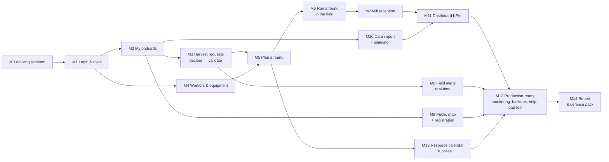

# OliveConnect — Milestones (vertical slices)

Each milestone is a **vertical slice**: a thin, demoable feature that goes through **every layer** (React page → REST controller → service → Spring Data repository → MongoDB/Redis) and is **deployed** on the server when it is done. There are no "backend phase" or "frontend phase" milestones.

The project is **vibe-coded**: an AI agent writes most of the code, slice by slice. The milestones are therefore small, have explicit "done when" checks, and point to the design docs the agent must follow.

Design reference (source of names, rules and schemas): [`docs/01–11`](docs/). The [traceability matrix](docs/11-traceability.md) is the naming contract.

---

## How we work (applies to every milestone)

1. **One milestone = one branch = one PR** (`m03-harvest-requests`). If a milestone is too big for one PR, split it into sub-slices (`M3a`, `M3b`), each still end-to-end.
2. **Start each agent session with a brief**: the milestone section below, plus the doc sections it links to. The agent must reuse the names from [docs/11](docs/11-traceability.md): class, collection, endpoint and page.
3. **Every slice ships:**
   - the entity, repository, service and controller, plus the React page (Controller → Service → DAO → Entity, with constructor injection);
   - tests: at least **one nominal and one alternative scenario** through the API (Testcontainers), plus unit tests for the business rules;
   - the MongoDB indexes for its queries, documented in [docs/05](docs/05-nosql-schema.md) when they change;
   - a page usable on a **phone** (360 px width).
4. **Done means merged and runnable.** The PR is merged, CI is green, and the demo script works on the **production compose run locally** (`docker compose -f deploy/docker-compose.yml up --build`, then open `http://localhost`). The VPS is only deployed in M13 (see [M13](#m13--production-ready)).
5. **The human reviews every PR**: read the diff, run the demo script, and check the names against the traceability matrix. Never merge code that nobody on the team understands, because it will be defended at the oral exam.
6. **Docs and diagrams are updated in the same PR as the code, never later.** The agent follows [`docs/agents/doc-sync.md`](docs/agents/doc-sync.md) and runs the `check-docs` skill before merging (see [Keeping docs & diagrams in sync](#keeping-docs--diagrams-in-sync)).

### Definition of Done (checklist copied into each PR)

- [ ] Demo script of the milestone passes on the production compose run locally
- [ ] Nominal + alternative API tests green in CI
- [ ] Role and ownership rules enforced (another user's data returns 404)
- [ ] Indexes created for new queries
- [ ] Works on a 360 px wide screen
- [ ] Diagrams and docs updated **in this PR**; `docs` CI job green and `check-docs` skill run
- [ ] Traceability row (`docs/11`) updated

The same checklist is in [`.github/pull_request_template.md`](.github/pull_request_template.md).

---

## Keeping docs & diagrams in sync

The report, the diagrams and the design work are deliverables, and the subject grades how consistent they are with the code. They are produced in three stages, with no separate "documentation phase":

| When | What | Who |
|---|---|---|
| **Before coding** (done) | `docs/01–11`: study, requirements, use cases, class diagram, sequences, state machines, NoSQL schema + transformation rules, API, deployment design | agent |
| **Every milestone PR** | Updates to the docs and diagrams that the slice touched (table below), following [`docs/agents/doc-sync.md`](docs/agents/doc-sync.md) | agent, reviewed in the PR |
| **M14** | Report assembled from `docs/` plus the evidence that only exists at the end (screenshots, test results, load test, Grafana, restore drill); `check-docs all` on the whole repo | agent |

**Three safeguards stop the diagrams from drifting:**

1. **Rules**: `AGENTS.md` and [`docs/agents/doc-sync.md`](docs/agents/doc-sync.md) map each kind of change (field, index, endpoint, state, flow, infra) to the exact docs and diagrams to update, and define diagram conventions that tests can parse.
2. **Automated checks**:
   - `scripts/check-diagrams.sh` (job `docs` in CI): every Mermaid block must render.
   - The `check-docs` skill (`.claude/skills/check-docs/SKILL.md`), run by the agent at the end of each milestone before merging: it compares the branch diff with the docs, fixes the docs on the same branch, and prints the "Docs updated" lines for the PR.
3. **Review**: the PR template requires a "Docs updated" section, and the reviewer reads the doc diff along with the code diff.

### Docs touched by each milestone

| Milestone | Docs and diagrams to update in its PR |
|---|---|
| M0 | `docs/03` architecture + packages (actual structure), `docs/10` deployment + pipeline diagrams, compose and Nginx excerpts |
| M1 | `docs/04` User/FarmerProfile/Role + SD-1; `docs/05` §4.1 + Redis keys §7; `docs/06` auth/users endpoints + §4; `docs/09` T-AUTH/T-SEC |
| M2 | `docs/04` Orchard/Plot/OliveVariety; `docs/05` §4.2–4.3; `docs/06` orchards/varieties; `docs/08` farmer navigation |
| M3 | `docs/04` HarvestRequest + StatusChange + Notification, SD-2, HarvestRequest state machine; `docs/05` §4.4, §4.11; `docs/06`; `docs/09` T-HR |
| M4 | `docs/04` Worker/Equipment hierarchy/Unavailability, Equipment states; `docs/05` §4.7 (rule R8); `docs/06` |
| M5 | `docs/04` CollectionRound/RoundStop/ResourceBooking/Mill, SD-3, SD-4, round state machine, planning helper §5; `docs/05` §4.5–4.6; `docs/06`; `docs/09` T-RD |
| M6 | `docs/04` SD-6, RoundStop state machine; `docs/06` round actions; `docs/08` team-leader navigation |
| M7 | `docs/04` MillReception/QualityAssessment, SD-7; `docs/05` §4.8; `docs/06` mills; `docs/09` T-ML |
| M8 | `docs/04` FieldAlert, SD-5, alert state machine; `docs/03` §5 notification flow; `docs/05` §4.9; `docs/06` alerts + SSE |
| M9 | `docs/02` F4 use cases; `docs/05` §6 map query; `docs/06` map + registrations; `docs/08` §5 |
| M10 | `docs/04` ImportJob + telemetry classes, SD-8; `docs/05` §4.10–4.11; `docs/07` formats + rules; `docs/06` imports/settings |
| M11 | `docs/04` SD-9; `docs/05` §6 pipelines (actual code) + measured timings; `docs/06` dashboard |
| M12 | `docs/04` SupplyOrder; `docs/06` calendar/supplies; `docs/02` FR-3.x, FR-6.5 |
| M13 | `docs/10` (everything matches the real server), `docs/09` load-test results |
| M14 | everything, `check-docs all` |

---

## Overview

| # | Milestone | Main actors | Subject features | Can run in parallel with |
|---|---|---|---|---|
| M0 | Walking skeleton | — | infra | — |
| M1 | Login & roles | Admin, all | security | — |
| M2 | My orchards | Farmer | F1, F4 (basic) | M4 |
| M3 | Harvest requests: declare → validate | Farmer, Collection manager | F1 | M4, M9, M10 |
| M4 | Workers & equipment | Logistics manager | F3 | M2, M3 |
| M5 | Plan a round | Collection manager | F1, F3 | M8, M9, M10 |
| M6 | Run a round in the field | Team leader | F1 | M8, M9, M10 |
| M7 | Mill reception | Mill manager | F1, F5 data | M8, M9, M10, M12 |
| M8 | Field alerts, real-time | Farmer, Collection manager | F2 | M5–M7 |
| M9 | Public map & registration | Visitor, Admin | F4 | M3–M8 |
| M10 | Data import & simulator | Admin, external systems | §III.2 | M3–M8 |
| M11 | Dashboard KPIs | Collection mgr, Mill mgr, Admin | F5 | M12 |
| M12 | Resource calendar & supplies | Logistics, Collection manager | F3 | M8–M11 |
| M13 | Production-ready | Admin | §III.1, §V | — |
| M14 | Report & defence pack | — | §VI | — |

After M1, three students can each drive a parallel track:

| Track | Milestones |
|---|---|
| A — Collection flow | M2 → M3 → M5 → M6 → M7 |
| B — Resources & field | M4 → M8 → M12 |
| C — Data & public | M9 → M10 → M11 → M13 |
| All three | M14 (each student checks the chapters of their track) |

Each student still touches every layer in their slices, which matters because each one is graded on all three modules.

---

## M0 — Walking skeleton

**Goal:** prove that the whole chain works end-to-end before writing any feature: browser → Nginx → Spring Boot → MongoDB + Redis, built by CI and runnable as the production compose on a laptop.

**Demo:** `docker compose -f deploy/docker-compose.yml up --build`, then open `http://localhost`. The React page shows "API: UP · MongoDB: UP · Redis: UP" and the backend version, read from a real API call.

**Scope**
- `backend/`: Spring Boot 3 + Java 21 + Maven wrapper; dependencies Web, Validation, Data MongoDB, Data Redis, Actuator, springdoc; Log4j2 instead of Logback. One `GET /api/system/status` endpoint that pings MongoDB and Redis (Controller → Service). One MockMvc + Testcontainers test.
- `frontend/`: pnpm, React + Vite + TypeScript, Tailwind CSS v4 with a customised shadcn/ui theme, TanStack Router (file-based) and TanStack Query. One status page that calls `/api/system/status`. The dev proxy forwards `/api` to the backend.
- `deploy/`: `docker-compose.dev.yml` (MongoDB as single-node replica set `rs0`, Redis) and `docker-compose.yml` for production (Nginx serving the SPA and proxying `/api`, plus api, mongo `rs0` and redis; MongoDB and Redis ports are not published). Dockerfiles for the api and the web app.
- CI on GitHub Actions: backend `./mvnw verify`, frontend `pnpm lint` + `pnpm build`, `docker compose build`, plus the existing `docs` job (diagram rendering). No deploy step in M0.
- The [`check-docs` skill](.claude/skills/check-docs/SKILL.md) (run at the end of each milestone, see [Keeping docs & diagrams in sync](#keeping-docs--diagrams-in-sync)).
- Normalise `docs/06` §2 to **one HTTP method and one path per row**, so the endpoint catalogue can be checked.

**Done when**
- [ ] Dev setup works: `docker compose -f deploy/docker-compose.dev.yml up` + `./mvnw spring-boot:run` + `pnpm dev`
- [ ] The production compose works locally: `docker compose -f deploy/docker-compose.yml up --build`, and the status page works on `http://localhost`
- [ ] CI is green on the PR
- [ ] MongoDB and Redis are **not** reachable from the host in the production compose
- [ ] The `check-docs` skill has been run and the docs are updated in this PR

**Refs:** [docs/03 §1–4](docs/03-architecture.md), [docs/10 §2–5](docs/10-deployment.md)

---

## M1 — Login & roles

**Goal:** every actor can log in and land on a page for their role. The admin manages accounts.

**Demo:** the admin (seeded from env variables) logs in, creates a farmer account and a collection manager account. Each of them logs in and sees a different home page. A farmer who opens `/admin/users` is denied.

**Scope**
- `User` (+ embedded `FarmerProfile`), `Role` enum, `users` collection with a unique `email` index.
- `POST /api/auth/login|refresh|logout`, `GET /api/me`. JWT access token (15 min) and refresh token stored in Redis (7 days, rotated). BCrypt password hashing. Login rate limiting in Redis.
- Admin: `GET/POST/PUT /api/users`, roles, enable/disable.
- `GlobalExceptionHandler` returning ProblemDetail errors; auditing (`createdAt`, `createdBy`).
- Frontend: login page, auth context with silent refresh, `RequireRole` guard, app layout (bottom nav on mobile), one placeholder home page per role, admin user list and form.

**Done when**
- [ ] Wrong password returns 401; 6 failures in a row return 429
- [ ] A disabled user cannot log in, and their refresh tokens are revoked
- [ ] Every endpoint except `/api/auth/**` and `/api/system/status` requires a token
- [ ] Tests: login nominal, bad credentials, rate limit, role-denied (403)

**Refs:** [docs/06 §4](docs/06-api-security.md), SD-1 in [docs/04](docs/04-uml-design.md)

---

## M2 — My orchards

**Goal:** a farmer registers their orchards with plots and GPS position, and sees them on a map.

**Demo:** on a phone, the farmer taps "Add orchard". The position is auto-filled from GPS and can be adjusted on the map. They add 2 plots (variety, area, trees), save, and see the orchard on a "My orchards" map and list. Another farmer cannot open it through its URL.

**Scope**
- `Orchard` with embedded `Plot[]`, GeoJSON `location`, computed totals (`areaHa`, `treeCount`, `mainVarietyCode`). `OliveVariety` reference collection, seeded at startup and cached in Redis.
- `GET/POST/PUT/DELETE /api/orchards`, `GET /api/varieties`. Ownership rule: a farmer only ever sees their own orchards (404 otherwise). The collection manager can read all of them.
- Indexes: `location` 2dsphere, `ownerId`.
- Frontend: orchard form with a Leaflet map picker and `navigator.geolocation`, list page, map of my orchards.

**Done when**
- [ ] Totals are recomputed on every save
- [ ] Out-of-range coordinates (outside Tunisia) are rejected with 400
- [ ] Tests: create nominal, another farmer gets 404, invalid plot gets 400

**Refs:** [docs/05 §4.2–4.3](docs/05-nosql-schema.md), FR-1.1 in [docs/02](docs/02-requirements.md)

---

## M3 — Harvest requests: declare → validate

**Goal:** the first core business flow. A farmer declares a harvest, the collection manager validates or rejects it, and the farmer follows its status.

**Demo:** the farmer declares an URGENT harvest in 3 inputs (orchard, type, dates; the estimate is pre-filled). The collection manager sees it at the top of the queue (sorted by priority) and validates it. The farmer sees the status timeline and gets an in-app notification. A second request for the same orchard is refused. The farmer cancels a request that is still `SUBMITTED`.

**Scope**
- `HarvestRequest` with an orchard snapshot, `statusHistory[]`, `priorityScore`, and `@Version` for optimistic locking. State machine: `SUBMITTED → VALIDATED | REJECTED | CANCELLED` (the other states come in M5–M6).
- `POST/GET/PUT /api/harvest-requests`, `/cancel`, `/validate`, `/reject` (reason required). The DTO carries `allowedActions`.
- `Notification` collection (TTL 90 days) and `GET /api/notifications`. The frontend **polls** every 30 s; real-time push comes in M8.
- Indexes: `{farmerId, createdAt}`, `{status, priorityScore}`, and a partial `{orchardId, status}` index for active requests.
- Frontend: request form, "My requests" list with timeline, manager queue with validate/reject, notification bell.

**Done when**
- [ ] A transition that the state machine does not allow returns 409; a concurrent edit returns 409 `STALE_VERSION`
- [ ] Tests: SD-2 nominal and its alternatives (400 invalid dates, 404 orchard not owned, 409 duplicate active request), reject without a reason (400)

**Refs:** SD-2 and the HarvestRequest state machine in [docs/04](docs/04-uml-design.md), [docs/05 §4.4](docs/05-nosql-schema.md)

---

## M4 — Workers & equipment

**Goal:** the logistics manager keeps the list of resources that rounds will book.

**Demo:** the logistics manager adds 3 seasonal workers, 1 tractor, 2 bins (4,000 kg each) and a stock of shakers. They mark one bin as "maintenance" from date X to date Y. The lists can be filtered by type and status.

**Scope**
- `Worker` and `Equipment` (abstract, with subclasses `Tractor`, `Bin`, `Tool`) in a **single `equipment` collection** with a type discriminator. Embedded `Unavailability[]`.
- `/api/workers`, `/api/equipment?type=`, `/…/{id}/unavailabilities`.
- Frontend: logistics pages (lists and forms, with a form that adapts to the equipment type).

**Done when**
- [ ] Polymorphic read: `GET /api/equipment` returns tractors, bins and tools, each with its own fields
- [ ] Tests: CRUD nominal, a duplicate `code` returns 409, a farmer gets 403

**Refs:** inheritance rule R8 in [docs/05 §3, §4.7](docs/05-nosql-schema.md)

---

## M5 — Plan a round

**Goal:** the collection manager turns validated requests into a collection round, booking people and equipment without conflicts.

**Demo:** the manager opens the planning board. Validated requests are shown on a map and in a priority-sorted list. They select 3 nearby requests and pick a date, a team leader, 4 workers, 1 tractor, 2 bins and a destination mill, then save. The farmers are notified and the requests become `SCHEDULED`. A second round that tries to use the same bin at the same time is refused with "Bin B-07 is already booked by round T-…". A farmer cancels a scheduled request, and the stop disappears from the round.

**Scope**
- `CollectionRound` with embedded `RoundStop[]`, `ResourceBooking` collection, `Mill` (seeded; the mill manager comes in M7).
- `POST/PUT /api/rounds`, `/cancel`, `GET /api/resources/availability`, `GET /api/planning/suggestions` (priority score, `$geoNear` grouping, nearest mill with enough capacity).
- Creating a round runs in a **MongoDB transaction** (round + bookings + request statuses), with a Redis lock per resource.
- Farmer modify/cancel rules from SD-4 (allowed only while the round is `PLANNED`).
- Frontend: planning board (list + map + round form with free/busy indicators), and a "My rounds" list for the team leader (read-only for now).

**Done when**
- [ ] A booking conflict returns 409 and **nothing** is persisted (rollback test)
- [ ] Two concurrent plans for the same bin: exactly one succeeds
- [ ] A low-capacity mill produces a warning, not an error
- [ ] Tests: SD-3 and SD-4, all branches

**Refs:** SD-3, SD-4 and the planning helper in [docs/04](docs/04-uml-design.md), [docs/05 §4.5–4.6](docs/05-nosql-schema.md)

---

## M6 — Run a round in the field

**Goal:** the team leader drives the round from a phone, and every status updates by itself.

**Demo:** on the round date, the team leader opens the round on a phone and taps Start (the farmers are notified). For each stop they open navigation, enter the harvested kg and number of crates, and mark it DONE (or SKIPPED with a reason). They close the round. The orchards become `HARVESTED`, the requests `COMPLETED`, and skipped requests go back to `VALIDATED` so they can be re-planned. With the network off, the stop form keeps its draft and syncs once the connection is back.

**Scope**
- `/api/rounds/{id}/start`, `PATCH /stops/{order}` (positional update), `/complete`.
- Status cascade: round → requests → orchard `harvestStatus`.
- Frontend: a mobile "round runner" page with a draft saved in IndexedDB and a retry queue.

**Done when**
- [ ] Another team leader gets 403; starting before the round date returns 409; closing with pending stops returns 422
- [ ] Tests: SD-6 nominal and its alternatives

**Refs:** SD-6 and the round/stop state machines in [docs/04](docs/04-uml-design.md)

---

## M7 — Mill reception

**Goal:** the mill weighs each bin, the farmer sees the result, and the data for the dashboard starts to exist.

**Demo:** the mill manager (assigned to one mill) sees today's incoming rounds and records a weighing in 4 inputs: bin, gross weight, tare and quality grade. Net weight and fill rate are computed automatically, the mill's available capacity goes down, and the farmer is notified with the weight and grade. Weighing the same bin load twice is refused. The mill manager also publishes the mill's capacity.

**Scope**
- `MillReception` with embedded `QualityAssessment`, computed `netWeightKg`/`fillRate`/`leadTimeHours`, and copied dimensions (`season`, `varietyCode`, `delegation`, `orchardAreaHa`).
- `/api/mills/{id}/incoming`, `/receptions`, `/capacity`, and `GET /api/receptions?mine=true` for farmers.
- A unique index on `{roundId, binId, orchardId}`.
- Frontend: mill pages and a "My receptions" page for the farmer.

**Done when**
- [ ] A manager of another mill gets 403; a bin that is not in the round returns 422; an absurd weight returns 422
- [ ] Tests: SD-7 nominal and its alternatives

**Refs:** SD-7 in [docs/04](docs/04-uml-design.md), [docs/05 §4.8](docs/05-nosql-schema.md)

---

## M8 — Field alerts, real-time

**Goal:** a farmer reports a problem from the orchard, and the collection manager sees it instantly.

**Demo:** the farmer taps "+ Alert". GPS preselects the nearest orchard. They choose "Maturity", add a photo and send. **Without refreshing**, the manager's screen shows the alert on the map and in the queue. The manager acknowledges it, then clicks "Create urgent request". The farmer is notified at each step. An alert sent from 5 km away is flagged as a location mismatch.

**Scope**
- `FieldAlert` with GeoJSON `location`, `statusHistory[]`, and photos stored in GridFS.
- Real-time delivery: `GET /api/events` (SSE with ticket authentication) and Redis pub/sub fan-out. The notification bell switches from polling to SSE.
- `/api/alerts`, `/acknowledge`, `/resolve`, `/dismiss`, `/create-urgent-request`, and `/api/orchards/nearest`.
- Frontend: a mobile alert form, the manager's alert board with a live map, and a `useEventStream` hook.

**Done when**
- [ ] The SSE event arrives within 2 s of the report
- [ ] Wrong photo type or size returns 400; only one open alert of the same type is allowed per orchard
- [ ] Tests: SD-5 nominal and its alternatives

**Refs:** SD-5, the notification fan-out in [docs/03 §5](docs/03-architecture.md), [docs/05 §4.9](docs/05-nosql-schema.md)

---

## M9 — Public map & registration

**Goal:** a visitor explores orchards without logging in and can ask to join the cooperative.

**Demo:** a logged-out visitor opens the home page and sees a map of the Sfax region with clustered orchards, coloured by harvest status and filterable by variety, status and maturity. No owner name appears anywhere, not even in the JSON. The visitor submits a registration request. The admin approves it, which creates a farmer account with a temporary password that must be changed at first login.

**Scope**
- `GET /api/map/public?bbox=&filters` (projection with no personal data, clustering at low zoom), cached in Redis and by Nginx.
- `RegistrationRequest` with `/api/registrations` and `/approve`/`/reject`.
- Frontend: public map page, registration form, admin registrations page.

**Done when**
- [ ] A test asserts that the public DTO has no personal fields
- [ ] `explain()` shows the 2dsphere index is used (IXSCAN)
- [ ] The map responds in under 2 s with 1,500 orchards

**Refs:** FR-4.x, FR-6.1 in [docs/02](docs/02-requirements.md), [docs/08 §5](docs/08-frontend.md)

---

## M10 — Data import & simulator

**Goal:** reference and dynamic data arrive automatically from simulated external systems, after a conformity check.

**Demo:** the simulator drops `orchards.csv`, `weather_*.json`, `maturity_*.csv` and `mill_capacity_*.json` into the inbox. Within 15 minutes, orchards appear on the map, their maturity values update, mill capacities change, and a heavy-rain alert is created automatically. The admin opens the import journal and sees a `PARTIAL` run with 3 rejected lines and the reason for each. Dropping the same file again is skipped.

**Scope**
- `data-simulator/` producing reference data, dynamic data and deliberately invalid records, plus a `--history` mode that generates 3 seasons of data.
- `ImportJob` with embedded errors; `ImportScheduler` (with ShedLock) and one importer per dataset; validators; bulk upserts.
- Time-series collections `weather_readings` and `maturity_readings`; `orchards.currentMaturityIndex` updated from the latest reading.
- Automatic alert rules (thresholds stored in `system_settings`).
- `/api/imports`, `/run`, `/upload`, and `/api/settings`.
- Frontend: intranet pages for the import journal (with rejected rows) and settings.

**Done when**
- [ ] Idempotent by file checksum; more than 50 % invalid rows makes the run `FAILED` with nothing committed
- [ ] Tests: T-IM-1 to T-IM-5 from [docs/09](docs/09-testing.md)

**Refs:** [docs/07](docs/07-data-import.md), SD-8 in [docs/04](docs/04-uml-design.md), [docs/05 §4.10](docs/05-nosql-schema.md)

---

## M11 — Dashboard KPIs

**Goal:** managers see how the season is going, computed by MongoDB aggregations over large data.

**Demo:** with the `--history` dataset loaded (around 10⁵ receptions), the collection manager opens the dashboard and sees KPI tiles plus charts for yield per orchard and per delegation, collection lead time (average and p90), bin fill rate per week, and mill volumes. They filter by season, variety and delegation and export a CSV. The second load is noticeably faster because the result is cached.

**Scope**
- `KpiRepositoryCustom` (aggregation pipelines through `MongoTemplate`), `KpiService` with a Redis cache (TTL 5 min), and `/api/dashboard/*` including a CSV export.
- Frontend: dashboard page with Recharts charts (shadcn chart component).
- Report evidence: `explain()` output and timings for each pipeline.

**Done when**
- [ ] KPI values match a hand-computed test fixture
- [ ] Each pipeline answers in under 1 s on the history dataset
- [ ] Each role sees only its own scope (a mill manager sees only their mill)

**Refs:** [docs/05 §6](docs/05-nosql-schema.md), SD-9 in [docs/04](docs/04-uml-design.md)

---

## M12 — Resource calendar & supplies

**Goal:** the logistics manager sees who and what is busy when, and restocks consumables.

**Demo:** a week calendar per resource shows bookings coming from rounds and unavailability periods. The logistics manager creates a supply order for 20 nets; when it is marked received, the stock goes up. The intranet grids let staff correct imported orchards and equipment.

**Scope**
- `/api/resources/calendar`, `SupplyOrder` with `/api/supply-orders` and `/receive`.
- Intranet data grids for orchards, equipment and round corrections (each correction is recorded in the history).
- Frontend: calendar view, supply orders page, intranet grids.

**Done when**
- [ ] The calendar is consistent with the bookings created in M5
- [ ] Tests: T-RS-1, T-RS-2 from [docs/09](docs/09-testing.md)

**Refs:** FR-3.3–3.5 and FR-6.5 in [docs/02](docs/02-requirements.md)

---

## M13 — Production-ready

**Goal:** meet the quality and hosting requirements of the subject and prepare the defence.

**Demo:** the end-to-end journey on a phone over HTTPS, through all five features. The Grafana dashboards show uptime, CPU and RAM, JVM, MongoDB and Redis metrics, and logs. Restoring last night's backup into a scratch container works. The k6 test with 100 virtual users passes.

**Scope**
- **Deployment to the VPS** (first time): provision the server; GitHub Actions deploy job over SSH running `git pull && docker compose -f deploy/docker-compose.yml up -d --build` on `main`; MongoDB authentication (keyfile + app user) and Redis password.
- HTTPS with Let's Encrypt (geolocation requires it), Nginx hardening and rate limits, `/intranet` restricted by IP.
- Monitoring: Prometheus, Grafana, Loki/Promtail, exporters and Uptime Kuma, with alert rules.
- Backups: `backup.sh`, a cron job, an off-site copy and a **documented restore drill**.
- Contextual help pages and a guided tour per role on first login.
- Playwright E2E test of the full journey; k6 load test.
- Deployment and operations documentation (procedure, server configuration, user and rights management); final report assembled from `docs/`.

**Done when**
- [ ] k6: map p95 under 2 s and p99 under 10 s, error rate under 1 %, at 100 virtual users
- [ ] The restore drill is done, with screenshots
- [ ] The report covers every item of the subject's "VI. Résultats attendus"

**Refs:** [docs/09](docs/09-testing.md), [docs/10](docs/10-deployment.md)

---

## M14 — Report & defence pack

**Goal:** produce the report and supporting material required by "VI. Résultats attendus" from what is already in `docs/` and in the running system, with docs and code proven consistent.

**Demo:** `report/build.sh` produces `report/OliveConnect-report.pdf` (and `.docx`). Every diagram in it is rendered from the same Mermaid sources as `docs/`, and `check-docs all` reports no mismatch on the final commit.

**Scope**
- **Strict sync pass**: run the `check-docs` skill with `all` (whole repo, both directions). Remove or mark as "future work" anything that is documented but was never built, and fix every mismatch.
- **Diagrams**: `scripts/check-diagrams.sh --export report/diagrams` renders all diagrams to SVG/PNG. The class diagram is split into 3 focused views for the report body, with the full diagram as an appendix.
- **Evidence collected automatically**:
  - Playwright script capturing screenshots of every page for every role, on mobile and desktop;
  - JaCoCo coverage report and the test scenario table with results;
  - `explain()` output and timings for the key queries;
  - k6 summary;
  - Grafana panel captures;
  - restore-drill log;
  - OpenAPI spec export.
- **Report** (`report/`, Markdown chapters → Pandoc → PDF/DOCX), following the subject:
  1. Introduction
  2. Preliminary study (`docs/01`)
  3. Requirements analysis (`docs/02`)
  4. Design: architecture and the Controller/Service/DAO/Entity layers (`docs/03`), UML (`docs/04`), API and security (`docs/06`)
  5. NoSQL schema, transformation rules, persistence API justification (`docs/05`)
  6. Data integration (`docs/07`)
  7. Implementation and UI per role (`docs/08` + screenshots)
  8. Tests (`docs/09` + results)
  9. Deployment and monitoring procedure, user and rights management (`docs/10`)
  10. Conclusion and outlook

  Appendices: traceability matrix, full class diagram, index list, OpenAPI excerpt.
- **Defence pack**:
  - a 10-minute demo script covering all features, with normal and alternative scenarios;
  - one page per student titled "what I built and why", based on their track;
  - a list of likely oral-exam questions with answers (embed vs. reference, index choices, transactions, security).

**Done when**
- [ ] `check-docs all` reports no mismatch on the final commit
- [ ] Every item of "VI. Résultats attendus" maps to a report chapter
- [ ] The report builds from a clean clone with one command

**Refs:** all of `docs/`, [`docs/agents/doc-sync.md`](docs/agents/doc-sync.md)

---

## Scope guard

If time runs short, cut in this order, without breaking the four required features (F1, F2, F3, F4/F5):

1. M12 intranet grids (keep the calendar)
2. Offline draft in M6
3. Server-side clustering and the Nginx micro-cache in M9 (keep the Redis cache)
4. CSV export in M11
5. Guided tour in M13 (keep the help pages)
