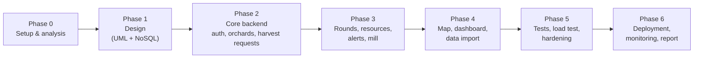

# OliveConnect — Implementation Plan

> Smart olive-collection management platform for an olive cooperative in the Sfax region.
> 2nd-year ING INFO project (AY 2026-2027) — modules: *Massive Databases*, *J2EE Development*, *Web Server Administration*. Group of 3 students.

This file is the entry point. Each topic has its own document in [`docs/`](docs/), with Mermaid diagrams that render directly on GitHub/GitLab, in VS Code (Markdown Preview Mermaid Support) or at <https://mermaid.live>.

> **Evaluation warning from the subject:** *consistency between the class model, the NoSQL schema, the Spring Boot API and the deployment will be checked closely.*
> Every document below uses **the same names** (classes ⇄ collections ⇄ DTOs ⇄ endpoints ⇄ React pages). A [traceability matrix](docs/11-traceability.md) proves it.

---

## 1. Decisions taken

| Topic | Decision | Why |
|---|---|---|
| Features (section II) | **All 5**: collection platform, field alerts, resource management, interactive map, performance dashboard | Competitive grading; map and dashboard justify the NoSQL choices (geo indexes, aggregation pipeline) |
| Main database | **MongoDB 7/8** | Document model fits nested domain objects; native GeoJSON + `2dsphere`; aggregation framework for KPIs; time-series collections for weather/maturity data |
| Secondary store | **Redis 7** | Cache (map layer, KPIs, reference data), refresh-token store / revocation, login rate-limiting, pub/sub to fan out real-time notifications |
| Persistence API | **Spring Data MongoDB** + **Spring Data Redis** (via Spring Cache) | Required by the subject (DAO layer on Spring Data); repositories + `MongoTemplate` for geo/aggregation |
| Backend | **Spring Boot 3.x, Java 21, Maven (wrapper)** | Subject requirement; Java 21 LTS |
| Frontend | **React 18 + Vite + TypeScript**, Leaflet, Chart.js, Mantine UI | Mobile-first, fast build, static files served by Nginx |
| Deployment | **Linux VPS + Docker Compose**, **Nginx** reverse proxy | Reproducible; Nginx is one of the servers named in section V |
| Monitoring | Spring Actuator + **Prometheus + Grafana**, node-exporter, cAdvisor, **Loki/Promtail** for logs, **Uptime Kuma** for availability | Section V asks for uptime, resource usage, logs, cache |
| Backups | Nightly `mongodump` + Redis RDB snapshot, rotation, off-site copy, tested restore | Section V |

## 2. Document map (follows "VI. Expected results")

| # | Document | Content | Report chapter |
|---|---|---|---|
| 01 | [Preliminary study](docs/01-preliminary-study.md) | Context, problems, existing situation, objectives, actors (completed + justified), feature choice | Preliminary study |
| 02 | [Requirements analysis](docs/02-requirements.md) | Functional requirements per feature, use-case diagrams, user stories, non-functional requirements | Requirements analysis |
| 03 | [Architecture](docs/03-architecture.md) | System architecture, layered architecture (Controller/Service/DAO/Entity), packages, tech stack | Design |
| 04 | [UML design](docs/04-uml-design.md) | Class diagram, sequence diagrams (nominal + alternative), state machines, activity diagram | Design |
| 05 | [NoSQL schema](docs/05-nosql-schema.md) | Collections, embed vs. reference, indexes, shard keys, transformation rules, Redis key design, persistence API justification | NoSQL schema + transformation rules + persistence API |
| 06 | [REST API & security](docs/06-api-security.md) | Endpoint catalogue, DTOs, error model, JWT, role/ownership matrix | Design (Controller layer) |
| 07 | [Data import](docs/07-data-import.md) | External sources (simulated), formats, validation rules, scheduling, intranet enrichment app | Data updates |
| 08 | [Frontend](docs/08-frontend.md) | Pages per role, navigation, mobile UX, online help, guided tour | Design / UI |
| 09 | [Testing](docs/09-testing.md) | Test strategy, nominal/alternative scenarios, load test (100 concurrent users, < 10 s) | Tests |
| 10 | [Deployment & monitoring](docs/10-deployment.md) | Deployment diagram, Docker Compose, Nginx, HTTPS, backups, monitoring, user/rights administration | Deployment & monitoring procedure |
| 11 | [Traceability](docs/11-traceability.md) | Class ⇄ collection ⇄ repository ⇄ service ⇄ endpoint ⇄ page | Consistency proof |
| 12 | [Roadmap & team](docs/12-roadmap.md) | Phases, Gantt, task split among 3 students, Definition of Done, risks | Project management |

## 3. Roadmap at a glance



Details, Gantt chart and task split: [docs/12-roadmap.md](docs/12-roadmap.md).

## 4. Target repository layout

```text
projectolive/
├── PLAN.md                    ← you are here
├── docs/                      ← design documents (feed the report)
├── backend/                   ← Spring Boot API (Maven wrapper)
│   └── src/main/java/tn/oliveconnect/...
├── frontend/                  ← React + Vite + TS
├── data-simulator/            ← generates CSV/JSON external sources
├── deploy/
│   ├── docker-compose.yml
│   ├── nginx/                 ← nginx.conf, site config
│   ├── monitoring/            ← prometheus.yml, grafana dashboards, loki
│   └── backup/                ← backup/restore scripts + cron
└── report/                    ← final report (LaTeX/Docx) + exported diagrams
```

## 5. Prerequisites on the dev machines

- **JDK 21** (this machine currently has Java 8 → install `jdk21-openjdk` and select it with `archlinux-java set java-21-openjdk`). Spring Boot 3 does not run on Java 8.
- Maven is not required globally: the project uses `./mvnw`.
- Node 20+ (present), Docker + Docker Compose (present), Git (present).
- MongoDB Compass and RedisInsight (optional GUI tools).
