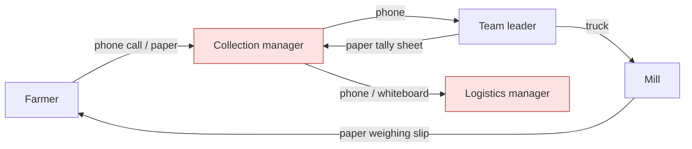
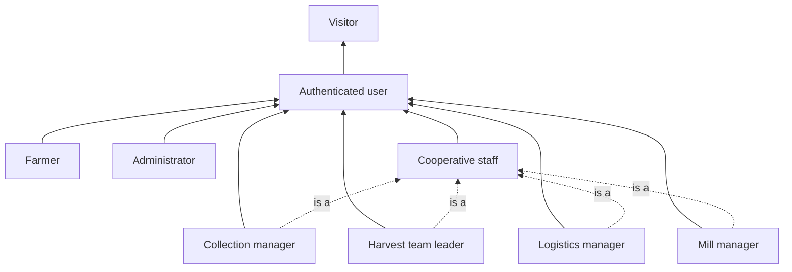

# 01 — Preliminary Study

## 1. Context

An olive cooperative in the Sfax agricultural region is seeing production grow because orchards are expanding and harvesting is becoming mechanised. The growth causes several operational problems:

- harvest collections are poorly managed;
- harvest teams, transporters and olive mills coordinate poorly;
- shared resources are under pressure: seasonal workers, tractors, bins (*bennes*), nets, shakers.

The data volume (maturity readings, weather measurements, round history, mill weighings) grows quickly during the harvest season, roughly November to January. That growth is what justifies a **NoSQL** database.

## 2. Current situation (assumed) and its problems

| # | Problem (subject §I.2) | Consequence | OliveConnect answer |
|---|---|---|---|
| P1 | No coordination between harvest teams, logistics and mills | Duplicated trips, idle mills, bins left half-empty | One shared platform, rounds linked to a mill, real-time status |
| P2 | Disorganised handling of orchard alerts (optimal maturity, rain, pests) | Olives harvested too late, quality loss | Geolocated alert form, alert queue for the collection manager, notifications |
| P3 | No real-time tracking of collections | Quality control is difficult | Round progress updated in the field by the team leader, status timeline |
| P4 | No performance data | No way to optimise yield or cost | KPI dashboard: yield per orchard, collection lead time, bin fill rate |

## 3. Objectives (subject §I.5)

1. **Centralise** collection and orchard management on one platform shared by all teams.
2. **React faster** to field alerts: report maturity online and track collection progress.
3. **Optimise resource allocation**: plan rounds based on availability of workers, tractors and bins.
4. **Monitor and evaluate performance**: dashboard of key indicators.

## 4. Actors (completed and justified)

The subject's table is a starting point that "students must complete and justify". Our version:

| Actor | Type | Role | Justification / additions |
|---|---|---|---|
| **Visitor** | Primary, anonymous | Views the public orchard map (aggregated, no personal data) and general information, requests registration | Public map shows only orchard location, variety and harvest status, never the owner's identity or yields (privacy requirement §III.1) |
| **Farmer** (member) | Primary | Registers orchards, declares planned or urgent harvests, reports maturity or problems with geolocation, receives notifications, tracks progress, **modifies or cancels a request before its round starts**, views their own mill receptions | The subject's description of the process adds "modify/cancel before the round starts" and the mill weighing result |
| **Collection manager** | Primary | Validates or rejects requests, plans rounds (maturity + availability), builds rounds, handles alerts | Central decision maker |
| **Harvest team leader** | Primary, mobile | Supervises the round in the field, updates progress, harvested quantities and orchard status | Uses the app on a phone in the orchard, so the UI must be mobile-first |
| **Logistics manager** | Primary | Manages seasonal workers, tractors, bins and equipment (nets, shakers); maintains the round calendar per resource; **places supply orders** | The subject lists a "logistics tool for supplies" |
| **Mill manager** | Primary | Receives bins, records weight and quality, publishes available processing capacity | Capacity also arrives from the simulated mill system |
| **Administrator** | Primary | Manages accounts and rights, configures the system (reference data, thresholds), supervises external data imports and the server | Also uses the **intranet enrichment app** |
| **Weather / maturity sensor service** | Secondary, system (simulated) | Pushes weather readings and maturity indices periodically (JSON/CSV) | Feeds dynamic data and can create automatic alerts (for example, heavy rain forecast) |
| **Mill system** | Secondary, system (simulated) | Publishes daily processing capacity | Dynamic data |
| **Reference data source** | Secondary, system (simulated) | Provides orchards, plots, varieties, resources, mills | Subject §III.2 "first source" |
| **Scheduler** *(added)* | Secondary, internal | Triggers periodic imports, reminders, KPI pre-computation | Makes periodic loading explicit in diagrams |

### Actor generalisation

> Arrows read "specialises": every authenticated user can do everything a visitor can do.

## 5. Feature choice (subject §II, at least 4)

We implement **all five** features:

| # | Feature | Actors | Why we keep it |
|---|---|---|---|
| F1 | Digital collection & orchard management platform | Farmer, Collection manager, Team leader | Core business process; without it nothing else has data |
| F2 | Field alert module (geolocation, real-time notifications) | Farmer, Collection manager | Directly addresses P2; uses MongoDB geo queries + Redis pub/sub + SSE |
| F3 | Resource management system (calendar per resource, supplies) | Logistics manager, Collection manager | Addresses resource pressure; needed by F1 to plan rounds without conflicts |
| F4 | Interactive orchard / yield map | Visitor, Farmer, Collection manager | Showcases `2dsphere` indexes and the < 10 s performance requirement |
| F5 | Performance dashboard | Collection manager, Mill manager, Admin | Showcases the aggregation pipeline over massive data (receptions, rounds) |

## 6. Business glossary (shared vocabulary)

The same names are used in classes, collections, endpoints and UI.

| Business term (FR) | Term used in code | Definition |
|---|---|---|
| Verger | `Orchard` | Farmland with olive trees, owned/exploited by one farmer |
| Parcelle | `Plot` | Subdivision of an orchard with one variety and planting year |
| Variété d'olive | `OliveVariety` | Chemlali, Chetoui, Zalmati, Oueslati, Zarrazi… |
| Récolte (déclaration) | `HarvestRequest` | A farmer's request to have an orchard harvested (PLANNED or URGENT) |
| Signalement / alerte | `FieldAlert` | A geolocated report: maturity reached, rain, pests, disease… |
| Tournée | `CollectionRound` | A planned day of work: a team, equipment, a list of orchards, a destination mill |
| Étape de tournée | `RoundStop` | One orchard visited within a round |
| Ouvrier saisonnier | `Worker` | Seasonal worker |
| Tracteur / benne / filet / vibreur | `Equipment` (`TRACTOR`, `BIN`, `NET`, `SHAKER`) | Physical resources |
| Réservation de ressource | `ResourceBooking` | A resource booked for a round on a time slot (calendar) |
| Approvisionnement | `SupplyOrder` | Purchase/supply order for consumable equipment (nets, shakers…) |
| Pressoir | `Mill` | Olive mill (oil press) |
| Pesée / réception | `MillReception` | Weighing of a bin at the mill, with quality grading |
| Relevé de maturité | `MaturityReading` | Maturity index of an orchard at a point in time (Jaén index 0–7) |
| Mesure météo | `WeatherReading` | Weather measurement (temperature, rainfall, humidity, wind) |
| Taux de remplissage | `fillRate` | Net weight / bin capacity |
| Délai de collecte | `collectionLeadTime` | Time between request validation and reception at the mill |
| Rendement | `yield` | kg of olives per hectare (and estimated oil per kg) |
