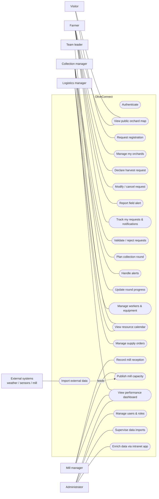
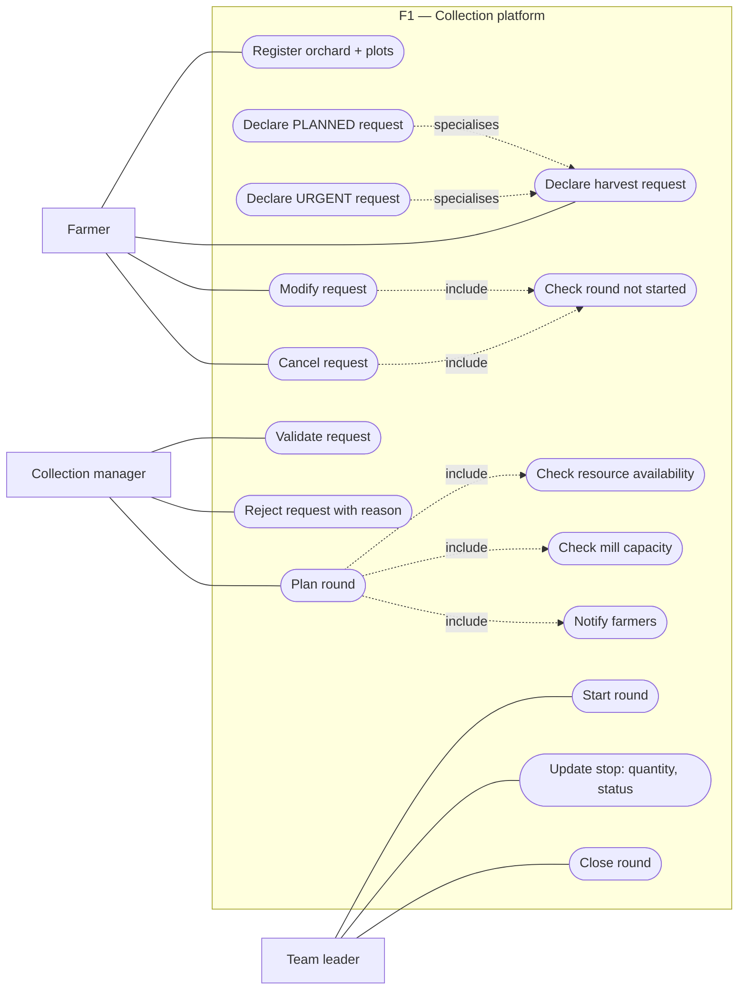
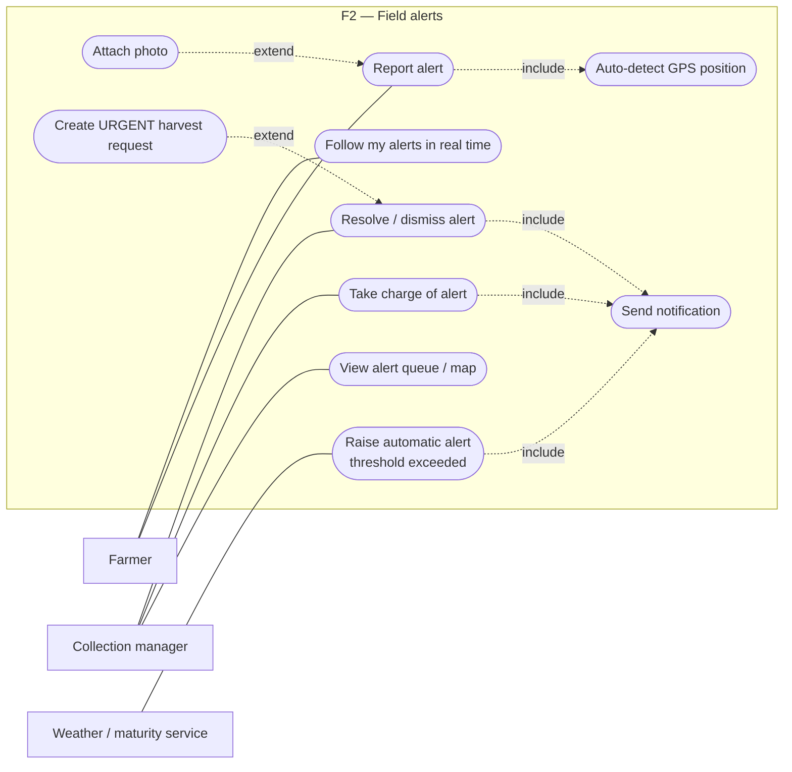
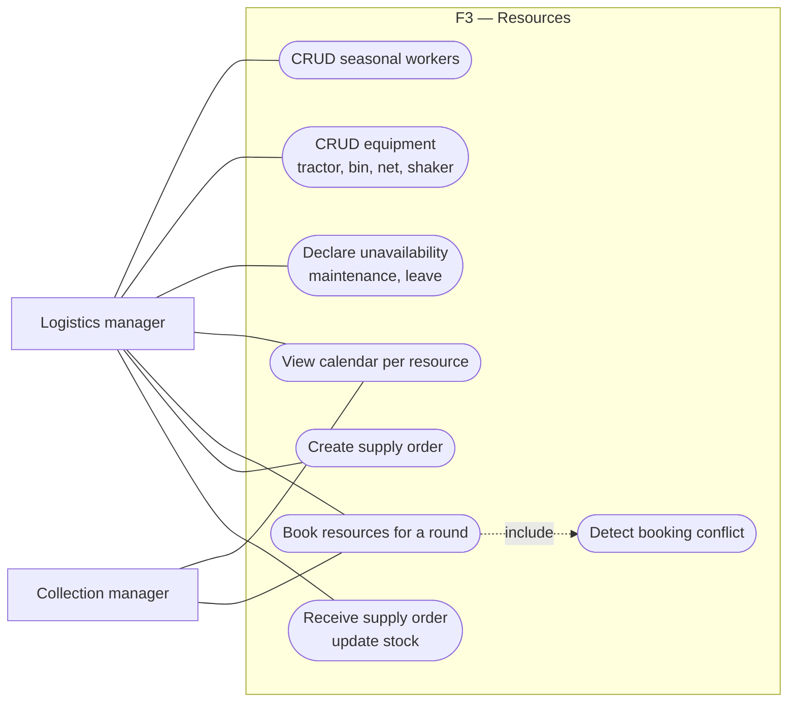
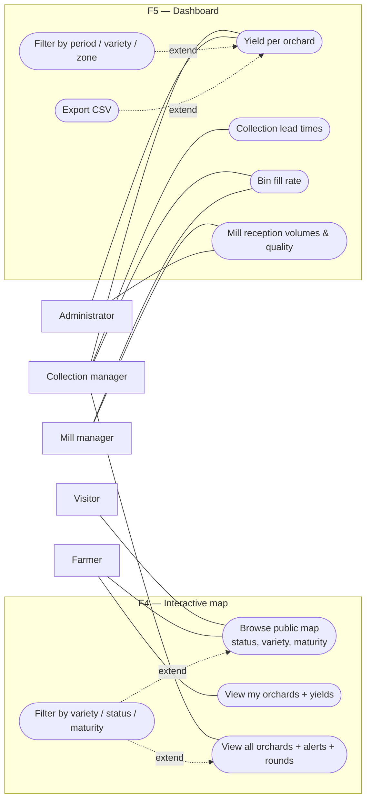
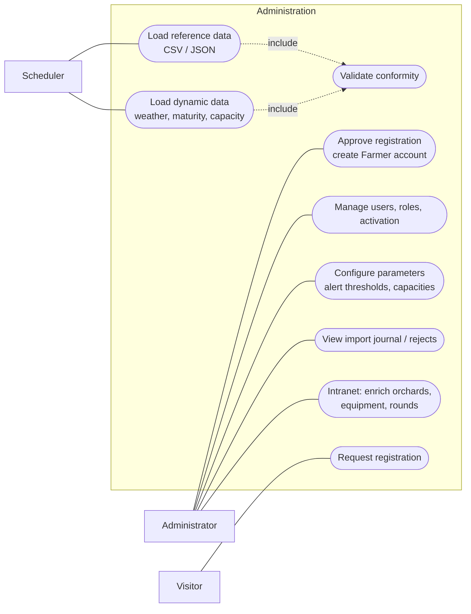

# 02 — Requirements Analysis

Mermaid has no native UML use-case diagram, so use cases are drawn as flowcharts: actors are rectangles, use cases are rounded nodes (`([ ])`), and `include`/`extend` relationships appear as dotted labelled arrows. For the report, the same diagrams can be redrawn in StarUML or PlantUML if the teachers expect strict UML notation.

## 1. Overall use-case diagram

> Every use case except UC1, UC2 and UC20 *includes* **Authenticate** (UC0). The arrows are left out to keep the diagram readable.

## 2. Detailed use-case diagrams per feature

### F1 — Collection & orchard management platform

### F2 — Field alerts

### F3 — Resource management

### F4 — Interactive map, F5 — Dashboard

### Administration & data

## 3. Functional requirements

IDs are reused in the [traceability matrix](11-traceability.md) and the [tests](09-testing.md).

### F1 — Collection platform
| ID | Requirement | Priority |
|---|---|---|
| FR-1.1 | A farmer can create/edit their orchards with plots (variety, area, number of trees, planting year) and a GPS position (auto-detected, adjustable on a map) | Must |
| FR-1.2 | A farmer declares a harvest request: orchard, type `PLANNED`/`URGENT`, desired date window, estimated quantity, comment. At most 3 inputs required (orchard, type, date); the estimate is pre-filled from history | Must |
| FR-1.3 | A farmer can modify or cancel a request **only while it is not attached to a round in progress** (status ∈ `SUBMITTED`, `VALIDATED`, `SCHEDULED` and round not `IN_PROGRESS`) | Must |
| FR-1.4 | The collection manager sees pending requests sorted by priority (URGENT first, then maturity index, then date) and validates or rejects them (reason required) | Must |
| FR-1.5 | The collection manager creates a round: date, slot, team leader, workers, tractor(s), bin(s), ordered list of stops, destination mill. The system refuses conflicting bookings and warns if mill capacity is insufficient | Must |
| FR-1.6 | Farmers are notified when their request is validated, rejected, scheduled, rescheduled, started, completed, and when the mill reception is recorded | Must |
| FR-1.7 | The team leader starts the round, updates each stop (status, harvested kg, number of crates, comment) and closes it; orchard harvest status is updated automatically | Must |
| FR-1.8 | Every status change is historised (who, when, from → to) | Should |

### F2 — Field alerts
| ID | Requirement | Priority |
|---|---|---|
| FR-2.1 | A farmer reports an alert in at most 3 inputs: type (`MATURITY`, `RAIN`, `PEST`, `DISEASE`, `OTHER`), orchard (pre-selected by nearest GPS position), optional description/photo | Must |
| FR-2.2 | The browser geolocation is proposed automatically; the position must lie within 2 km of the selected orchard, otherwise a warning is shown | Should |
| FR-2.3 | New alerts appear in real time (SSE) on the collection manager's queue and map | Must |
| FR-2.4 | The collection manager takes charge of, resolves or dismisses an alert; the farmer is notified at each step | Must |
| FR-2.5 | From a `MATURITY` alert, the manager can create an `URGENT` harvest request in one click | Should |
| FR-2.6 | Dynamic imports raise automatic alerts when thresholds are exceeded (rain > X mm in 24 h, maturity index ≥ configured optimum) | Should |

### F3 — Resources
| ID | Requirement | Priority |
|---|---|---|
| FR-3.1 | CRUD of seasonal workers (identity, phone, skills, daily rate, availability periods) | Must |
| FR-3.2 | CRUD of equipment by type: `TRACTOR` (plate, power), `BIN` (capacity kg), `NET`, `SHAKER` (stock quantity), with status `AVAILABLE`/`MAINTENANCE`/`OUT_OF_ORDER` | Must |
| FR-3.3 | Calendar view per resource (day/week) showing bookings and unavailability | Must |
| FR-3.4 | A resource cannot be booked twice on overlapping slots (enforced server-side) | Must |
| FR-3.5 | Supply orders for consumables: create, mark as received (increments stock), list | Should |

### F4 — Map
| ID | Requirement | Priority |
|---|---|---|
| FR-4.1 | Public map: orchards as markers/clusters coloured by harvest status, with variety and maturity level; no personal data | Must |
| FR-4.2 | Filters: variety, harvest status, maturity range, zone (delegation) | Must |
| FR-4.3 | The farmer sees their own orchards with yield history; the collection manager also sees open alerts and today's rounds | Should |
| FR-4.4 | The map loads only the visible area (bounding-box query) and responds in < 2 s (target), < 10 s (hard limit) | Must |

### F5 — Dashboard
| ID | Requirement | Priority |
|---|---|---|
| FR-5.1 | Yield per orchard (kg/ha, kg/tree, estimated oil) for a season | Must |
| FR-5.2 | Collection lead time: validation → reception (average, p90) per zone/week | Must |
| FR-5.3 | Bin fill rate: average net weight / capacity per round, per bin, per week | Must |
| FR-5.4 | Mill volumes & quality distribution per day; capacity use | Should |
| FR-5.5 | KPIs are computed by MongoDB aggregation pipelines and cached in Redis (TTL 5 min) | Must |
| FR-5.6 | CSV export of any KPI table | Could |

### Administration & data
| ID | Requirement | Priority |
|---|---|---|
| FR-6.1 | A visitor submits a registration request; an admin approves it, which creates a `FARMER` account and displays a temporary password once to the admin (no email); the Farmer must change it at first login (`mustChangePassword`) | Must |
| FR-6.2 | The admin creates staff accounts, assigns one or more roles, activates/deactivates accounts | Must |
| FR-6.3 | Reference data (orchards, plots, varieties, resources, mills) is loaded from CSV/JSON files daily; dynamic data (weather, maturity, mill capacity) every 15 min | Must |
| FR-6.4 | Every imported record is checked for conformity; rejected rows are logged with the reason; a journal per import run is kept | Must |
| FR-6.5 | An intranet section (admin/logistics) lets users enrich orchards, equipment and rounds manually | Must |
| FR-6.6 | System parameters (alert thresholds, maturity optimum per variety, default bin capacity) are editable by the admin | Should |

## 4. User stories (sample — full list goes into the backlog)

| As a… | I want to… | So that… | Accept. criteria |
|---|---|---|---|
| Farmer | declare an urgent harvest from my phone in under 30 s | my ripe olives are collected before the rain | 3 fields, GPS pre-filled, confirmation + notification |
| Farmer | cancel my request | I don't block a team if I harvested myself | Allowed until round starts; 409 afterwards with clear message |
| Collection manager | see all pending requests on a map coloured by maturity | I group close orchards into one round | Map + list in sync, filter URGENT |
| Collection manager | be blocked if I book a bin already booked | no double booking | 409 + name of the conflicting round |
| Team leader | update quantities offline-tolerant | network in orchards is weak | Form keeps draft locally, retries on reconnect |
| Mill manager | record a weighing in 4 inputs | the queue at the mill stays short | gross, tare, quality grade, bin → net & fill rate computed |
| Admin | see the last import runs and rejected rows | I fix the source files | Journal page with counts and reasons |

## 5. Non-functional requirements (subject §III.1)

| ID | Category | Requirement | How we satisfy it | Verified by |
|---|---|---|---|---|
| NFR-1 | Usability | Simple, readable UI including on phones | Mobile-first layout, large touch targets, bottom nav for field roles | Manual tests on 360 px viewport, Lighthouse |
| NFR-2 | Usability | Short forms, automatic geolocation | ≤ 3 required fields, `navigator.geolocation`, defaults from history | Form review |
| NFR-3 | Help | Permanent contextual help + guided tour for new users | `?` drawer per page (markdown help content), React Joyride tour on first login (`user.onboardingDone`) | Demo |
| NFR-4 | Performance | Hundreds of farmers, ~100 simultaneous connections; map/search < 10 s | Indexes (2dsphere, compound), bbox queries, projections, pagination, Redis cache, gzip, HTTP caching of static assets | k6 load test (see [09](09-testing.md)) |
| NFR-5 | Security | Authentication, role-based rights, farmers' data visible only to authorised profiles | Spring Security + JWT, `@PreAuthorize`, ownership checks in services, public DTOs without personal data, BCrypt, HTTPS | Security tests (403/404 on others' data) |
| NFR-6 | Availability | Server monitored; regular backups | Prometheus/Grafana/Uptime Kuma, nightly backups, restore drill | Deployment doc |
| NFR-7 | Maintainability | Layered architecture with DI, logs | Controller/Service/Repository/Entity, constructor injection, Log4j2 | Code review |
| NFR-8 | Traceability | Who changed what | Auditing (`@CreatedBy`, `@LastModifiedBy`) + status history | Tests |
