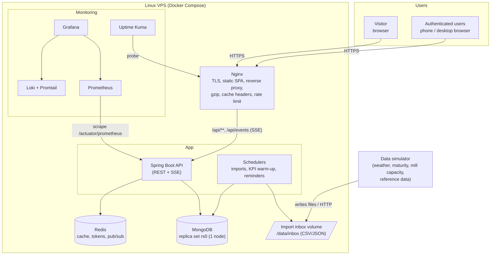
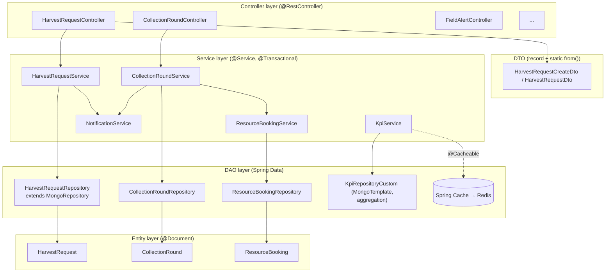
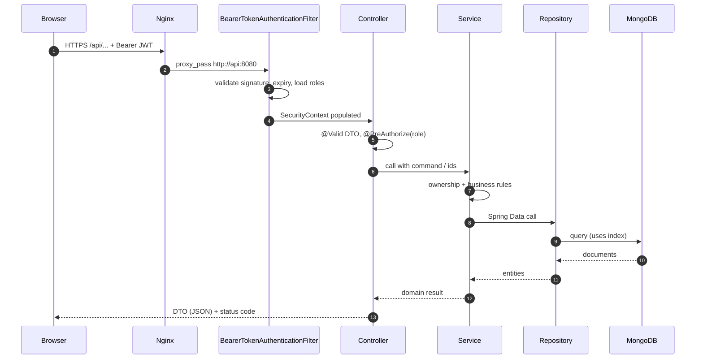
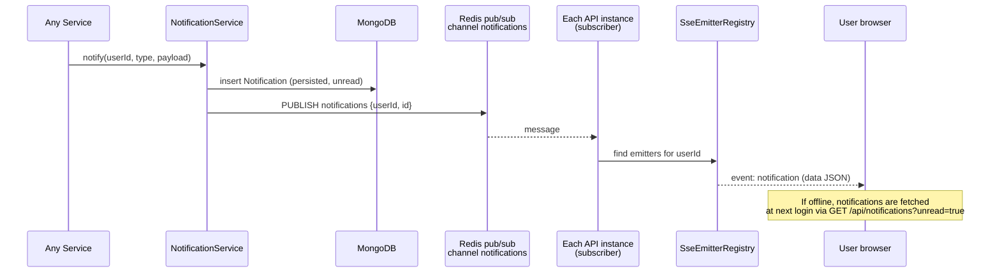

# 03 — Architecture

## 1. System architecture (C4 level 1–2)



**Main choices**

- **Single deployable backend** (a modular monolith). With 3 students and a 30 h budget per module, microservices would add work without any benefit. The packages are still split by feature, so the code stays modular.
- **SPA + REST API**: Nginx serves the React build as static files and proxies `/api`. The Actuator runs on the same port 8080 as the API and is not proxied. The browser only ever talks to Nginx, so there is no CORS to configure in production.
- **Real-time** uses **Server-Sent Events** (`/api/events`), which is simpler than WebSocket and enough for one-way server→client notifications. Redis pub/sub broadcasts each event to every API instance, so the backend can scale horizontally.
- MongoDB runs as a **single-node replica set**. That is required for multi-document transactions (`@Transactional` on round creation plus bookings) and for change streams.

## 2. Layered architecture (subject §IV.1)

For each use case, the API is split into **Controller → Service → DAO (Spring Data Repository) → Entity**, with **constructor-based dependency injection** between the layers.



**Rules for each layer** (checked in code review):

| Layer | Responsibilities | Must not |
|---|---|---|
| Controller | HTTP mapping, `@Valid` input validation, map DTO ⇄ domain, HTTP status codes | contain business rules, call repositories |
| Service | Business rules, ownership checks, transactions, orchestration, events, logging | return entities to controllers (it returns DTOs or domain objects mapped by the controller) |
| Repository (DAO) | Persistence via Spring Data (derived queries, `@Query`, custom `MongoTemplate` implementations for geo/aggregation) | contain business logic |
| Entity | `@Document` classes, indexes (`@Indexed`, `@CompoundIndex`, `@GeoSpatialIndexed`), auditing fields, `@Version` | depend on upper layers |

Cross-cutting: `GlobalExceptionHandler` (`@RestControllerAdvice`) → RFC 7807 `ProblemDetail`; `SecurityConfig`; `AuditorAware`; Log4j2; Actuator.

## 3. Backend package structure (package-by-feature)

```text
tn.oliveconnect
├── OliveConnectApplication.java
├── config/            (M1a) SecurityConfig, ProblemSecurityHandler, AppProperties, AuditingConfig.
│                      Planned: RedisConfig, CacheConfig, OpenApiConfig, AsyncConfig, SchedulingConfig
├── auth/              (M1a) AuthController, MeController, AuthService, JwtService, RefreshTokenStore,
│                      LoginRateLimiter, LoginRequest, LoginResponse, AccessToken, Session,
│                      InvalidCredentialsException, UnauthenticatedException, TooManyAttemptsException
├── common/            (M1a) GlobalExceptionHandler, NotFoundException.
│                      Planned: Conflict, Forbidden, BusinessRule exceptions, PageResponse
├── user/              (M1a) User, FarmerProfile, Role, Delegation, MeDto, UserRepository, AdminSeeder.
│                      RegistrationRequest, RegistrationStatus, RegistrationRequestRepository, RegistrationService,
│                      RegistrationController and their DTOs (M9).
│                      Planned: UserService, UserController (admin)
├── orchard/           Orchard, Plot, GeoPoint, OliveVariety, HarvestStatus, DTOs, repositories,
│                      OrchardService, OrchardController, OliveVarietyController, OliveVarietySeeder,
│                      MapController (public + private layers, future)
├── harvest/           HarvestRequest, HarvestRequestStatus, StatusChange, HarvestRequestRepository,
│                      HarvestRequestService, HarvestRequestController
├── round/             CollectionRound, RoundStop, RoundStatus, CollectionRoundRepository,
│                      CollectionRoundService, PlanningService, CollectionRoundController
├── resource/          Worker, Equipment, EquipmentType, ResourceBooking, SupplyOrder,
│                      repositories, ResourceService, BookingService, SupplyService, controllers
├── alert/             FieldAlert, AlertType, AlertStatus, FieldAlertRepository, FieldAlertService,
│                      AutoAlertRule, FieldAlertController
├── mill/              Mill, MillReception, QualityGrade, repositories, MillService,
│                      MillReceptionService, MillController
├── telemetry/         WeatherReading, MaturityReading (time-series), repositories, TelemetryService
├── notification/      Notification, NotificationRepository, NotificationService,
│                      SseEmitterRegistry, RedisNotificationPublisher/Subscriber, NotificationController
├── dashboard/         KpiService, KpiRepositoryCustom(+Impl with Aggregation), DashboardController, dto/
├── dataimport/        ImportJob, ImportJobRepository, ImportScheduler, ImportService,
│                      parsers/ (CsvParser, JsonParser), validators/, ImportController (admin)
├── settings/          SystemSettings, SettingsService, SettingsController
└── system/            SystemStatusController, SystemStatusService, SystemStatusDto  (M0: GET /api/system/status)
```

## 4. Technology stack

| Concern | Choice | Version (target) |
|---|---|---|
| Language / runtime | Java | 21 LTS |
| Framework | Spring Boot (Web, Validation, Security, Data MongoDB, Data Redis, Cache, Actuator) | 3.4+ |
| Build | Maven via `mvnw` | 3.9 |
| Mapping | Hand-written static `from(entity)` methods on DTO records | — |
| API doc | springdoc-openapi (Swagger UI) | 2.x |
| Auth | JWT HS256 signed and checked by the Spring Security OAuth2 Resource Server (Nimbus, HMAC key from `JWT_SECRET`), BCrypt passwords | — |
| Logging | Log4j2 (`spring-boot-starter-log4j2`, JSON layout for Loki) — the subject cites Log4j | 2.x |
| CSV | OpenCSV or Jackson CSV | — |
| Metrics | Micrometer + Prometheus registry | — |
| Tests | JUnit 5, Mockito, AssertJ, Spring Boot Test, MockMvc, Testcontainers (MongoDB, Redis) | — |
| DB | MongoDB | 7.0 / 8.0 |
| Cache | Redis | 7.x |
| Frontend | React 19, Vite, TypeScript, pnpm, Tailwind CSS v4, shadcn/ui (custom olive theme), TanStack Router (file-based), TanStack Query, react-leaflet + Leaflet.markercluster, Recharts (shadcn chart), React Hook Form, React Joyride, Vitest + Testing Library, Playwright | — |
| Server | Nginx | 1.27 |
| Monitoring | Prometheus, Grafana, Loki/Promtail, node-exporter, cAdvisor, Uptime Kuma | — |
| Load test | k6 (or JMeter) | — |

## 5. Main cross-cutting flows

### Request flow through the layers



### Real-time notification fan-out


