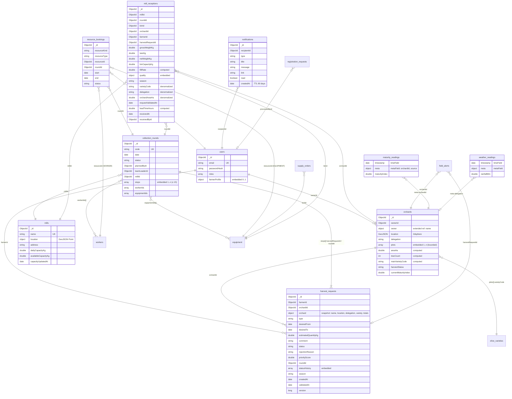
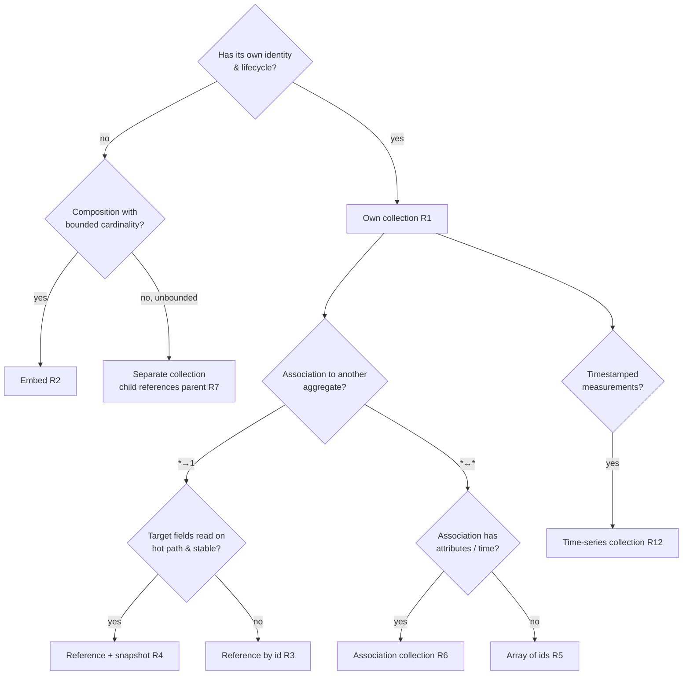
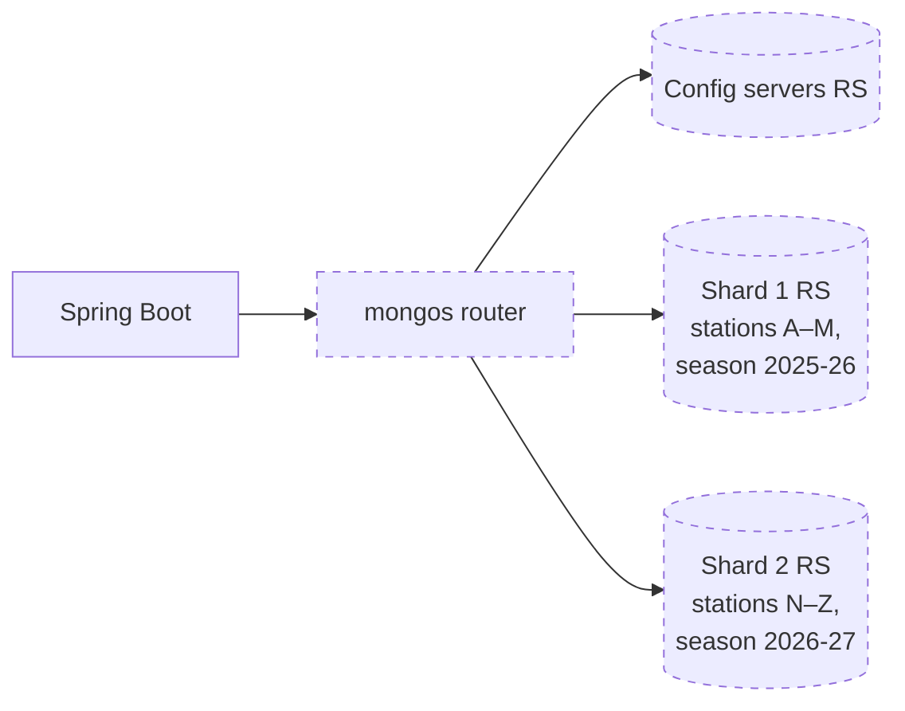

# 05 — NoSQL Schema (MongoDB + Redis)

This document covers the three database points of subject §IV.2:

1. **NoSQL schema**: the collections, and the reasons behind each structuring choice (embedding or referencing, partition keys, indexes).
2. **Transformation rules** from the class diagram ([04](04-uml-design.md)) to the schema.
3. **Persistence API**: the API used, and why it was chosen.

## 1. Why MongoDB (plus Redis)

| Need from the subject | MongoDB feature | Alternatives considered |
|---|---|---|
| Rich, nested business objects (orchard + plots, round + stops, history) | Document model, embedded arrays | Cassandra: no nesting flexibility, query-first modeling for every screen |
| Geolocation (alerts, map, nearest mill) | GeoJSON + `2dsphere` index, `$geoWithin`, `$geoNear` | Elasticsearch has geo too, but it is a weak primary store (no transactions) |
| Massive, fast-growing data (weather, maturity, weighings) | **Time-series collections**, compound indexes, sharding | Cassandra is excellent for pure time series, but the rest of the domain fits poorly |
| KPIs "computed by aggregation on massive data" (F5) | Aggregation pipeline (`$match`, `$group`, `$bucket`, `$setWindowFields`) | Redis cannot aggregate; Elasticsearch aggregations are good but would add a second source of truth |
| Consistency of planning (round + bookings) | Multi-document ACID transactions (replica set) | — |
| Spring ecosystem | Spring Data MongoDB (mature) | — |

**Redis** handles what MongoDB does poorly: very low-latency caching with TTL, counters for rate limiting, short-lived tokens, and pub/sub between API instances. Redis is **never** the source of truth: if the whole Redis instance is lost, only performance suffers, never data.

## 2. Collections overview



| Collection | Type | Expected volume (1 season) | Growth |
|---|---|---|---|
| `users` | regular | ~600 (500 farmers + staff) | low |
| `registration_requests` | regular | hundreds | low |
| `olive_varieties` | regular (reference) | ~10 | static |
| `orchards` | regular | ~1 500 | low |
| `harvest_requests` | regular | ~5 000 / season | medium |
| `collection_rounds` | regular | ~1 500 / season | medium |
| `workers` | regular | ~300 | low |
| `equipment` | regular, polymorphic | ~400 | low |
| `resource_bookings` | regular | ~20 000 / season | medium |
| `supply_orders` | regular | hundreds | low |
| `mills` | regular | ~5–20 | static |
| `mill_receptions` | regular, append-mostly | ~15 000 / season, kept over years | **high** |
| `field_alerts` | regular | ~5 000 / season | medium |
| `weather_readings` | **time-series** | stations × 96/day × 90 days ≈ 10⁵–10⁶ | **massive** |
| `maturity_readings` | **time-series** | 1 500 orchards × 1–4/day × 90 ≈ 10⁵–5·10⁵ | **massive** |
| `notifications` | regular + TTL | ~100 000 / season | high, auto-expired |
| `import_jobs` | regular | ~10 000 / season | medium |
| `system_settings` | singleton | 1 | — |

## 3. Transformation rules: class diagram → MongoDB

These rules are applied **systematically**. The rule ID (R1…R12) is cited next to each collection in §4.

| Rule | UML construct | MongoDB transformation | Criteria / justification |
|---|---|---|---|
| **R1** | Class with its own identity and lifecycle (an "aggregate root") | → **its own collection**; `id` → `_id` (ObjectId, or a natural key when stable, such as `olive_varieties._id = code`) | Accessed and modified independently |
| **R2** | **Composition** (filled diamond) with **bounded** cardinality, read together with the parent | → **embedded** sub-document or array | Atomic update of a single document; one read per screen; bounded so it never approaches the 16 MB limit. Examples: `Orchard *-- Plot`, `CollectionRound *-- RoundStop`, `MillReception *-- QualityAssessment`, `*-- StatusChange`, `User *-- FarmerProfile`, `ImportJob *-- ImportError` (capped at 500, with the total count kept) |
| **R3** | Association to an **independent** class, multiplicity `* → 1` | → **reference** by id (manual reference, field `xxxId`, ObjectId). No `DBRef` | The target has its own lifecycle (R1); manual refs are lighter and work in aggregation `$lookup` |
| **R4** | `* → 1` association whose target attributes are **read with the source on most screens** and rarely change | → reference **plus a snapshot** of the needed fields (*extended reference pattern*) | Avoids `$lookup` on hot paths (lists, map). Example: `harvest_requests.orchard {name, location, delegation}`, `orchards.owner {displayName}`. The service updates the snapshots on the (rare) changes |
| **R5** | Association `* ↔ *` | → **array of ids** on the side that is queried, with a multikey index | `collection_rounds.workerIds[]`, `equipmentIds[]`. The reverse direction ("rounds of worker X") goes through the multikey index |
| **R6** | Association that carries **attributes** or **time** (an association class) | → **its own collection** (R1) with both references | `ResourceBooking` (start/end, status): needed for calendar and overlap queries |
| **R7** | 1 → * association with **unbounded growth** | → **never embedded**: the child collection references the parent | `Orchard → MaturityReading`, `Mill → MillReception`, `User → Notification`. The 16 MB limit and write amplification rule out embedding |
| **R8** | Generalisation / inheritance | → **single collection per hierarchy**, discriminator field (`type` + Spring `_class`), subclass-specific fields present only where relevant | `Equipment ← Tractor / Bin / Tool` → `equipment` collection. Polymorphic queries ("all available resources") use one collection |
| **R9** | Enumeration | → **string** value (readable, stable when the enum is reordered) | `status`, `type`, `roles[]` |
| **R10** | Geographic attribute | → **GeoJSON** `{type: "Point", coordinates: [lng, lat]}` (or `Polygon`) + `2dsphere` index | `orchards.location`, `field_alerts.location`, `mills.location` |
| **R11** | **Derived** attribute used in queries or aggregations | → **computed at write time and stored** (*computed pattern*) | `netWeightKg`, `fillRate`, `orchards.treeCount/areaHa`, `orchards.currentMaturityIndex` (latest reading), `harvest_requests.priorityScore` |
| **R12** | Timestamped measurement class (sensor, weather) | → **time-series collection** (`timeField`, `metaField`, `granularity`) + TTL if needed | Compressed columnar storage, efficient range queries and aggregations |
| **R13** | Attributes needed for **analytics** on a fact collection | → **denormalised dimensions** on the fact document (season, varietyCode, delegation, farmerId) | Dashboard `$group` with no `$lookup` (star-schema-like "fact" document) |
| **R14** | Optimistic concurrency required | → `version` field (`@Version`) | Concurrent edits (manager vs. farmer on the same request) |



## 4. Collection details (sample documents + indexes + justification)

### 4.1 `users` (R1, R2 FarmerProfile, R9 roles)

```json
{
  "_id": ObjectId("665f..."),
  "email": "a.benali@example.tn",
  "passwordHash": "$2a$12$...",
  "firstName": "Ali", "lastName": "Ben Ali", "phone": "+21620000000",
  "roles": ["FARMER"],
  "enabled": true,
  "onboardingDone": false,
  "mustChangePassword": false,
  "farmerProfile": { "memberNumber": "ADH-0421", "cin": "01234567", "address": "Route de Gremda km 7", "delegation": "SAKIET_EZZIT" },
  "assignedMillId": null,
  "createdAt": ISODate("2026-11-20T08:00:00Z"), "createdBy": "665e...",
  "lastModifiedAt": ISODate("2026-11-20T08:00:00Z"), "lastModifiedBy": "665e...", "version": 0
}
```
| Index | Purpose |
|---|---|
| `{ email: 1 }` unique | login |
| `{ roles: 1, enabled: 1 }` | "notify all collection managers", user admin list |
| `{ "farmerProfile.memberNumber": 1 }` unique, sparse | search member |

- `delegation` is stored as the code of the `Delegation` enum (`SAKIET_EZZIT`, not the display label, which lives in the frontend). The same code is used by `orchards.delegation` and the telemetry `meta.delegation`.
- `createdBy` and `lastModifiedBy` hold the **user id** of the acting User (JWT `sub`), or `"system"` for the seeded Admin. They are filled by Mongo auditing.
- `email` is saved trimmed and lowercased. The first Admin is created at startup by `AdminSeeder` when no Admin exists (`ADMIN_EMAIL`, `ADMIN_PASSWORD`).
- When the FARMER role is removed, `farmerProfile` stays in the document but is ignored. Users are never deleted: disabling sets `enabled` to `false`.
- The indexes above are declared by entity annotations (`@Indexed`, `@CompoundIndex`) and created by the idempotent `MongoIndexInitializer` at startup. Automatic Spring index creation is disabled so the initializer can remove the legacy orchard geospatial index name before creating `location_2dsphere`.

### 4.2 `orchards` (R1, R2 plots, R4 owner snapshot, R10, R11)

```json
{
  "_id": ObjectId("..."),
  "name": "Henchir El Mezraa",
  "ownerId": ObjectId("665f..."),
  "owner": { "displayName": "Ali Ben Ali" },
  "location": { "type": "Point", "coordinates": [10.7603, 34.7998] },
  "delegation": "SAKIET_EZZIT",
  "plots": [
    { "code": "P1", "varietyCode": "CHEMLALI", "areaHa": 4.5, "treeCount": 450, "plantingYear": 1998, "irrigated": false },
    { "code": "P2", "varietyCode": "CHETOUI",  "areaHa": 1.2, "treeCount": 180, "plantingYear": 2015, "irrigated": true }
  ],
  "areaHa": 5.7, "treeCount": 630, "mainVarietyCode": "CHEMLALI",
  "harvestStatus": "SCHEDULED",
  "currentMaturityIndex": 3.8, "maturityUpdatedAt": ISODate("2026-11-21T06:00:00Z"),
  "lastSeasonYieldKgHa": 2100,
  "version": 3
}
```

The M2 API persists the point and bounded plot array on every write. `ownerId` is the
authenticated Farmer id and `owner.displayName` is the extended-reference snapshot used by
staff searches. `areaHa`, `treeCount` and `mainVarietyCode` are recomputed from `plots` before
the document is saved. A future boundary polygon remains part of the design but is not accepted
by the M2 form yet.
| Index | Purpose |
|---|---|
| `{ location: "2dsphere" }` | map bbox `$geoWithin`, nearest orchard, `$geoNear` grouping |
| `{ ownerId: 1 }` | "my orchards" |
| `{ harvestStatus: 1, mainVarietyCode: 1, delegation: 1 }` | map filters |
| `{ name: "text", "owner.displayName": "text" }` | staff search |

**Why embed plots:** an orchard has few plots (bounded, under 20), they are always shown with the orchard, and they are imported and edited together.
**Why not embed harvest requests or readings:** they grow without bound (R7) and have their own lifecycle (R1).

### 4.3 `olive_varieties` (R1, natural key)

`{ "_id": "CHEMLALI", "name": "Chemlali", "avgOilYieldPct": 20, "optimalMaturityMin": 3, "optimalMaturityMax": 4.5 }`. This reference data is cached in Redis without expiry and evicted on update.

### 4.4 `harvest_requests` (R1, R2 history, R3, R4 snapshot, R11 priority, R14)

```json
{
  "_id": ObjectId("..."),
  "farmerId": ObjectId("665f..."),
  "orchardId": ObjectId("..."),
  "orchard": { "id": ObjectId("..."), "name": "Henchir El Mezraa", "location": {"type":"Point","coordinates":[10.7603,34.7998]}, "delegation": "SAKIET_EZZIT", "mainVarietyCode": "CHEMLALI", "areaHa": 5.7, "lastSeasonYieldKgHa": 2100, "currentMaturityIndex": 3.8 },
  "type": "URGENT",
  "desiredFrom": ISODate("2026-11-24"), "desiredTo": ISODate("2026-11-27"),
  "estimatedQuantityKg": 9000,
  "comment": "Rain forecast Friday",
  "status": "SCHEDULED",
  "rejectionReason": null,
  "roundId": ObjectId("..."),
  "priorityScore": 88.0,
  "statusHistory": [
    { "from": null, "to": "SUBMITTED", "at": ISODate("..."), "byUserId": ObjectId("665f...") },
    { "from": "SUBMITTED", "to": "VALIDATED", "at": ISODate("..."), "byUserId": ObjectId("...") },
    { "from": "VALIDATED", "to": "SCHEDULED", "at": ISODate("..."), "byUserId": ObjectId("..."), "comment": "Round T-2026-118" }
  ],
  "season": "2026-2027",
  "createdAt": ISODate("..."), "validatedAt": ISODate("..."), "version": 4
}
```
| Index | Purpose |
|---|---|
| `{ farmerId: 1, createdAt: -1 }` | "my requests" (farmer home) |
| `{ status: 1, priorityScore: -1 }` | manager queue sorted by priority |
| `{ "orchard.location": "2dsphere", status: 1 }` | requests map / grouping by proximity |
| `{ orchardId: 1, status: 1 }` partial on `SUBMITTED`, `VALIDATED`, `SCHEDULED`, `IN_PROGRESS` | "one active request per orchard" check |
| `{ roundId: 1 }` | requests of a round |

### 4.5 `collection_rounds` (R1, R2 stops + history, R5 ids arrays, R14)

```json
{
  "_id": ObjectId("..."),
  "code": "T-2026-118",
  "date": ISODate("2026-11-25"), "startTime": "07:00", "endTime": "15:00",
  "status": "PLANNED",
  "plannedById": ObjectId("..."), "teamLeaderId": ObjectId("..."),
  "millId": ObjectId("..."),
  "workerIds": [ObjectId("..."), ObjectId("...")],
  "equipmentIds": [ObjectId("tractor..."), ObjectId("bin..."), ObjectId("shaker...")],
  "stops": [
    { "order": 1, "harvestRequestId": ObjectId("..."), "orchardId": ObjectId("..."), "farmerId": ObjectId("..."),
      "orchardName": "Henchir El Mezraa", "location": {"type":"Point","coordinates":[10.7603,34.7998]},
      "plannedArrival": "07:30", "estimatedKg": 9000, "status": "PENDING", "harvestedKg": null, "crateCount": null, "comment": null }
  ],
  "estimatedTotalKg": 15000, "totalHarvestedKg": 0,
  "statusHistory": [ { "from": null, "to": "PLANNED", "at": ISODate("..."), "byUserId": ObjectId("...") } ],
  "season": "2026-2027", "version": 0
}
```
| Index | Purpose |
|---|---|
| `{ code: 1 }` unique | human reference |
| `{ date: 1, status: 1 }` | calendar of the day/week |
| `{ teamLeaderId: 1, date: -1 }` | team leader's "my rounds" |
| `{ millId: 1, date: 1, startTime: 1 }` | mill's incoming rounds for a day, ordered by start time |
| `{ "stops.harvestRequestId": 1 }` (multikey) | find the round of a request |
| `{ workerIds: 1 }`, `{ equipmentIds: 1 }` (multikey) | rounds of a resource |

Stops are embedded (R2): there are at most about 15 per round, they are read and updated with the round, and a field update uses the positional operator `stops.$[s]` with `arrayFilters`, which is atomic on one document.

### 4.6 `resource_bookings` (R6)

```json
{ "_id": ObjectId("..."), "resourceKind": "EQUIPMENT", "resourceType": "BIN", "resourceId": ObjectId("bin..."),
  "roundId": ObjectId("..."), "start": ISODate("2026-11-25T07:00:00Z"), "end": ISODate("2026-11-25T15:00:00Z"),
  "status": "ACTIVE" }
```
`resourceKind` is `WORKER`, `EQUIPMENT`, or `TEAM_LEADER`; team-leader bookings reference the selected User id and use the same overlap and Redis-lock rules.
| Index | Purpose |
|---|---|
| `{ resourceId: 1, start: 1, end: 1 }` partial `status: "ACTIVE"` | **overlap check**: `{resourceId: X, start: {$lt: newEnd}, end: {$gt: newStart}, status: "ACTIVE"}` |
| `{ start: 1, resourceType: 1 }` | calendar per resource type for a week |
| `{ roundId: 1 }` | release bookings when a round is cancelled |

Overlap check and insert happen **in the same transaction** as the round creation. Concurrent planning of the same resource is serialised by a Redis lock `lock:resource:{kind}:{id}` (SET NX PX 5000, renewed every second until transaction completion). The transaction alone does not prevent two inserts that don't conflict on the same document.

### 4.7 `workers`, `equipment` (R1, R2 unavailabilities, R8 inheritance)

```json
// equipment — single collection for the hierarchy (R8)
{ "_id": ObjectId("..."), "_class": "tn.oliveconnect.resource.Bin", "type": "BIN", "code": "B-07",
  "status": "AVAILABLE", "serialNumber": "BN-2019-07", "capacityKg": 4000,
  "unavailabilities": [ { "from": ISODate("..."), "to": ISODate("..."), "reason": "Welding repair" } ] }
{ "_id": ObjectId("..."), "_class": "tn.oliveconnect.resource.Tractor", "type": "TRACTOR", "code": "TR-02",
  "status": "AVAILABLE", "plateNumber": "123 TU 4567", "powerHp": 90, "unavailabilities": [] }
{ "_id": ObjectId("..."), "_class": "tn.oliveconnect.resource.Tool", "type": "SHAKER", "code": "VIB-STOCK",
  "status": "AVAILABLE", "toolType": "SHAKER", "stockQuantity": 12, "unavailabilities": [] }

// workers
{ "_id": ObjectId("..."), "firstName": "Sami", "lastName": "Trabelsi", "cin": "12345678", "phone": "+21620123456",
  "skills": ["HARVEST", "TRACTOR"], "dailyRate": 45.0, "active": true,
  "unavailabilities": [ { "from": ISODate("..."), "to": ISODate("..."), "reason": "Leave" } ] }
```
`type` always equals `toolType` for a `Tool` (`NET` or `SHAKER`). `unavailabilities` is append-only in M4 and does not change `status`. Deletion is a hard delete until the bookings of M5 exist.
Indexes: `{ type: 1, status: 1 }`, `{ code: 1 }` unique. Workers: `{ active: 1, skills: 1 }`, `{ cin: 1 }` unique.

### 4.8 `mills`, `mill_receptions` (R1, R2 quality, R3, R11 computed, R13 denormalised)

```json
// mills — seeded reference destinations; capacity is mutable for later mill-management slices
{ "_id": ObjectId("..."), "name": "Sfax North Olive Mill", "address": "Route de Tunis, Sfax",
  "location": {"type": "Point", "coordinates": [10.7603, 34.7998]},
  "dailyCapacityKg": 40000, "availableCapacityKg": 40000,
  "capacityUpdatedAt": ISODate("2026-11-20T08:00:00Z") }

// mill_receptions — the main "fact" collection for the dashboard
{
  "_id": ObjectId("..."),
  "millId": ObjectId("..."), "roundId": ObjectId("..."), "binId": ObjectId("..."),
  "orchardId": ObjectId("..."), "farmerId": ObjectId("..."), "harvestRequestId": ObjectId("..."),
  "grossWeightKg": 4350, "tareKg": 820, "netWeightKg": 3530,
  "binCapacityKg": 4000, "fillRate": 0.8825,
  "quality": { "grade": "GOOD", "defectRatePct": 3.1, "leafRatePct": 1.2, "estimatedOilYieldPct": 21 },
  "season": "2026-2027", "varietyCode": "CHEMLALI", "delegation": "SAKIET_EZZIT", "orchardAreaHa": 5.7,
  "requestValidatedAt": ISODate("2026-11-21T10:00:00Z"),
  "leadTimeHours": 97.5,
  "receivedAt": ISODate("2026-11-25T12:30:00Z"), "receivedById": ObjectId("...")
}
```
| Index | Purpose |
|---|---|
| `{ season: 1, receivedAt: 1 }` | dashboard period filters (first `$match` stage) |
| `{ season: 1, orchardId: 1 }` | yield per orchard |
| `{ millId: 1, receivedAt: -1 }` | mill daily list / capacity use |
| `{ farmerId: 1, receivedAt: -1 }` | farmer "my receptions" |
| `{ roundId: 1, binId: 1, orchardId: 1 }` unique | prevents weighing the same bin load twice |

`mills`: `{ location: "2dsphere" }` for nearest-mill suggestions, plus `{ name: 1 }` unique for the seeded reference names. `availableCapacityKg` is updated by `$inc` on each reception and overwritten by the dynamic import (mill system).

| Index | Purpose |
|---|---|
| `{ location: "2dsphere" }` (`location_2dsphere`) | nearest-mill `$geoNear` suggestions |
| `{ name: 1 }` unique | idempotent lookup of seeded mill names |

### 4.9 `field_alerts` (R1, R2 history, R10)

```json
{ "_id": ObjectId("..."), "type": "MATURITY", "severity": "HIGH", "status": "NEW", "source": "FARMER",
  "orchardId": ObjectId("..."), "orchardName": "Henchir El Mezraa", "farmerId": ObjectId("..."), "reporterId": ObjectId("..."),
  "location": { "type": "Point", "coordinates": [10.7611, 34.8002] }, "locationMismatch": false,
  "description": "Olives turning purple, ~60% veraison", "photoUrls": ["/api/files/alerts/abc.jpg"],
  "handledById": null, "harvestRequestId": null, "statusHistory": [...],
  "createdAt": ISODate("...") }
```
Indexes: `{ status: 1, createdAt: -1 }` (queue), `{ location: "2dsphere", status: 1 }` (alerts map), `{ farmerId: 1, createdAt: -1 }`, `{ orchardId: 1, type: 1, status: 1 }` (duplicate detection: one open alert of the same type per orchard).

Photos are stored on disk in a Docker volume, or in GridFS. **Choice: GridFS** (`bucket alerts`), so that the backup covers them too.

### 4.10 Time-series: `weather_readings`, `maturity_readings` (R7, R12)

```js
db.createCollection("weather_readings", {
  timeseries: { timeField: "timestamp", metaField: "meta", granularity: "minutes" },
  expireAfterSeconds: 60 * 60 * 24 * 365 * 3   // keep 3 seasons
});
db.createCollection("maturity_readings", {
  timeseries: { timeField: "timestamp", metaField: "meta", granularity: "hours" }
});
```
```json
{ "timestamp": ISODate("2026-11-21T06:15:00Z"), "meta": { "stationId": "SFX-03", "delegation": "SAKIET_EZZIT" },
  "temperatureC": 14.2, "humidityPct": 81, "rainfallMm": 2.4, "windKmh": 12 }
{ "timestamp": ISODate("2026-11-21T06:00:00Z"), "meta": { "orchardId": ObjectId("..."), "source": "SENSOR" },
  "maturityIndex": 3.8, "varietyCode": "CHEMLALI" }
```
Secondary indexes: `{ "meta.orchardId": 1, timestamp: -1 }` (latest value, history chart), `{ "meta.delegation": 1, timestamp: -1 }`.

The latest maturity value is also copied onto `orchards.currentMaturityIndex` (R11), so the map never has to query the time series.

### 4.11 `notifications` (R7 + TTL), `import_jobs`, `registration_requests`, `system_settings`

- `notifications` documents contain `recipientId`, `type`, `title`, `message`, optional `link`, `read` and `createdAt`.
  M3 uses `NEW_REQUEST`, `REQUEST_VALIDATED` and `REQUEST_REJECTED`; real-time fan-out is deferred to M8.
  Indexes are `{ recipientId: 1, read: 1, createdAt: -1 }`, plus a **TTL** index `{ createdAt: 1 }, expireAfterSeconds: 7776000` (90 days).
- `import_jobs`: `{ checksum: 1 }` unique (idempotency), `{ startedAt: -1 }`, `{ dataset: 1, status: 1 }`. `errors[]` holds at most 500 entries and `errorCount` keeps the total (R2 bounded).
- `registration_requests`: `{ status: 1, createdAt: -1 }`, `{ email: 1 }`. Document: `{ firstName, lastName, email, phone, cin, message, status: PENDING|APPROVED|REJECTED, createdAt, processedById, createdUserId }`. `processedById` and `createdUserId` are set on approval; `processedById` alone on rejection. `users.mustChangePassword` is `true` for an account created by an approval until the Farmer changes the temporary password.
- `system_settings`: a single document with `_id: "global"`.

## 5. Partitioning (sharding) strategy

The deployment runs a single-node replica set, which is plenty for hundreds of users. For the "massive databases" module, we still design the shard keys we would use when scaling out:

| Collection | Shard key | Why |
|---|---|---|
| `weather_readings` | `{ "meta.stationId": 1, timestamp: 1 }` (time-series sharding on metaField + time) | Spreads stations across shards; range queries per station stay on one shard; avoids the monotonic hotspot of `timestamp` alone |
| `maturity_readings` | `{ "meta.orchardId": "hashed" }` | Even distribution; queries are always per orchard |
| `mill_receptions` | `{ season: 1, millId: 1, _id: 1 }` | Dashboard queries filter by season (targeted); `millId` spreads writes during the harvest peak; `_id` adds cardinality |
| `notifications` | `{ recipientId: "hashed" }` | Always queried by recipient |
| `harvest_requests`, `collection_rounds`, `orchards` | unsharded (small) | Below the size where sharding is worth it |


*(Target architecture; dashed = not deployed for the project.)*

## 6. Key queries and how the indexes serve them (performance requirement < 10 s)

| Query | MongoDB | Index used | Target |
|---|---|---|---|
| Public map, visible area | `orchards.find({location: {$geoWithin: {$box: [[w,s],[e,n]]}}, harvestStatus: {$in: [...]}}, {projection: name, location, mainVarietyCode, harvestStatus, currentMaturityIndex})` | `location_2dsphere` | < 300 ms (then cached in Redis per bbox/zoom + filter). The polygon is a GeoJSON `$geometry` (not the legacy `$box`) so MongoDB uses the 2dsphere index. Cells with several orchards are grouped by `MapService` at zoom < 13 |
| Manager queue | `harvest_requests.find({status: "VALIDATED"}).sort({priorityScore: -1}).limit(50)` | `status_1_priorityScore_-1` | < 50 ms |
| Nearby requests (grouping) | `$geoNear` on `orchard.location`, `maxDistance 10 000`, `query {status: VALIDATED}` | `orchard.location_2dsphere_status_1` | < 100 ms |
| Booking conflicts | `resource_bookings.find({resourceId: {$in: ids}, start: {$lt: e}, end: {$gt: s}, status: "ACTIVE"})` | `resource_id_start_end_active` | < 20 ms |
| Yield per orchard | aggregation below | `season_1_orchardId_1` | < 1 s for 10⁵ receptions |
| Latest maturity history | `maturity_readings.find({"meta.orchardId": X}).sort({timestamp: -1}).limit(30)` | `meta.orchardId_1_timestamp_-1` | < 50 ms |

Each of these queries gets checked with `explain("executionStats")` (`IXSCAN`, never `COLLSCAN`), and the screenshots go in the report.

### KPI aggregation pipelines (F5)

**Yield per orchard (kg/ha) for a season:**
```js
db.mill_receptions.aggregate([
  { $match: { season: "2026-2027" } },
  { $group: { _id: "$orchardId", totalNetKg: { $sum: "$netWeightKg" },
              areaHa: { $first: "$orchardAreaHa" }, variety: { $first: "$varietyCode" },
              delegation: { $first: "$delegation" },
              estOilKg: { $sum: { $multiply: ["$netWeightKg", { $divide: ["$quality.estimatedOilYieldPct", 100] }] } } } },
  { $project: { totalNetKg: 1, variety: 1, delegation: 1, estOilKg: 1,
                yieldKgHa: { $cond: [{ $gt: ["$areaHa", 0] }, { $divide: ["$totalNetKg", "$areaHa"] }, null] } } },
  { $sort: { yieldKgHa: -1 } }
])
```

**Average bin fill rate per ISO week:**
```js
db.mill_receptions.aggregate([
  { $match: { season: "2026-2027", receivedAt: { $gte: from, $lt: to } } },
  { $group: { _id: { week: { $isoWeek: "$receivedAt" }, year: { $isoWeekYear: "$receivedAt" } },
              avgFillRate: { $avg: "$fillRate" }, receptions: { $sum: 1 },
              underFilled: { $sum: { $cond: [{ $lt: ["$fillRate", 0.7] }, 1, 0] } } } },
  { $sort: { "_id.year": 1, "_id.week": 1 } }
])
```

**Collection lead time (validation → reception) per delegation, with p90:**
```js
db.mill_receptions.aggregate([
  { $match: { season: "2026-2027" } },
  { $group: { _id: "$delegation",
              avgLeadTimeH: { $avg: "$leadTimeHours" },
              p90LeadTimeH: { $percentile: { input: "$leadTimeHours", p: [0.9], method: "approximate" } },
              n: { $sum: 1 } } }
])
```

**Daily rainfall per delegation (time series):**
```js
db.weather_readings.aggregate([
  { $match: { timestamp: { $gte: ISODate("2026-11-01") } } },
  { $group: { _id: { d: { $dateTrunc: { date: "$timestamp", unit: "day" } }, del: "$meta.delegation" },
              rainMm: { $sum: "$rainfallMm" } } }
])
```

## 7. Redis design

| Key pattern | Type | TTL | Usage |
|---|---|---|---|
| `cache:varieties::all` | string (JSON) | none (evict on update) | reference data |
| `cache:mapPublic::{w},{s},{e},{n}:{zoom}:{variety}:{status}:{delegation}:{maturityMin}:{maturityMax}` | string (GeoJSON) | 60 s | public map response, one key per distinct normalised request (M9) |
| `cache:kpi::{name}:{filterHash}` | string (JSON) | 300 s | dashboard |
| `refresh:{tokenId}` | hash `{userId, exp}` | 7 days | refresh tokens (deletion = logout / revocation) |
| `user:{userId}:refresh` | set of tokenIds | 7 days | revoke all sessions of a user (on disable, password reset, email change) |
| `ratelimit:login:{email}:{ip}` | counter | 15 min | brute-force protection: +1 per failed login, TTL set at the first failure (fixed window), deleted on success; 5 → 429 |
| `lock:resource:{resourceId}` | string (NX) | 5 s | serialise concurrent bookings |
| channel `notifications` | pub/sub | — | SSE fan-out between API instances |

Eviction policy `allkeys-lru` with `maxmemory 256mb`. Persistence: RDB snapshot every 15 min (refresh tokens survive a restart; the cache does not need to).

## 8. Persistence API and its justification

**Chosen: Spring Data MongoDB, plus Spring Data Redis through the Spring Cache abstraction.**

| Criterion | Spring Data MongoDB | Alternatives |
|---|---|---|
| Subject requirement "DAO based on Spring Data" | ✅ | Raw MongoDB Java driver ✗ (no repository abstraction); Morphia ✗ |
| Productivity | `MongoRepository<T, ID>` CRUD + **derived queries**, `@Query` JSON queries, and `Pageable`/`PageResponse` envelopes; M3 uses `MongoTemplate` for its optional status/type filters | — |
| Advanced needs | `MongoTemplate` for **geo** (`NearQuery`, `GeoJsonPoint`, `$geoWithin`), **aggregation** (`Aggregation.newAggregation(...)`), `$inc`/positional updates, bulk ops for imports | Spring Data Elasticsearch: great search but no transactions; Cassandra: query-first model too rigid for this domain |
| Mapping | `@Document`, `@Field`, `@Indexed`, `@CompoundIndex`, `@GeoSpatialIndexed`, `@TimeSeries`, inheritance via `_class` (R8), `@Version` (R14) | — |
| Transactions | `MongoTransactionManager` + `@Transactional` (replica set) | — |
| Auditing | `@EnableMongoAuditing`: `@CreatedDate`, `@LastModifiedDate`, `@CreatedBy` | — |
| Testing | `@DataMongoTest` + Testcontainers | — |
| Redis | `@Cacheable`, `@CacheEvict` with `RedisCacheManager` (per-cache TTL); `StringRedisTemplate` for tokens, rate limits, locks, pub/sub (`RedisMessageListenerContainer`) | Caffeine (local only, not shared between instances) |

### Repository patterns (examples)

```java
public interface HarvestRequestRepository extends MongoRepository<HarvestRequest, String> {
    Optional<HarvestRequest> findByIdAndFarmerId(String id, String farmerId);
    boolean existsByOrchardIdAndStatusIn(String orchardId, Collection<HarvestRequestStatus> active);
}

// HarvestRequestService builds the optional status/type criteria and stable sort, then pages it.
PageRequest page = PageRequest.of(pageNumber, pageSize,
    Sort.by(Sort.Direction.DESC, "priorityScore").and(Sort.by(Sort.Direction.ASC, "createdAt")));
Page<HarvestRequest> result = PageableExecutionUtils.getPage(
    mongoTemplate.find(Query.of(filter).with(page), HarvestRequest.class), page,
    () -> mongoTemplate.count(Query.of(filter).limit(-1).skip(-1), HarvestRequest.class));

public interface ResourceBookingRepository extends MongoRepository<ResourceBooking, String> {
    @Query("{ 'resourceId': { $in: ?0 }, 'status': 'ACTIVE', 'start': { $lt: ?2 }, 'end': { $gt: ?1 } }")
    List<ResourceBooking> findOverlapping(Collection<String> resourceIds, Instant start, Instant end);
}

// Custom implementation with MongoTemplate (geo + aggregation)
public class KpiRepositoryCustomImpl implements KpiRepositoryCustom {
    private final MongoTemplate mongo;
    public List<FillRatePoint> fillRateByWeek(String season, Instant from, Instant to) {
        Aggregation agg = newAggregation(
            match(where("season").is(season).and("receivedAt").gte(from).lt(to)),
            project("fillRate").and(DateOperators.IsoWeek.isoWeekOf("receivedAt")).as("week"),
            group("week").avg("fillRate").as("avgFillRate").count().as("receptions"),
            sort(Sort.Direction.ASC, "_id"));
        return mongo.aggregate(agg, MillReception.class, FillRatePoint.class).getMappedResults();
    }
}
```

### Index management

- Indexes are declared on the entities (`@Indexed`, `@CompoundIndex`) and created by `MongoIndexInitializer` at startup. `spring.data.mongodb.auto-index-creation: false` prevents Spring from trying to create `location_2dsphere` before the initializer can reconcile the legacy `location` index name.
- Target for production (M13): `auto-index-creation=false`. Indexes, time-series collections, TTL and validators are created by an **idempotent migration** at startup (Mongock, or a `MongoIndexInitializer` `ApplicationRunner`), so they are versioned and can be reviewed.
- Optional **`$jsonSchema` validators** on the critical collections (`mill_receptions`, `harvest_requests`) give a second line of defence after Bean Validation.
