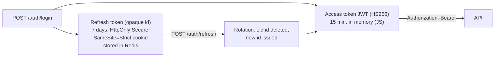

# 06 — REST API & Security

Base URL: `/api`. Format: JSON, dates in ISO-8601 UTC, GeoJSON for positions. API docs: Swagger UI at `/api/docs` (springdoc), disabled or protected in production.

## 1. Conventions

| Topic | Convention |
|---|---|
| Resource naming | plural kebab-case nouns (`/harvest-requests`, `/collection-rounds` → short alias `/rounds`) |
| State transitions | explicit action sub-resources (`POST /rounds/{id}/start`) instead of a generic PATCH of `status`, so each business rule has one entry point |
| Pagination | `?page=0&size=20&sort=createdAt,desc` → `PageResponse{content, page, size, totalElements}` |
| Errors | RFC 7807 `application/problem+json`: `{type, title, status, detail, instance, errors:[{field, message}], code}` |
| Concurrency | `version` in DTOs; on `OptimisticLockingFailureException` → **409** `code: STALE_VERSION` |
| Status codes | 200 OK, 201 Created (+ `Location`), 204 No Content, 400 validation, 401 unauthenticated, 403 wrong role, **404 for another user's resource** (no information leak), 409 conflict/state, 422 business rule, 429 rate limit |
| IDs | ObjectId hex strings |

**Error codes** (`code` property of the ProblemDetail, produced by `GlobalExceptionHandler` and, for 401/403 raised by the security filters, by `ProblemSecurityHandler`). The frontend switches on `code`, never on the message.

| Code | Status | When | Since |
|---|---|---|---|
| `VALIDATION_FAILED` | 400 | Bean Validation failed, `errors[]` lists `{field, message}` | M1a |
| `UNAUTHENTICATED` | 401 | missing, expired or invalid access token | M1a |
| `SESSION_EXPIRED` | 401 | `/auth/refresh` received a refresh cookie that is unknown, already used, revoked, or belongs to a disabled User (the frontend retries once after about 1 s) | M1a |
| `INVALID_CREDENTIALS` | 401 | unknown email, wrong password or disabled User (same generic message) | M1a |
| `FORBIDDEN` | 403 | authenticated but the role is not allowed | M1a |
| `NOT_FOUND` | 404 | resource missing (or not visible to the caller) | M1a |
| `INTERNAL_ERROR` | 500 | unexpected error (details only in the logs) | M1a |
| `EMAIL_TAKEN`, `MEMBER_NUMBER_TAKEN` | 409 | duplicate email or member number (also on registration submit and approve) | M1b |
| `CIN_TAKEN`, `CODE_TAKEN` | 409 | duplicate worker `cin` or equipment `code` | M4 |
| `EQUIPMENT_TYPE_IMMUTABLE` | 422 | `PUT /equipment/{id}` with a `type` different from the stored one | M4 |
| `REGISTRATION_ALREADY_PROCESSED` | 409 | approve or reject a registration request that is not `PENDING` | M9 |
| `WRONG_PASSWORD` | 422 | `PATCH /me/password` with a wrong `currentPassword` | M9 |
| `SELF_LOCKOUT` | 422 | an Admin disables themselves or removes their own ADMIN role | M1b |
| `TOO_MANY_ATTEMPTS` | 429 | 5 failed logins in 15 min, with `Retry-After` | M1a |
| `STALE_VERSION` | 409 | optimistic locking conflict (stale `version`) | M1b |

## 2. Endpoint catalogue

Roles: **PUB** public, **F** farmer, **CM** collection manager, **TL** team leader, **LM** logistics manager, **MM** mill manager, **AD** admin. "own" means the service also checks ownership.

### System (M0)
| Method | Path | Roles | Description | FR |
|---|---|---|---|---|
| GET | `/system/status` | PUB | `{api, mongo, redis, version}`, each of the first three is `UP` or `DOWN` (Mongo and Redis are pinged) | — |

### Auth & accounts
| Method | Path | Roles | Description | FR |
|---|---|---|---|---|
| POST | `/auth/login` | PUB | body `{email, password}` → `200 {accessToken, expiresIn, user}` + `refresh_token` cookie, 400 `VALIDATION_FAILED`, 401 `INVALID_CREDENTIALS`, 429 `TOO_MANY_ATTEMPTS` (`Retry-After` header and `retryAfterSeconds`) | — |
| POST | `/auth/refresh` | PUB (cookie) | rotate the refresh token → `200` same body as login + new cookie; 401 `UNAUTHENTICATED` (cookie missing) or `SESSION_EXPIRED` (cookie unknown or already used, User disabled → all their sessions revoked); the cookie is cleared on 401 | — |
| POST | `/auth/logout` | PUB (cookie) | revoke this session only (identified by the cookie, works with an expired access token), clear the cookie → `204`, idempotent | — |
| GET | `/me` | any | `MeDto {id, email, firstName, lastName, roles, onboardingDone, mustChangePassword}`, 401 `UNAUTHENTICATED` without a valid token | — |
| PATCH | `/me` | any | update phone, onboardingDone (planned) | NFR-3 |
| PATCH | `/me/password` | any | body `{currentPassword, newPassword}` (8 to 72 characters) → `204`, clears `mustChangePassword`; 400 `VALIDATION_FAILED`, 422 `WRONG_PASSWORD` | FR-6.1 |
| POST | `/registrations` | PUB | body `{firstName, lastName, email, phone?, cin, message?}` → `201` + `Location` and `RegistrationDto {id, firstName, lastName, email, phone, cin, message, status, createdAt, processedById}`; 400 `VALIDATION_FAILED`, 409 `EMAIL_TAKEN` (a User or a pending request already has this email) | FR-6.1 |
| GET | `/registrations` | AD | list `RegistrationDto[]`, newest first, optional query `status` (`PENDING`, `APPROVED`, `REJECTED`) | FR-6.1 |
| POST | `/registrations/{id}/approve` | AD | body `{memberNumber, delegation}` → `200 {registration, userId, temporaryPassword}`: creates a FARMER (12-character generated password, `mustChangePassword=true`); the password is returned only here, with `Cache-Control: no-store`. 404, 409 `REGISTRATION_ALREADY_PROCESSED` / `EMAIL_TAKEN` / `MEMBER_NUMBER_TAKEN` | FR-6.1 |
| POST | `/registrations/{id}/reject` | AD | → `200 RegistrationDto` (`REJECTED`); 404, 409 `REGISTRATION_ALREADY_PROCESSED` | FR-6.1 |
| GET | `/users` | AD | list Users, query `role`, `enabled`, `page`, `size`; sorted by `lastName` → `PageResponse<UserDto>` | FR-6.2 |
| POST | `/users` | AD | create User (details, roles, Farmer profile, password) → 201 + `Location`, 400 `VALIDATION_FAILED`, 409 `EMAIL_TAKEN` / `MEMBER_NUMBER_TAKEN` | FR-6.2 |
| GET | `/users/{id}` | AD | detail → `UserDto`, 404 `NOT_FOUND` | FR-6.2 |
| PUT | `/users/{id}` | AD | edit User: details, roles and Farmer profile in one call; optional `password` resets it; a new email or a password reset revokes all sessions. 400, 404, 409 `EMAIL_TAKEN` / `MEMBER_NUMBER_TAKEN`, 422 `SELF_LOCKOUT` (removing own ADMIN role) | FR-6.2 |
| POST | `/users/{id}/enable` | AD | enable User → 204, 404 | FR-6.2 |
| POST | `/users/{id}/disable` | AD | disable User + revoke sessions → 204, 404, 422 `SELF_LOCKOUT` (own User) | FR-6.2 |

Users are never deleted: disabling replaces deletion, so there is no `DELETE /users/{id}`.

### Orchards, varieties, map (F1, F4)
| Method | Path | Roles | Description | FR |
|---|---|---|---|---|
| GET | `/orchards` | F (own), CM, AD | list (farmer: only own), sorted by name | FR-1.1 |
| POST | `/orchards` | F, AD | create with GeoJSON Point and embedded plots; returns 201 + `Location` | FR-1.1 |
| GET | `/orchards/{id}` | F own, CM, AD | detail; another Farmer's orchard is indistinguishable from missing and returns 404 | FR-1.1 |
| PUT | `/orchards/{id}` | F own, AD | replace name, delegation, position and plots; totals are recomputed | FR-1.1 |
| DELETE | `/orchards/{id}` | F own, AD | delete an owned orchard | FR-1.1 |
| GET | `/orchards/{id}/maturity` | F own, CM | maturity time series, query `days` (default 30) | FR-4.3 |
| GET | `/orchards/nearest` | F | own orchard nearest to GPS position, query `lng`, `lat` (alert form) | FR-2.1 |
| GET | `/varieties` | PUB | reference list | — |
| GET | `/map/public` | PUB | GeoJSON FeatureCollection **without personal data**, query `bbox=w,s,e,n` (required), `zoom` (0-22, default 15, below 13 orchards are grouped into grid clusters `{cluster: true, count}`), `variety`, `status`, `delegation` (a Delegation code, FR-4.2 zone), `maturityMin`, `maturityMax`; features carry only `id`, `varietyCode`, `harvestStatus`, `maturityIndex`; 400 `VALIDATION_FAILED` on a bad `bbox` (including one wider or taller than 4 degrees), `zoom`, `status` or `delegation`; cached 60 s in Redis | FR-4.1, 4.2, 4.4 |
| GET | `/map/private` | F (own), CM, AD | enriched layers, query `bbox`, `layers=orchards,alerts,rounds` | FR-4.3 |

`POST` and `PUT /orchards` accept `{name, delegation, location: {type: "Point", coordinates: [lng, lat]}, plots}`.
Each plot contains `{code, varietyCode, areaHa, treeCount, plantingYear, irrigated}`. The service
rejects unknown varieties, duplicate plot codes and positions outside Tunisia with
`400 VALIDATION_FAILED`. `GET /varieties` is public and reads the seeded reference collection
through the Redis key `cache:varieties::all`. An Admin may additionally send `ownerId` when
creating an orchard for a Farmer; a Farmer's owner is always the authenticated User.

### Harvest requests (F1)
| Method | Path | Roles | Description | FR |
|---|---|---|---|---|
| POST | `/harvest-requests` | F | declare | FR-1.2 |
| GET | `/harvest-requests` | F (own), CM | list / queue sorted by priority, query `status`, `type`, `mine` | FR-1.4 |
| GET | `/harvest-requests/{id}` | F own, CM, TL (if in their round) | detail + history | FR-1.8 |
| PUT | `/harvest-requests/{id}` | F own | modify (rules SD-4) | FR-1.3 |
| POST | `/harvest-requests/{id}/cancel` | F own | cancel | FR-1.3 |
| POST | `/harvest-requests/{id}/validate` | CM | validate | FR-1.4 |
| POST | `/harvest-requests/{id}/reject` | CM | reject | FR-1.4 |

### Rounds & planning (F1, F3)
| Method | Path | Roles | Description | FR |
|---|---|---|---|---|
| GET | `/planning/suggestions` | CM | priority-sorted groups, free resources, mill, query `date` | FR-1.5 |
| POST | `/rounds` | CM | plan round (transaction + bookings) | FR-1.5 |
| GET | `/rounds` | CM, LM, TL (own) | calendar/list, query `from`, `to`, `status`, `teamLeaderId` | FR-3.3 |
| GET | `/rounds/{id}` | CM, LM, TL own, MM (if delivering to their mill) | detail | — |
| PUT | `/rounds/{id}` | CM (PLANNED only) | modify stops/resources | FR-1.5 |
| POST | `/rounds/{id}/cancel` | CM | cancel + release bookings | — |
| POST | `/rounds/{id}/start` | TL own | start round | FR-1.7 |
| POST | `/rounds/{id}/complete` | TL own | complete round | FR-1.7 |
| PATCH | `/rounds/{id}/stops/{order}` | TL own | update stop (status, kg, crates) | FR-1.7 |

### Resources (F3)
| Method | Path | Roles | Description | FR |
|---|---|---|---|---|
| GET | `/workers` | LM, CM, AD | list seasonal workers, query `active`, `page`, `size` | FR-3.1 |
| POST | `/workers` | LM, AD | create worker | FR-3.1 |
| GET | `/workers/{id}` | LM, CM, AD | detail | FR-3.1 |
| PUT | `/workers/{id}` | LM, AD | edit worker | FR-3.1 |
| DELETE | `/workers/{id}` | LM, AD | delete worker (hard delete until M5) | FR-3.1 |
| GET | `/equipment` | LM, CM, AD | list tractors, bins, nets, shakers, query `type` (for example `BIN`), `status`, `page`, `size` | FR-3.2 |
| POST | `/equipment` | LM, AD | create equipment | FR-3.2 |
| GET | `/equipment/{id}` | LM, CM, AD | detail | FR-3.2 |
| PUT | `/equipment/{id}` | LM, AD | edit equipment | FR-3.2 |
| DELETE | `/equipment/{id}` | LM, AD | delete equipment (hard delete until M5) | FR-3.2 |
| POST | `/workers/{id}/unavailabilities` | LM, AD | worker leave, 201 with the updated worker | FR-3.2 |
| POST | `/equipment/{id}/unavailabilities` | LM, AD | equipment maintenance, 201 with the updated equipment, `status` unchanged | FR-3.2 |
| GET | `/resources/availability` | CM, LM, AD | free resources on a slot, query `start`, `end`, `type` | FR-1.5 |
| GET | `/resources/calendar` | CM, LM, AD | bookings + unavailabilities, query `resourceId`, `from`, `to` | FR-3.3 |
| GET | `/supply-orders` | LM | list | FR-3.5 |
| POST | `/supply-orders` | LM | create | FR-3.5 |
| POST | `/supply-orders/{id}/receive` | LM | mark received (stock `$inc`) | FR-3.5 |

### Alerts (F2)
| Method | Path | Roles | Description | FR |
|---|---|---|---|---|
| POST | `/alerts` | F | report (multipart: JSON + photo) | FR-2.1, 2.2 |
| GET | `/alerts` | F (own), CM | list, query `status`, `type`, `mine` | FR-2.3 |
| POST | `/alerts/{id}/acknowledge` | CM | acknowledge | FR-2.4 |
| POST | `/alerts/{id}/resolve` | CM | resolve | FR-2.4 |
| POST | `/alerts/{id}/dismiss` | CM | dismiss | FR-2.4 |
| POST | `/alerts/{id}/create-urgent-request` | CM | one-click urgent request | FR-2.5 |
| GET | `/files/alerts/{fileId}` | F own, CM | photo (GridFS) | — |

### Mills (F1, F5)
| Method | Path | Roles | Description | FR |
|---|---|---|---|---|
| GET | `/mills` | any authenticated | list + capacity | — |
| PUT | `/mills/{id}/capacity` | MM (own mill), AD | publish available capacity | — |
| GET | `/mills/{id}/incoming` | MM own | rounds delivering today | — |
| POST | `/mills/{id}/receptions` | MM own | record weighing | SD-7 |
| GET | `/receptions` | F (own), MM, CM | list receptions, query `mine` | FR-1.6 |

### Dashboard (F5)
| Method | Path | Roles | Description | FR |
|---|---|---|---|---|
| GET | `/dashboard/summary` | CM, MM, AD | KPI tiles, query `season` | — |
| GET | `/dashboard/yield` | CM, AD | yield, query `season`, `groupBy=orchard\|variety\|delegation` | FR-5.1 |
| GET | `/dashboard/lead-time` | CM, AD | lead time, query `season`, `groupBy=delegation\|week` | FR-5.2 |
| GET | `/dashboard/fill-rate` | CM, MM, AD | fill rate, query `season`, `groupBy=week\|bin\|round` | FR-5.3 |
| GET | `/dashboard/mill-volumes` | MM (own), CM, AD | mill volumes, query `millId`, `from`, `to` | FR-5.4 |
| GET | `/dashboard/{kpi}/export.csv` | same as KPI | CSV export of a KPI | FR-5.6 |

### Notifications, imports, settings
| Method | Path | Roles | Description |
|---|---|---|---|
| GET | `/events` | any authenticated | real-time SSE stream (`text/event-stream`), authenticated with the short-lived `ticket` query parameter |
| GET | `/notifications` | any (own) | inbox, query `unread` |
| POST | `/notifications/{id}/read` | own | mark one as read |
| POST | `/notifications/read-all` | own | mark all as read |
| GET | `/imports` | AD | import journal, query `dataset`, `status` |
| GET | `/imports/{id}` | AD | details + rejected rows |
| POST | `/imports/run` | AD | manual trigger, query `type=REFERENCE\|DYNAMIC` |
| POST | `/imports/upload` | AD | upload a CSV/JSON into the inbox |
| GET | `/settings` | AD | thresholds, parameters |
| PUT | `/settings` | AD | update thresholds, parameters |
| POST | `/events/ticket` | any authenticated | one-time SSE ticket (see §4.1) |

**Actuator** (not under `/api`, same port 8080 as the API): `/actuator/health` and `/actuator/info` are exposed today. `/actuator/prometheus` is added in M10. Nginx only proxies `/api/`, so the Actuator is not reachable from outside, only from the `back` Docker network.

## 3. DTO examples (the API contract)

```jsonc
// POST /api/harvest-requests  — HarvestRequestCreateDto
{ "orchardId": "6660…", "type": "URGENT", "desiredFrom": "2026-11-24", "desiredTo": "2026-11-27",
  "estimatedQuantityKg": 9000, "comment": "Rain forecast Friday" }

// 201 — HarvestRequestDto
{ "id": "6671…", "orchard": { "id": "6660…", "name": "Henchir El Mezraa", "delegation": "SAKIET_EZZIT" },
  "type": "URGENT", "status": "SUBMITTED", "desiredFrom": "2026-11-24", "desiredTo": "2026-11-27",
  "estimatedQuantityKg": 9000, "priorityScore": 82.5, "roundId": null,
  "history": [ { "to": "SUBMITTED", "at": "2026-11-21T09:12:00Z", "by": "Ali Ben Ali" } ],
  "allowedActions": ["MODIFY", "CANCEL"], "version": 0 }
```

```jsonc
// POST /api/workers (PUT: same body)  — WorkerRequestDto. cin = 8 digits, phone = +216 + 8 digits (optional),
// dailyRate >= 0, active defaults to true
{ "firstName": "Sami", "lastName": "Trabelsi", "cin": "12345678", "phone": "+21620123456",
  "skills": ["HARVEST", "TRACTOR"], "dailyRate": 45.0, "active": true }

// 201 (Location: /api/workers/{id}) — WorkerDto
{ "id": "6680…", "firstName": "Sami", "lastName": "Trabelsi", "cin": "12345678", "phone": "+21620123456",
  "skills": ["HARVEST", "TRACTOR"], "dailyRate": 45.0, "active": true,
  "unavailabilities": [ { "from": "2026-11-25T00:00:00Z", "to": "2026-11-27T00:00:00Z", "reason": "Leave" } ],
  "createdAt": "2026-11-20T09:00:00Z", "version": 0 }

// POST /api/equipment (PUT: same body, "type" must not change) — EquipmentRequestDto.
// type = TRACTOR | BIN | NET | SHAKER. Required by type: TRACTOR plateNumber + powerHp (> 0),
// BIN capacityKg (> 0) + optional serialNumber, NET/SHAKER stockQuantity (>= 0). status defaults to AVAILABLE.
{ "type": "BIN", "code": "B-07", "status": "AVAILABLE", "serialNumber": "BN-2019-07", "capacityKg": 4000 }

// 201 (Location: /api/equipment/{id}) — EquipmentDto: one shape for all types,
// the fields of the other types are present and null
{ "id": "6690…", "type": "BIN", "code": "B-07", "status": "AVAILABLE",
  "plateNumber": null, "powerHp": null,
  "serialNumber": "BN-2019-07", "capacityKg": 4000.0,
  "toolType": null, "stockQuantity": null,
  "unavailabilities": [], "createdAt": "2026-11-20T09:00:00Z", "version": 0 }
// TRACTOR fills plateNumber, powerHp. NET and SHAKER fill toolType (= type) and stockQuantity.

// POST /api/workers/{id}/unavailabilities and /api/equipment/{id}/unavailabilities — UnavailabilityDto.
// "to" must be after "from" (else 400 VALIDATION_FAILED on field "to": a deliberate choice, the same field-error style as M1b, instead of 422). 201 returns the updated WorkerDto / EquipmentDto.
{ "from": "2026-11-25T00:00:00Z", "to": "2026-11-27T00:00:00Z", "reason": "Welding repair" }

// GET /api/workers, GET /api/equipment — PageResponse<WorkerDto | EquipmentDto>
{ "content": [ … ], "page": 0, "size": 20, "totalElements": 1 }
```

`allowedActions` is computed server-side from the state machine and the user's rights. The frontend uses it to show or hide buttons, so the rules exist in only one place.

```jsonc
// 409 example
{ "type": "https://oliveconnect.tn/errors/booking-conflict", "title": "Resource already booked",
  "status": 409, "code": "BOOKING_CONFLICT",
  "detail": "Bin B-07 is already booked by round T-2026-118 (07:00–15:00).",
  "conflicts": [ { "resourceId": "…", "resourceCode": "B-07", "roundCode": "T-2026-118" } ] }
```

## 4. Security design

### 4.1 Authentication



- **Refresh cookie**: `refresh_token`, `HttpOnly; Secure; SameSite=Strict; Path=/api/auth; Max-Age=604800`. Spring CSRF protection is disabled: SameSite=Strict plus the Bearer access token make it safe.
- **Rotation without reuse detection**: every refresh deletes the old id and issues a new one. An old id presented again gets 401, nothing more. Refresh re-reads the User from MongoDB: a disabled User gets 401 and all their sessions are revoked, otherwise the new access token carries the User's current roles.
- **Frontend (silent refresh)**: refresh on app boot and after any 401 (one refresh at a time, then the call is retried once). If the refresh gets 401 `SESSION_EXPIRED` (cookie present but refused, on boot or after an API 401), it is retried once after about 1 s because another tab may have just rotated the shared cookie.
- Passwords hashed with **BCrypt** (strength 12). Password policy: 8 to 72 characters (on create and on reset). An account created by approving a registration has `mustChangePassword=true` (also in `MeDto` and the login response `user`); `PATCH /me/password` clears it. The API does not block other calls meanwhile, the frontend forces the change screen.
- JWT claims: `sub` = userId, `roles` (mapped to `ROLE_*` authorities), `millId` (for mill managers, from M7), `exp`. The secret comes from the `JWT_SECRET` environment variable (at least 32 characters, the API refuses to start otherwise) and is never committed. The seeded Admin comes from `ADMIN_EMAIL` and `ADMIN_PASSWORD`.
- **Login rate limiting** through Redis, key `ratelimit:login:{email}:{ip}`: every failed login (unknown email, wrong password, disabled User) adds 1; the 15 min window starts at the first failure. With 5 failures, every attempt gets 429 `TOO_MANY_ATTEMPTS` with `Retry-After` and `retryAfterSeconds`, even with the right password. A success clears the counter. The client IP comes from Nginx's `X-Forwarded-For` (`server.forward-headers-strategy: native`).
- **SSE authentication**: `EventSource` cannot send headers, so the client first calls `POST /api/events/ticket`. That returns a one-time ticket stored in Redis for 30 s, which is then passed as `?ticket=`.

### 4.2 Authorisation: three levels

1. **URL level** (`SecurityFilterChain`): `/api/map/public/**`, `/api/varieties`, `/api/auth/**` and `POST /api/registrations` are `permitAll`. Everything else is `authenticated`. `/api/system/status` is also `permitAll` (M0), as are `/actuator/health`, `/actuator/info` and the Swagger UI paths. A missing or invalid token returns 401 `UNAUTHENTICATED`. The Actuator exposes only `health` and `info` on port 8080, and Nginx never proxies it. The Actuator paths are public because the Docker healthcheck calls them. Also permitted until the M13 hardening: the springdoc pages (`/swagger-ui/**`, `/v3/api-docs/**`, `/api/docs/**`) and CORS preflight `OPTIONS` requests.
2. **Method level** (`@PreAuthorize("hasRole('COLLECTION_MANAGER')")`) on controllers.
3. **Data level (ownership)** in services. For example, `OrchardService.getForUser(id, user)` loads with `findByIdAndOwnerId(id, user.id())` when the user is only a FARMER. Missing → `NotFoundException` (404, not 403, so the existence of other farmers' data is never revealed). Mill managers are restricted to `assignedMillId`, team leaders to their own rounds.

### 4.3 Role × resource matrix

| Resource | Visitor | Farmer | Coll. mgr | Team leader | Logistics | Mill mgr | Admin |
|---|---|---|---|---|---|---|---|
| Public map (no personal data) | R | R | R | R | R | R | R |
| Orchards | – | CRUD own | R all | R (round stops) | – | – | CRUD |
| Harvest requests | – | C, R/U/cancel own | R, validate/reject | R (own rounds) | – | – | R |
| Rounds | – | R own stops (status only) | CRUD | R own, start/stops/complete | R | R (to their mill) | R |
| Workers / equipment | – | – | R | – | CRUD | – | CRUD |
| Bookings / calendar | – | – | CR | R own | CRUD | – | R |
| Supply orders | – | – | – | – | CRUD | – | R |
| Alerts | – | C, R own | R, handle | – | – | – | R |
| Mills / capacity | – | R | R | R | R | U own | CRUD |
| Receptions | – | R own | R | – | – | C/R own mill | R |
| Dashboard | – | (own yields on profile) | R | – | – | R (own mill) | R |
| Users / roles | C (registration) | R/U self | R/U self | R/U self | R/U self | R/U self | CRUD |
| Imports / settings | – | – | – | – | – | – | CRUD |

### 4.4 Other protections

- HTTPS everywhere, with HSTS (Nginx). CSP, `X-Content-Type-Options` and `Referrer-Policy` headers.
- Bean Validation on every DTO. Uploads are limited to `image/jpeg|png` and 5 MB, and stored as GridFS objects (never served from a path the user controls).
- MongoDB has auth enabled, an application user with the `readWrite` role on the `oliveconnect` DB only, and is not exposed outside the Docker network. Redis has a `requirepass` password and is not exposed either.
- Personal data minimisation: the public map DTO (`PublicOrchardFeature`) has no owner, phone or yield fields. A unit test asserts this.
- Audit: `createdBy`/`lastModifiedBy`, status history, and Log4j2 logs of security events (login failures, 403s).
