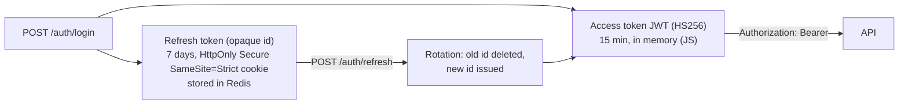

# 06 — REST API & Security

Base URL: `/api`. Format: JSON, dates in ISO-8601 UTC, GeoJSON for positions. API docs: Swagger UI at `/api/docs` (springdoc), disabled or protected in production.

## 1. Conventions

| Topic | Convention |
|---|---|
| Resource naming | plural kebab-case nouns (`/harvest-requests`, `/collection-rounds` → short alias `/rounds`) |
| State transitions | explicit action sub-resources (`POST /rounds/{id}/start`) instead of a generic PATCH of `status`, so each business rule has one entry point |
| Pagination | `?page=0&size=20&sort=createdAt,desc` → `PageResponse{content, page, size, totalElements}` |
| Errors | RFC 7807 `application/problem+json`: `{type, title, status, detail, instance, errors:[{field, message}], code}` |
| Concurrency | `version` in DTOs; on `OptimisticLockingFailureException` → **409** `code: STALE_VERSION` |
| Status codes | 200 OK, 201 Created (+ `Location`), 204 No Content, 400 validation, 401 unauthenticated, 403 wrong role, **404 for another user's resource** (no information leak), 409 conflict/state, 422 business rule, 429 rate limit |
| IDs | ObjectId hex strings |

## 2. Endpoint catalogue

Roles: **PUB** public, **F** farmer, **CM** collection manager, **TL** team leader, **LM** logistics manager, **MM** mill manager, **AD** admin. "own" means the service also checks ownership.

### Auth & accounts
| Method | Path | Roles | Description | FR |
|---|---|---|---|---|
| POST | `/auth/login` | PUB | login → access token + refresh cookie | — |
| POST | `/auth/refresh` | PUB (cookie) | rotate refresh token | — |
| POST | `/auth/logout` | any | revoke refresh token | — |
| GET | `/me` | any | profile + roles + `onboardingDone` | — |
| PATCH | `/me` | any | update phone, password, onboardingDone | NFR-3 |
| POST | `/registrations` | PUB | visitor registration request | FR-6.1 |
| GET | `/registrations?status=PENDING` | AD | list | FR-6.1 |
| POST | `/registrations/{id}/approve` · `/reject` | AD | approve → creates FARMER | FR-6.1 |
| GET/POST/PUT | `/users`, `/users/{id}` | AD | manage accounts | FR-6.2 |
| PUT | `/users/{id}/roles` · POST `/users/{id}/enable` · `/disable` | AD | rights | FR-6.2 |

### Orchards, varieties, map (F1, F4)
| Method | Path | Roles | Description | FR |
|---|---|---|---|---|
| GET | `/orchards` | F (own), CM, AD | list (farmer: only own) | FR-1.1 |
| POST | `/orchards` | F, AD | create with plots | FR-1.1 |
| GET/PUT/DELETE | `/orchards/{id}` | F own, CM (read), AD | detail / edit | FR-1.1 |
| GET | `/orchards/{id}/maturity?days=30` | F own, CM | maturity time series | FR-4.3 |
| GET | `/orchards/nearest?lng=&lat=` | F | own orchard nearest to GPS position (alert form) | FR-2.1 |
| GET | `/varieties` | PUB | reference list | — |
| GET | `/map/public?bbox=w,s,e,n&variety=&status=&maturityMin=&maturityMax=` | PUB | GeoJSON FeatureCollection **without personal data** | FR-4.1, 4.2, 4.4 |
| GET | `/map/private?bbox=…&layers=orchards,alerts,rounds` | F (own), CM, AD | enriched layers | FR-4.3 |

### Harvest requests (F1)
| Method | Path | Roles | Description | FR |
|---|---|---|---|---|
| POST | `/harvest-requests` | F | declare | FR-1.2 |
| GET | `/harvest-requests?status=&type=&mine=true` | F (own), CM | list / queue sorted by priority | FR-1.4 |
| GET | `/harvest-requests/{id}` | F own, CM, TL (if in their round) | detail + history | FR-1.8 |
| PUT | `/harvest-requests/{id}` | F own | modify (rules SD-4) | FR-1.3 |
| POST | `/harvest-requests/{id}/cancel` | F own | cancel | FR-1.3 |
| POST | `/harvest-requests/{id}/validate` · `/reject` | CM | review | FR-1.4 |

### Rounds & planning (F1, F3)
| Method | Path | Roles | Description | FR |
|---|---|---|---|---|
| GET | `/planning/suggestions?date=` | CM | priority-sorted groups, free resources, mill | FR-1.5 |
| POST | `/rounds` | CM | plan round (transaction + bookings) | FR-1.5 |
| GET | `/rounds?from=&to=&status=&teamLeaderId=` | CM, LM, TL (own) | calendar/list | FR-3.3 |
| GET | `/rounds/{id}` | CM, LM, TL own, MM (if delivering to their mill) | detail | — |
| PUT | `/rounds/{id}` | CM (PLANNED only) | modify stops/resources | FR-1.5 |
| POST | `/rounds/{id}/cancel` | CM | cancel + release bookings | — |
| POST | `/rounds/{id}/start` · `/complete` | TL own | lifecycle | FR-1.7 |
| PATCH | `/rounds/{id}/stops/{order}` | TL own | update stop (status, kg, crates) | FR-1.7 |

### Resources (F3)
| Method | Path | Roles | Description | FR |
|---|---|---|---|---|
| GET/POST/PUT/DELETE | `/workers`, `/workers/{id}` | LM (CM read) | seasonal workers | FR-3.1 |
| GET/POST/PUT/DELETE | `/equipment`, `/equipment/{id}` (`?type=BIN`) | LM (CM read) | tractors, bins, nets, shakers | FR-3.2 |
| POST | `/workers/{id}/unavailabilities`, `/equipment/{id}/unavailabilities` | LM | leave / maintenance | FR-3.2 |
| GET | `/resources/availability?start=&end=&type=` | CM, LM | free resources on a slot | FR-1.5 |
| GET | `/resources/calendar?resourceId=&from=&to=` | CM, LM | bookings + unavailabilities | FR-3.3 |
| GET/POST | `/supply-orders` | LM | list / create | FR-3.5 |
| POST | `/supply-orders/{id}/receive` | LM | mark received (stock `$inc`) | FR-3.5 |

### Alerts (F2)
| Method | Path | Roles | Description | FR |
|---|---|---|---|---|
| POST | `/alerts` (multipart: JSON + photo) | F | report | FR-2.1, 2.2 |
| GET | `/alerts?status=&type=&mine=true` | F (own), CM | list | FR-2.3 |
| POST | `/alerts/{id}/acknowledge` · `/resolve` · `/dismiss` | CM | handle | FR-2.4 |
| POST | `/alerts/{id}/create-urgent-request` | CM | one-click urgent request | FR-2.5 |
| GET | `/files/alerts/{fileId}` | F own, CM | photo (GridFS) | — |

### Mills (F1, F5)
| Method | Path | Roles | Description | FR |
|---|---|---|---|---|
| GET | `/mills` | any authenticated | list + capacity | — |
| PUT | `/mills/{id}/capacity` | MM (own mill), AD | publish available capacity | — |
| GET | `/mills/{id}/incoming` | MM own | rounds delivering today | — |
| POST | `/mills/{id}/receptions` | MM own | record weighing | SD-7 |
| GET | `/receptions?mine=true` | F (own), MM, CM | list receptions | FR-1.6 |

### Dashboard (F5)
| Method | Path | Roles | FR |
|---|---|---|---|
| GET | `/dashboard/summary?season=` | CM, MM, AD | KPI tiles |
| GET | `/dashboard/yield?season=&groupBy=orchard\|variety\|delegation` | CM, AD | FR-5.1 |
| GET | `/dashboard/lead-time?season=&groupBy=delegation\|week` | CM, AD | FR-5.2 |
| GET | `/dashboard/fill-rate?season=&groupBy=week\|bin\|round` | CM, MM, AD | FR-5.3 |
| GET | `/dashboard/mill-volumes?millId=&from=&to=` | MM (own), CM, AD | FR-5.4 |
| GET | `/dashboard/{kpi}/export.csv` | same as KPI | FR-5.6 |

### Notifications, imports, settings
| Method | Path | Roles | Description |
|---|---|---|---|
| GET | `/events` (SSE, `text/event-stream`) | any authenticated | real-time stream (token via cookie or `?ticket=` short-lived) |
| GET | `/notifications?unread=true` | any (own) | inbox |
| POST | `/notifications/{id}/read` · `/notifications/read-all` | own | — |
| GET | `/imports?dataset=&status=` | AD | import journal |
| GET | `/imports/{id}` | AD | details + rejected rows |
| POST | `/imports/run?type=REFERENCE\|DYNAMIC` | AD | manual trigger |
| POST | `/imports/upload` | AD | upload a CSV/JSON into the inbox |
| GET/PUT | `/settings` | AD | thresholds, parameters |
| GET | `/actuator/health`, `/actuator/prometheus` | internal network only (Nginx denies from outside) | monitoring |

## 3. DTO examples (the API contract)

```jsonc
// POST /api/harvest-requests  — HarvestRequestCreateDto
{ "orchardId": "6660…", "type": "URGENT", "desiredFrom": "2026-11-24", "desiredTo": "2026-11-27",
  "estimatedQuantityKg": 9000, "comment": "Rain forecast Friday" }

// 201 — HarvestRequestDto
{ "id": "6671…", "orchard": { "id": "6660…", "name": "Henchir El Mezraa", "delegation": "Sakiet Ezzit" },
  "type": "URGENT", "status": "SUBMITTED", "desiredFrom": "2026-11-24", "desiredTo": "2026-11-27",
  "estimatedQuantityKg": 9000, "priorityScore": 82.5, "roundId": null,
  "history": [ { "to": "SUBMITTED", "at": "2026-11-21T09:12:00Z", "by": "Ali Ben Ali" } ],
  "allowedActions": ["MODIFY", "CANCEL"], "version": 0 }
```

`allowedActions` is computed server-side from the state machine and the user's rights. The frontend uses it to show or hide buttons, so the rules exist in only one place.

```jsonc
// 409 example
{ "type": "https://oliveconnect.tn/errors/booking-conflict", "title": "Resource already booked",
  "status": 409, "code": "BOOKING_CONFLICT",
  "detail": "Bin B-07 is already booked by round T-2026-118 (07:00–15:00).",
  "conflicts": [ { "resourceId": "…", "resourceCode": "B-07", "roundCode": "T-2026-118" } ] }
```

## 4. Security design

### 4.1 Authentication



- Passwords hashed with **BCrypt** (strength 12). Password policy: 8+ characters. Temporary passwords must be changed at first login.
- JWT claims: `sub` = userId, `roles`, `millId` (for mill managers), `exp`. The secret comes from an environment variable and is never committed.
- Login rate limiting through Redis (5 failures in 15 min → 429).
- **SSE authentication**: `EventSource` cannot send headers, so the client first calls `POST /api/events/ticket`. That returns a one-time ticket stored in Redis for 30 s, which is then passed as `?ticket=`.

### 4.2 Authorisation: three levels

1. **URL level** (`SecurityFilterChain`): `/api/map/public/**`, `/api/varieties`, `/api/auth/**` and `POST /api/registrations` are `permitAll`. Everything else is `authenticated`. `/actuator/**` is denied except `health` (and Nginx only allows it from the internal network).
2. **Method level** (`@PreAuthorize("hasRole('COLLECTION_MANAGER')")`) on controllers.
3. **Data level (ownership)** in services. For example, `OrchardService.getForUser(id, user)` loads with `findByIdAndOwnerId(id, user.id())` when the user is only a FARMER. Missing → `NotFoundException` (404, not 403, so the existence of other farmers' data is never revealed). Mill managers are restricted to `assignedMillId`, team leaders to their own rounds.

### 4.3 Role × resource matrix

| Resource | Visitor | Farmer | Coll. mgr | Team leader | Logistics | Mill mgr | Admin |
|---|---|---|---|---|---|---|---|
| Public map (no personal data) | R | R | R | R | R | R | R |
| Orchards | – | CRUD own | R all | R (round stops) | – | – | CRUD |
| Harvest requests | – | C, R/U/cancel own | R, validate/reject | R (own rounds) | – | – | R |
| Rounds | – | R own stops (status only) | CRUD | R own, start/stops/complete | R | R (to their mill) | R |
| Workers / equipment | – | – | R | R (own round) | CRUD | – | CRUD |
| Bookings / calendar | – | – | CR | R own | CRUD | – | R |
| Supply orders | – | – | – | – | CRUD | – | R |
| Alerts | – | C, R own | R, handle | – | – | – | R |
| Mills / capacity | – | R | R | R | R | U own | CRUD |
| Receptions | – | R own | R | – | – | C/R own mill | R |
| Dashboard | – | (own yields on profile) | R | – | – | R (own mill) | R |
| Users / roles | C (registration) | R/U self | R/U self | R/U self | R/U self | R/U self | CRUD |
| Imports / settings | – | – | – | – | – | – | CRUD |

### 4.4 Other protections

- HTTPS everywhere, with HSTS (Nginx). CSP, `X-Content-Type-Options` and `Referrer-Policy` headers.
- Bean Validation on every DTO. Uploads are limited to `image/jpeg|png` and 5 MB, and stored as GridFS objects (never served from a path the user controls).
- MongoDB has auth enabled, an application user with the `readWrite` role on the `oliveconnect` DB only, and is not exposed outside the Docker network. Redis has a `requirepass` password and is not exposed either.
- Personal data minimisation: the public map DTO (`PublicOrchardFeature`) has no owner, phone or yield fields. A unit test asserts this.
- Audit: `createdBy`/`lastModifiedBy`, status history, and Log4j2 logs of security events (login failures, 403s).
