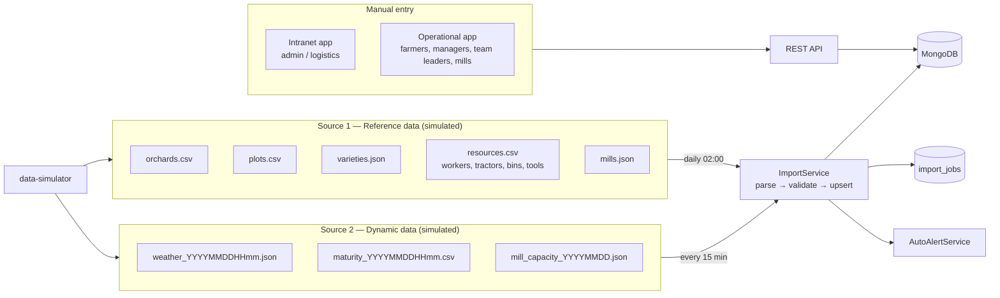
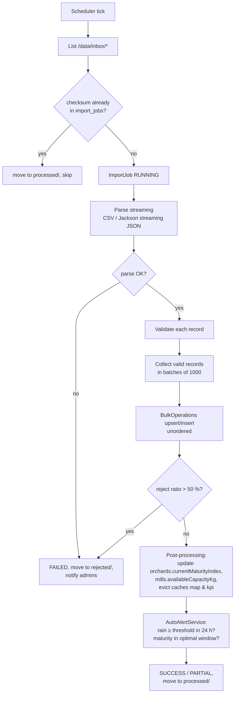

# 07 — Data Import & Intranet Enrichment (subject §III.2)

## 1. Three data sources



| Source | Datasets | Frequency | Target collection | Write mode |
|---|---|---|---|---|
| 1 (reference) | varieties, mills, orchards + plots, workers, equipment | daily (cron `0 0 2 * * *`) + manual trigger | `olive_varieties`, `mills`, `orchards`, `workers`, `equipment` | **upsert** on natural key (`code`, `externalRef`) — preserves manual enrichments on fields not provided by the source |
| 2 (dynamic) | weather, maturity, mill capacity | every 15 min (`fixedDelay`) | `weather_readings`, `maturity_readings` (insert), `mills.availableCapacityKg` (update), `orchards.currentMaturityIndex` (update, R11) | insert / targeted update |
| Manual | everything else (requests, rounds, alerts, receptions, enrichment) | real time | all | via API |

## 2. File formats (contract with the simulator)

**orchards.csv** (`;`-separated, UTF-8, header required)
```text
externalRef;name;memberNumber;lng;lat;delegation;plotCode;varietyCode;areaHa;treeCount;plantingYear;irrigated
ORC-0001;Henchir El Mezraa;ADH-0421;10.7603;34.7998;Sakiet Ezzit;P1;CHEMLALI;4.5;450;1998;false
ORC-0001;Henchir El Mezraa;ADH-0421;10.7603;34.7998;Sakiet Ezzit;P2;CHETOUI;1.2;180;2015;true
```
Rows are grouped by `externalRef`, and each group becomes one orchard document with its `plots[]` (rule R2).

**weather_202611210615.json**
```json
{ "generatedAt": "2026-11-21T06:15:00Z", "source": "SIM-WEATHER",
  "readings": [ { "stationId": "SFX-03", "delegation": "Sakiet Ezzit", "timestamp": "2026-11-21T06:15:00Z",
                  "temperatureC": 14.2, "humidityPct": 81, "rainfallMm": 2.4, "windKmh": 12 } ] }
```

**maturity_202611210600.csv**
```text
orchardExternalRef;timestamp;maturityIndex;source
ORC-0001;2026-11-21T06:00:00Z;3.8;SENSOR
```

**mill_capacity_20261121.json**
```json
{ "date": "2026-11-21", "mills": [ { "millCode": "MIL-SFX-01", "dailyCapacityKg": 60000, "availableCapacityKg": 42000 } ] }
```

## 3. Conformity checks (validation rules)

| Level | Rule | Example of rejection reason |
|---|---|---|
| File | allowed extension, file name pattern, UTF-8, size < 20 MB, header present | `FILE_FORMAT: missing column 'lat'` |
| File | **idempotency**: SHA-256 checksum not already imported | skipped, not an error |
| Record — types | number/date parsing, enum values | `line 14, maturityIndex: 'abc' is not a number` |
| Record — ranges | lng ∈ [7, 12], lat ∈ [30, 38] (Tunisia bbox); maturityIndex ∈ [0, 7]; rainfall ≥ 0; humidity ∈ [0, 100]; areaHa > 0; capacity ≥ 0; timestamp not in the future (> 1 h) | `line 3, lat: 48.85 outside Tunisia` |
| Record — references | `varietyCode` exists; `orchardExternalRef` exists; `memberNumber` matches a FARMER (or the orchard is created unassigned and flagged) | `line 7, varietyCode 'XYZ' unknown` |
| Record — consistency | sum of plot areas ≤ declared orchard area + 5 %; duplicate (same meta + timestamp) | `duplicate reading` |

Each rejected record becomes an `ImportError {line, field, reason}`. The job ends with `SUCCESS` (0 rejects), `PARTIAL` (some rejects) or `FAILED` (the file is unusable or more than 50 % of records were rejected; in that case **nothing is committed**).

## 4. Processing pipeline



**Implementation**

- `ImportScheduler` uses `@Scheduled` with **ShedLock**, backed by MongoDB, so that only one instance runs a given import when the API is scaled.
- `ImportService` holds one `DatasetImporter<T>` strategy per dataset (`OrchardCsvImporter`, `WeatherJsonImporter`…). Each one implements `parse`, `validate` and `persist`, so adding a dataset only means adding a bean (open/closed principle).
- Batch writes use `MongoTemplate.bulkOps(BulkMode.UNORDERED, …)`, which handles 10⁵ readings in seconds.
- **Spring Batch** is a possible alternative: it brings restartable chunked steps, but more configuration. We keep the lighter design and mention Spring Batch in the report as a possible improvement.
- Automatic alert rules come from `system_settings`: `rainAlertMm24h` (default 20), and maturity entering `[optimalMaturityMin, optimalMaturityMax]` of the variety. A rule creates a `FieldAlert` with `source = SENSOR` only when no open alert of the same type exists for that orchard.

## 5. Data simulator (`data-simulator/`)

A small **Python script**, or a Spring profile `simulator` (Java is preferred if the group wants a single language). It:

1. generates the reference set once: around 1 500 orchards around Sfax (random points inside polygons of the delegations: Sakiet Ezzit, Sakiet Eddaier, El Ain, Agareb, Menzel Chaker, Jebeniana…), 5 mills, 300 workers, 60 tractors, 200 bins, the varieties, and 500 farmers;
2. writes dynamic files every N minutes into the shared inbox volume, with realistic patterns: maturity rises by about 0.05 per day and differs per variety, and rain events are random;
3. injects about 2 % **invalid records** on purpose (out-of-range values, unknown variety) to demonstrate the conformity checks;
4. offers a `--history` mode that generates 3 past seasons of `mill_receptions` and readings (10⁵–10⁶ documents), to show the dashboard and the index performance on massive data.

## 6. Intranet enrichment app

The subject requires "a small intranet application dedicated to enriching data about orchards, equipment and rounds". It is implemented as a **separate section of the same React app** (`/intranet/*`), reachable only by **ADMIN** and **LOGISTICS_MANAGER**. In production, Nginx can also restrict this path to the cooperative's IP range (`allow 41.x.x.0/24; deny all;`), which makes it a true intranet.

| Screen | Purpose |
|---|---|
| Orchards data grid | Fix imported orchards: move pin on map, edit plots, assign owner (unassigned imports), boundary polygon drawing (Leaflet.draw) |
| Equipment data grid | Add serial numbers, capacities, maintenance notes |
| Rounds history | Correct quantities after the fact (with history entry), attach comments |
| Import journal | Upload a file manually, see runs, download rejected rows as CSV |
| Reference data | Varieties (optimal maturity window), delegations, thresholds (`system_settings`) |
