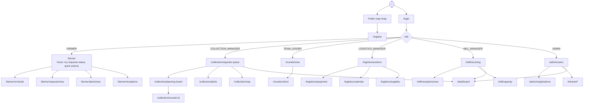

# 08 — Frontend (React + Vite + TypeScript)

## 1. Principles (subject §III.1)

| Requirement | Design response |
|---|---|
| Plain, readable, usable on a phone in the orchard | **Mobile-first** layout (360 px baseline); bottom tab bar for field roles (farmer, team leader); large buttons (≥ 44 px); high contrast for sunlight; minimal text |
| Short forms + automatic geolocation | ≤ 3 required inputs; GPS asked automatically on the alert and orchard forms; smart defaults (nearest orchard, estimate from last season, today + 3 days) |
| Permanent online help + guided tour | `?` button in the header opens a help drawer with content for the current route (Markdown files in `src/help/{route}.md`); **React Joyride** tour per role on first login (`onboardingDone=false`), can be replayed from the profile menu |
| Performance | Code-splitting per role (`React.lazy`), TanStack Query caching, map loads by bbox with debounce (300 ms), marker clustering |
| Weak network in the field | Team leader stop form keeps drafts in IndexedDB and retries; optional PWA (vite-plugin-pwa) for the app shell |
| Language | French UI (i18n via `react-i18next`, with an English and an Arabic file as a bonus). Code and docs in English |

## 2. Project structure

```text
frontend/
├── index.html
├── vite.config.ts            # proxy /api → http://localhost:8080 in dev
├── src/
│   ├── main.tsx, App.tsx      # router + providers (QueryClient, Mantine, Auth)
│   ├── api/                   # axios instance (JWT interceptor + refresh), typed clients per feature
│   ├── auth/                  # AuthContext, RequireRole, LoginPage
│   ├── components/            # Layout, BottomNav, HelpDrawer, MapView, StatusBadge, Timeline, ConfirmDialog
│   ├── features/
│   │   ├── public/            # PublicMapPage, RegistrationPage, AboutPage
│   │   ├── farmer/            # FarmerHome, OrchardsPage, OrchardForm, HarvestRequestForm, MyRequests, AlertForm, MyReceptions
│   │   ├── collection/        # RequestQueue, PlanningBoard, RoundForm, AlertsBoard, OperationsMap
│   │   ├── teamleader/        # MyRounds, RoundRunner (stop-by-stop)
│   │   ├── logistics/         # Workers, Equipment, ResourceCalendar, SupplyOrders
│   │   ├── mill/              # IncomingRounds, ReceptionForm, CapacityPage
│   │   ├── dashboard/         # DashboardPage + KPI charts
│   │   ├── notifications/     # NotificationBell, useEventStream (SSE)
│   │   ├── intranet/          # data grids, import journal, settings
│   │   └── admin/             # Users, Registrations
│   ├── help/                  # contextual help Markdown
│   ├── tours/                 # Joyride steps per role
│   └── types/                 # DTO types (generated from OpenAPI with openapi-typescript)
└── tests/                     # Vitest + Testing Library; e2e/ Playwright
```

DTO types are **generated from the backend OpenAPI spec** (`openapi-typescript`), so the frontend and API contracts cannot drift. This supports the consistency requirement.

## 3. Navigation per role



## 4. Key screens (wireframes)

**Farmer — declare harvest (mobile)**
```text
┌──────────────────────────┐
│ ← Declare a harvest   ?  │
├──────────────────────────┤
│ Orchard   [Henchir El ▼] │  ← preselected (nearest/last used)
│ Type   (•) Planned ( ) Urgent │
│ Dates  [24/11] → [27/11] │  ← default today+3 … +6
│ Estimate (kg) [ 9000 ]   │  ← prefilled from last season
│ Comment (optional)       │
│ [      SEND REQUEST     ]│
└──────────────────────────┘
 [Home] [Requests] [+Alert] [Notifs]
```

**Team leader — round runner**
```text
┌──────────────────────────┐
│ T-2026-118  ● IN PROGRESS│
│ Stop 2/5  Henchir El M.  │
│ [Navigate ↗]             │
│ Harvested kg  [ 3200 ]   │
│ Crates        [  80  ]   │
│ [ DONE ]  [ SKIP… ]      │
│ ○ Saved offline – will sync│
└──────────────────────────┘
```

**Collection manager — planning board (desktop)**: left pane = validated requests sorted by priority (badges URGENT / maturity), centre = map with the selected requests and suggested groups, right pane = round form (date, team leader, resources with free/busy indicators, mill with available capacity).

**Dashboard**: KPI tiles (season tonnage, avg yield kg/ha, avg lead time, avg fill rate), then charts: yield per delegation (bar), fill rate per week (line + 70 % threshold), lead time distribution (histogram), mill daily volumes (stacked bar), top/bottom orchards table with CSV export. Filters: season, period, variety, delegation.

## 5. Map (F4)

- **react-leaflet** with OpenStreetMap tiles and **Leaflet.markercluster**.
- Marker colour = `harvestStatus` (grey not harvested, blue scheduled, orange in progress, green harvested). A ring or opacity shows the maturity level. The icon differs per variety.
- The visible bbox is sent to `/api/map/public` on `moveend` (debounced). The response is GeoJSON. Zoom < 11 returns server-side clusters (aggregation by grid cell) to keep payloads small.
- Private layers (manager): open alerts (red pins, pulsing when NEW), today's rounds (polyline through the stops, ordered).

## 6. Real-time

The `useEventStream()` hook opens an `EventSource('/api/events?ticket=…')` after login. On each event it invalidates the matching TanStack Query keys (`['alerts']`, `['requests']`…) and shows a toast. It reconnects with backoff, and on reconnect it re-fetches unread notifications.
