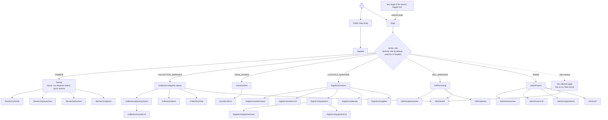

# 08 — Frontend (React + Vite + TypeScript)

## 1. Principles (subject §III.1)

| Requirement | Design response |
|---|---|
| Plain, readable, usable on a phone in the orchard | **Mobile-first** layout (360 px baseline); bottom tab bar for field roles (farmer, team leader); large buttons (≥ 44 px); high contrast for sunlight; minimal text |
| Short forms + automatic geolocation | ≤ 3 required inputs; GPS asked automatically on the alert and orchard forms; smart defaults (nearest orchard, estimate from last season, today + 3 days) |
| Permanent online help + guided tour | `?` button in the header opens a help drawer with content for the current route (Markdown files in `src/help/{route}.md`); **React Joyride** tour per role on first login (`onboardingDone=false`), can be replayed from the profile menu |
| Performance | Code-splitting per role (`React.lazy`), TanStack Query caching, map loads by bbox with debounce (300 ms), marker clustering |
| Weak network in the field | Team leader stop form keeps drafts in IndexedDB and retries; optional PWA (vite-plugin-pwa) for the app shell |
| Language | French UI (i18n via `react-i18next`, with an English and an Arabic file as a bonus). Code and docs in English |

**UI kit and theme**: **shadcn/ui** components on **Tailwind CSS v4**, with a custom olive theme defined as tokens on `:root`: olive primary, cream/stone background, terracotta accent, **Fraunces** headings, **IBM Plex Sans** body text and **IBM Plex Mono** numbers. Touch targets are large (≥ 44 px) and the theme is light mode only. Charts use Recharts through the shadcn chart component. Package manager: **pnpm**.

## 2. Project structure

Entries marked **(M0)** exist today. The others are planned for later milestones.

```text
frontend/
├── index.html                # (M0)
├── vite.config.ts            # (M0) proxy /api → http://localhost:$API_PORT in dev (default 8080), TanStack Router + Tailwind plugins, alias @ → src
├── components.json           # (M0) shadcn/ui configuration
├── Dockerfile, nginx.conf    # (M0) production image, see docs/10
├── src/
│   ├── main.tsx               # (M0) providers (QueryClient, AuthProvider, RouterProvider); restores the session from the refresh cookie before the first render (M1a)
│   ├── index.css              # (M0) Tailwind v4 import and olive theme tokens
│   ├── routeTree.gen.ts       # (M0) generated by the TanStack Router plugin, do not edit
│   ├── routes/                # TanStack Router file-based routes: __root.tsx, index.tsx (status page), login.tsx, _app.tsx (pathless layout with the login guard, adds no URL segment) and one _app.*.tsx file per Role home (M1a): _app.farmer.tsx, _app.collection.requests.tsx, _app.rounds.mine.tsx, _app.logistics.workers.tsx, _app.mill.incoming.tsx; the Admin's Users pages (M1b): _app.admin.users.index.tsx (list), _app.admin.users.new.tsx, _app.admin.users.$id.tsx; the Logistics pages (M4): _app.logistics.workers.index.tsx (replaces the placeholder), _app.logistics.workers.new.tsx, _app.logistics.workers.$id.tsx, _app.logistics.equipment.index.tsx, _app.logistics.equipment.new.tsx, _app.logistics.equipment.$id.tsx
│   ├── lib/                   # (M0) api.ts (fetch wrapper under /api + typed calls, JWT and refresh added with M1), utils.ts (cn helper)
│   ├── auth/                  # (M1a) AuthContext, session (in memory), refresh, roles (Role labels, ROLE_PRIORITY, ROLE_HOME, priorityRole, activeRole), activeRole (localStorage), nav (NAV per Active role), redirect (safeRedirect), types (hand-written Role union); unit tests *.test.ts (Vitest)
│   ├── admin/                 # (M1b) users.ts (API calls, Delegation labels, server field errors mapped to the form, banner messages), UserForm.tsx (one form for new and edit, Farmer profile section, Enable / Disable); unit tests users.test.ts (Vitest). Planned: Registrations
│   ├── logistics/             # (M4) resources.ts (all Worker / Equipment / Unavailability API types and calls, enum labels, small pure helpers), WorkerForm.tsx and EquipmentForm.tsx (one form for new and edit, the equipment fields follow the type), UnavailabilityPanel.tsx (list + add form), Field.tsx, Pager.tsx; unit tests resources.test.ts (Vitest)
│   ├── components/            # (M1a) AppLayout (header, side nav, bottom nav), RequireRole, RoleHome, PublicPage. Planned: HelpDrawer, MapView, StatusBadge, Timeline, ConfirmDialog
│   │   └── ui/                # (M0) shadcn/ui components: badge, button, card, input, label (more are added with the CLI when needed)
│   ├── features/
│   │   ├── public/            # PublicMapPage, RegistrationPage, AboutPage
│   │   ├── farmer/            # FarmerHome, OrchardsPage, OrchardForm, HarvestRequestForm, MyRequests, AlertForm, MyReceptions
│   │   ├── collection/        # RequestQueue, PlanningBoard, RoundForm, AlertsBoard, OperationsMap
│   │   ├── teamleader/        # MyRounds, RoundRunner (stop-by-stop)
│   │   ├── logistics/         # ResourceCalendar, SupplyOrders (Workers and Equipment: see src/logistics/, M4)
│   │   ├── mill/              # IncomingRounds, ReceptionForm, CapacityPage
│   │   ├── dashboard/         # DashboardPage + KPI charts (Recharts)
│   │   ├── notifications/     # NotificationBell, useEventStream (SSE)
│   │   └── intranet/          # data grids, import journal, settings
│   ├── help/                  # contextual help Markdown
│   ├── tours/                 # Joyride steps per role
│   └── types/                 # DTO types (generated from OpenAPI with openapi-typescript)
└── tests/                     # Testing Library component tests; e2e/ Playwright
```

Unit tests of pure functions (Vitest, `pnpm test`) sit next to the code in `src/auth/*.test.ts`.

The `Role` type is a **hand-written union** in `src/auth/types.ts` with the same values as the Java `Role` enum. The other DTO types are planned to be **generated from the backend OpenAPI spec** (`openapi-typescript`), so the frontend and API contracts cannot drift. This supports the consistency requirement.

## 3. Navigation per role

The route `/` is a temporary public status page (API, MongoDB, Redis, version, from `GET /api/system/status`) with a "Log in" link, or "Go to my home" when the User is logged in. It is replaced by the real landing page in a later milestone.

**Role priority** (highest first): ADMIN > COLLECTION_MANAGER > MILL_MANAGER > LOGISTICS_MANAGER > TEAM_LEADER > FARMER. After login the User lands on the Role home of the **Active role**: the role chosen in the switcher if the User still holds it, else the priority role.

**Layout** (`_app.tsx`, one for every role): a header (logo, role switcher, logout), a **bottom nav below `md`** (touch targets ≥ 44 px) and a **side nav from `md`**. The entries come from the Active role (`NAV` in `src/auth/nav.ts`). `/` and `/login` are public and do not use this layout.

**Role switcher**: a dropdown in the header, shown only when the User has 2 or more roles. It is **UI only**: it changes the home and the navigation, never the API's rights (the JWT always carries every role). The choice is kept in `localStorage` (wrapped in try/catch) and cleared on logout. If it is missing or no longer valid, the app falls back to the priority role.

**Guards**:
- The layout's `beforeLoad` sends a logged-out User to `/login?redirect=<path>`. After login the User goes to `redirect` if it is a path of this app (starts with `/`, not `//`), else to the Role home of the Active role.
- A logged-in User who opens `/login` is redirected to their Role home.
- Each Role home is wrapped in `RequireRole`. A User without the role sees a **"Not allowed" page** (inside the layout, with a link to their Role home), not a redirect. The API checks the roles again.

In M1a the six Role homes were placeholders ("Coming in M…"). In M1b `/admin/users` became real: a list with role and status filters and pagination (cards on mobile), `/admin/users/new` and `/admin/users/$id` sharing one form. The Farmer profile section appears when FARMER is ticked, and Enable / Disable are on the detail page (Disable asks for confirmation). Server field errors (`errors[]`) are shown on the matching fields, and 409 / 422 errors as messages. In M4 the Logistics manager gets `/logistics/workers` and `/logistics/equipment` with the same pattern: list with filters (`active` for workers, `type` and `status` for equipment), pagination, cards on mobile, `/new` and `/$id` pages sharing one form. The equipment form adapts to the type (Tractor: plate number, power; Bin: serial number, capacity; Net and Shaker: stock quantity, tool type is the type). The type is read-only on an existing equipment. The detail pages list the unavailabilities and have an add form (end after start, checked on the client and by the API). Delete asks for confirmation. The navigation has two entries, Workers and Equipment. The routes below the homes are planned for later milestones.



## 4. Key screens (wireframes)

**Farmer — declare harvest (mobile)**
```text
┌──────────────────────────┐
│ ← Declare a harvest   ?  │
├──────────────────────────┤
│ Orchard   [Henchir El ▼] │  ← preselected (nearest/last used)
│ Type   (•) Planned ( ) Urgent │
│ Dates  [24/11] → [27/11] │  ← default today+3 … +6
│ Estimate (kg) [ 9000 ]   │  ← prefilled from last season
│ Comment (optional)       │
│ [      SEND REQUEST     ]│
└──────────────────────────┘
 [Home] [Requests] [+Alert] [Notifs]
```

**Team leader — round runner**
```text
┌──────────────────────────┐
│ T-2026-118  ● IN PROGRESS│
│ Stop 2/5  Henchir El M.  │
│ [Navigate ↗]             │
│ Harvested kg  [ 3200 ]   │
│ Crates        [  80  ]   │
│ [ DONE ]  [ SKIP… ]      │
│ ○ Saved offline – will sync│
└──────────────────────────┘
```

**Collection manager — planning board (desktop)**: left pane = validated requests sorted by priority (badges URGENT / maturity), centre = map with the selected requests and suggested groups, right pane = round form (date, team leader, resources with free/busy indicators, mill with available capacity).

**Dashboard**: KPI tiles (season tonnage, avg yield kg/ha, avg lead time, avg fill rate), then charts: yield per delegation (bar), fill rate per week (line + 70 % threshold), lead time distribution (histogram), mill daily volumes (stacked bar), top/bottom orchards table with CSV export. Filters: season, period, variety, delegation.

## 5. Map (F4)

- **react-leaflet** with OpenStreetMap tiles and **Leaflet.markercluster**.
- Marker colour = `harvestStatus` (grey not harvested, blue scheduled, orange in progress, green harvested). A ring or opacity shows the maturity level. The icon differs per variety.
- The visible bbox is sent to `/api/map/public` on `moveend` (debounced). The response is GeoJSON. Zoom < 11 returns server-side clusters (aggregation by grid cell) to keep payloads small.
- Private layers (manager): open alerts (red pins, pulsing when NEW), today's rounds (polyline through the stops, ordered).

## 6. Real-time

The `useEventStream()` hook opens an `EventSource('/api/events?ticket=…')` after login. On each event it invalidates the matching TanStack Query keys (`['alerts']`, `['requests']`…) and shows a toast. It reconnects with backoff, and on reconnect it re-fetches unread notifications.
