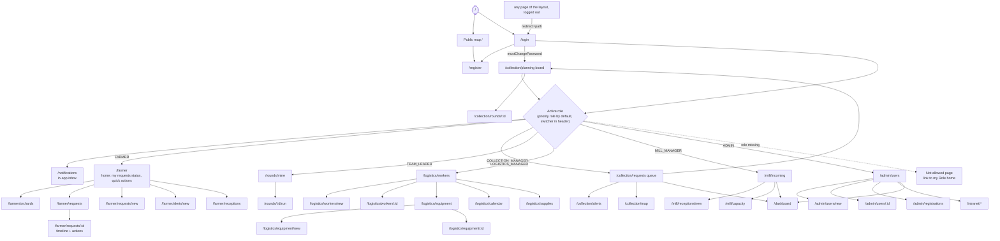

# 08 — Frontend (React + Vite + TypeScript)

## 1. Principles (subject §III.1)

| Requirement | Design response |
|---|---|
| Plain, readable, usable on a phone in the orchard | **Mobile-first** layout (360 px baseline); bottom tab bar for field roles (farmer, team leader); large buttons (≥ 44 px); high contrast for sunlight; minimal text |
| Short forms + automatic geolocation | ≤ 3 required inputs; GPS asked automatically on the alert and orchard forms; smart defaults (nearest orchard, estimate from last season, today + 3 days) |
| Permanent online help + guided tour | `?` button in the header opens a help drawer with content for the current route (Markdown files in `src/help/{route}.md`); **React Joyride** tour per role on first login (`onboardingDone=false`), can be replayed from the profile menu |
| Performance | Code-splitting per role (`React.lazy`), TanStack Query caching, map loads by bbox with debounce (300 ms), marker clustering |
| Weak network in the field | Team leader stop form keeps drafts in IndexedDB and retries; optional PWA (vite-plugin-pwa) for the app shell |
| Language | French UI (i18n via `react-i18next`, with an English and an Arabic file as a bonus). Code and docs in English |

**UI kit and theme**: **shadcn/ui** components on **Tailwind CSS v4**, with a custom olive theme defined as tokens on `:root`: olive primary, cream/stone background, terracotta accent, **Fraunces** headings, **IBM Plex Sans** body text and **IBM Plex Mono** numbers. Touch targets are large (≥ 44 px) and the theme is light mode only. Charts use Recharts through the shadcn chart component. Package manager: **pnpm**.

## 2. Project structure

Entries marked **(M0)** exist today. The others are planned for later milestones.

```text
frontend/
├── index.html                # (M0)
├── vite.config.ts            # (M0) proxy /api → http://localhost:$API_PORT in dev (default 8080), TanStack Router + Tailwind plugins, alias @ → src
├── components.json           # (M0) shadcn/ui configuration
├── Dockerfile, nginx.conf    # (M0) production image, see docs/10
├── src/
│   ├── main.tsx               # (M0) providers (QueryClient, AuthProvider, RouterProvider); restores the session from the refresh cookie before the first render (M1a)
│   ├── index.css              # (M0) Tailwind v4 import and olive theme tokens
│   ├── routeTree.gen.ts       # (M0) generated by the TanStack Router plugin, do not edit
│   ├── routes/                # TanStack Router file-based routes: __root.tsx, index.tsx (public map), login.tsx, register.tsx (public registration form, M9) and _app.tsx (pathless layout with the login guard; it also redirects a User with `mustChangePassword` to `/change-password`); M9 pages: _app.change-password.tsx (forced change of a temporary password) and _app.admin.registrations.tsx (list by status, approve with member number and delegation showing the temporary password once, reject); M1a role/layout pages: _app.farmer.tsx + _app.farmer.index.tsx, _app.collection.requests.tsx, _app.rounds.mine.tsx, _app.logistics.workers.tsx, _app.mill.incoming.tsx; M1b Admin Users pages: _app.admin.users.index.tsx (list), _app.admin.users.new.tsx, _app.admin.users.$id.tsx; M2 Farmer Orchard pages: _app.farmer.orchards.index.tsx, _app.farmer.orchards.new.tsx, _app.farmer.orchards.$id.tsx; M3 Farmer request pages: _app.farmer.requests.index.tsx, _app.farmer.requests.new.tsx, _app.farmer.requests.$id.tsx, the manager queue _app.collection.requests.tsx and _app.notifications.tsx; M4 Logistics pages: _app.logistics.workers.index.tsx, _app.logistics.workers.new.tsx, _app.logistics.workers.$id.tsx, _app.logistics.equipment.index.tsx, _app.logistics.equipment.new.tsx, _app.logistics.equipment.$id.tsx; M5 `_app.collection.planning.tsx` and the real `_app.rounds.mine.tsx`; M7 `_app.mill.incoming.tsx`, `_app.mill.receptions.new.tsx`, `_app.mill.capacity.tsx` and `_app.farmer.receptions.tsx`
│   ├── lib/                   # (M0) api.ts (fetch wrapper under /api + typed calls, JWT and refresh added with M1), utils.ts (cn helper)
│   ├── auth/                  # (M1a) AuthContext, session (in memory), refresh, roles (Role labels, ROLE_PRIORITY, ROLE_HOME, priorityRole, activeRole), activeRole (localStorage), nav (NAV per Active role), redirect (safeRedirect), types (hand-written Role union); unit tests *.test.ts (Vitest)
│   ├── admin/                 # (M1b) users.ts (API calls, Delegation labels, `setServerErrors` puts the server field errors on the form fields, banner messages), UserForm.tsx (React Hook Form; one form for new and edit, Farmer profile and mill assignment sections, Enable / Disable); unit tests users.test.ts (Vitest). registrations.ts (M9, registration API calls)
│   ├── logistics/             # (M4) resources.ts (all Worker / Equipment / Unavailability API types and calls, enum labels, small pure helpers), WorkerForm.tsx and EquipmentForm.tsx (React Hook Form; one form for new and edit, the equipment fields follow the type with `useWatch`), UnavailabilityPanel.tsx (list + add form, the end must be after the start via `validate`), Pager.tsx; unit tests resources.test.ts (Vitest)
│   ├── components/            # (M1a) AppLayout (header, side nav, bottom nav), RequireRole, RoleHome, PublicPage; Field (labelled input with its error, used with `register`) (M4); StatusBadge, Timeline (M3). Planned: HelpDrawer, MapView, ConfirmDialog
│   │   └── ui/                # (M0) shadcn/ui components: badge, button, card, input, label (more are added with the CLI when needed)
│   ├── features/
│   │   ├── public/            # PublicMapPage, RegistrationPage, AboutPage
│   │   ├── farmer/            # FarmerHome, OrchardsPage, OrchardForm, OrchardMap, orchard API (M2); HarvestRequestForm, MyRequests, HarvestRequestDetail, RequestActions, harvest request API/tests (M3); AlertForm; MyReceptions (M7)
│   │   ├── collection/        # RequestQueue, PlanningBoard, RoundForm, AlertsBoard, OperationsMap
│   │   ├── teamleader/        # MyRounds, RoundRunner (stop-by-stop)
│   │   ├── logistics/         # ResourceCalendar, SupplyOrders (Workers and Equipment: see src/logistics/, M4)
│   │   ├── mill/              # IncomingRounds, ReceptionForm, CapacityPage
│   │   ├── dashboard/         # DashboardPage + KPI charts (Recharts)
│   │   ├── notifications/     # NotificationBell, NotificationsPage, notification API/tests (M3); useEventStream (SSE, M8)
│   │   └── intranet/          # data grids, import journal, settings
│   ├── help/                  # contextual help Markdown
│   ├── tours/                 # Joyride steps per role
│   └── types/                 # DTO types (generated from OpenAPI with openapi-typescript)
└── tests/                     # Testing Library component tests; e2e/ Playwright
```

### Forms

All forms use **React Hook Form** (`react-hook-form`). There is no schema library (no Zod): keep it plain.

- Fields are wired with `register('name', rules)`. Client rules use the built-in options (`required`, `validate`); the server stays the source of truth, so most forms only declare the rules that are cheap and clear (for example "the end must be after the start").
- **One form component for "new" and "edit"**: it takes an optional entity and fills `defaultValues` from it.
- Inputs hold text; the request body is built in the `useMutation` function (`parseNumber`, `parseSkills`, `trim() || null`).
- Server field errors (400 `errors[]`) are put on the matching fields with `setError` (`setServerErrors` in `admin/users.ts`, the `farmerProfile.` prefix is removed). 409 and 422 stay a banner above the buttons (`errorBanner`); login keeps its own messages for 401 and 429.
- Fields that depend on another one (equipment type, FARMER role) read it with `useWatch`.
- Accessibility: each input has a `<Label htmlFor>` and `aria-invalid` when it has an error; the layout stays one column at 360 px.

Unit tests of pure functions (Vitest, `pnpm test`) sit next to the code in `src/auth/*.test.ts`.

The `Role` type is a **hand-written union** in `src/auth/types.ts` with the same values as the Java `Role` enum. The other DTO types are planned to be **generated from the backend OpenAPI spec** (`openapi-typescript`), so the frontend and API contracts cannot drift. This supports the consistency requirement.

## 3. Navigation per role

The route `/` is a temporary public status page (API, MongoDB, Redis, version, from `GET /api/system/status`) with a "Log in" link, or "Go to my home" when the User is logged in. It is replaced by the real landing page in a later milestone.

**Role priority** (highest first): ADMIN > COLLECTION_MANAGER > MILL_MANAGER > LOGISTICS_MANAGER > TEAM_LEADER > FARMER. After login the User lands on the Role home of the **Active role**: the role chosen in the switcher if the User still holds it, else the priority role.

**Layout** (`_app.tsx`, one for every role): a header (logo, role switcher, logout), a **bottom nav below `md`** (touch targets ≥ 44 px) and a **side nav from `md`**. The entries come from the Active role (`NAV` in `src/auth/nav.ts`). `/` and `/login` are public and do not use this layout.

**Role switcher**: a dropdown in the header, shown only when the User has 2 or more roles. It is **UI only**: it changes the home and the navigation, never the API's rights (the JWT always carries every role). The choice is kept in `localStorage` (wrapped in try/catch) and cleared on logout. If it is missing or no longer valid, the app falls back to the priority role.

**Guards**:
- The layout's `beforeLoad` sends a logged-out User to `/login?redirect=<path>`. After login the User goes to `redirect` if it is a path of this app (starts with `/`, not `//`), else to the Role home of the Active role.
- A logged-in User who opens `/login` is redirected to their Role home.
- Each Role home is wrapped in `RequireRole`. A User without the role sees a **"Not allowed" page** (inside the layout, with a link to their Role home), not a redirect. The API checks the roles again.

In M1a the six Role homes were placeholders ("Coming in M…"). In M1b `/admin/users` became real: a list with role and status filters and pagination (cards on mobile), `/admin/users/new` and `/admin/users/$id` sharing one form. The Farmer profile section appears when FARMER is ticked, and Enable / Disable are on the detail page (Disable asks for confirmation). Server field errors (`errors[]`) are shown on the matching fields, and 409 / 422 errors as messages.

M2 makes `/farmer/orchards` real. The Farmer navigation contains Home and Orchards, with
`/farmer/orchards/new` for the GPS-assisted form and `/farmer/orchards/$id` for editing. The
form uses a Leaflet map picker, asks `navigator.geolocation` for an initial position, supports
bounded plot rows, and displays the server-computed area, tree count and main variety on the
mobile-first list. Loading, empty, validation and API error states remain visible without
leaving the role layout. M2 renders the farmer's bounded orchard list with simple Leaflet
markers; marker clustering remains part of the later public bbox map work.

M3 makes the harvest flow real. Farmers use `/farmer/requests` to review status timelines,
`/farmer/requests/new` to declare a request, and `/farmer/requests/$id` to modify or cancel a
request while the API reports the action rules. Collection managers review the priority-sorted
queue at `/collection/requests` and validate or reject submitted requests with a required reason.
The header contains a notification bell for every authenticated role, and `/notifications`
polls the in-app inbox every 30 seconds; SSE remains a later M8 concern. M3 labels and validation
messages are French, quantity fields stay text-backed until the mutation parses them, the rejection
form uses React Hook Form, and action buttons are rendered only from the API's `allowedActions`.

M4 adds Worker and Equipment pages for the Logistics manager and Admin (full CRUD in the API), with
filters, pagination, mobile cards, shared `/new` and `/$id` forms, and unavailability panels.
Equipment fields adapt to the selected type and the type is read-only when editing. Delete asks
for confirmation. The navigation has Workers and Equipment entries for both roles; the Collection
manager can read those resources through the API but gets no page in M4. `RequireRole` accepts a
list of roles. All forms use React Hook Form with field-level server errors and accessible labels.

M5 makes `/collection/planning` real for collection managers: validated requests are shown in a
priority-sorted list and map, the helper suggests nearby groups, and the round form checks the
selected date/time, team leader, workers, equipment and mill before saving. The form keeps a
low-capacity mill as a visible warning, while booking conflicts and stale edits remain actionable
errors. Team leaders use `/rounds/mine` to inspect their assigned rounds and ordered stops; field
execution controls remain reserved for M6.

M6 makes `/rounds/:id/run` real for team leaders. The mobile runner starts the round on its
scheduled date, opens turn-by-turn navigation for each stop, records harvested kilograms and
crates, or records a skip reason, then closes the round. Stop drafts and failed mutations are kept
in IndexedDB in FIFO order and retried when the browser reports that the network is back; the
runner always shows the offline and pending-sync state at the 360 px baseline.

M7 makes the mill workflow real. Mill managers see today's rounds delivering to their assigned
mill at `/mill/incoming`, open `/mill/receptions/new` for a round stop, choose a bin, enter gross
and tare weights and a quality grade, and see the computed net weight/fill rate before submitting.
`/mill/capacity` publishes available capacity. Farmers use `/farmer/receptions` to see only their
own recorded receptions, including the final weight, fill rate, quality and traceability fields.
The UI keeps the API authoritative for round/bin ownership, duplicate weighing and weight limits;
the forms remain French, mobile-first and usable at the 360 px baseline.



## 4. Key screens (wireframes)

**Farmer — declare harvest (mobile)**
```text
┌──────────────────────────┐
│ ← Declare a harvest   ?  │
├──────────────────────────┤
│ Orchard   [Henchir El ▼] │  ← preselected (nearest/last used)
│ Type   (•) Planned ( ) Urgent │
│ Dates  [24/11] → [27/11] │  ← default today+3 … +6
│ Estimate (kg) [ 9000 ]   │  ← prefilled from last season
│ Comment (optional)       │
│ [      SEND REQUEST     ]│
└──────────────────────────┘
 [Home] [Requests] [+Alert] [Notifs]
```

**Team leader — round runner**
```text
┌──────────────────────────┐
│ T-2026-118  ● IN PROGRESS│
│ Stop 2/5  Henchir El M.  │
│ [Navigate ↗]             │
│ Harvested kg  [ 3200 ]   │
│ Crates        [  80  ]   │
│ [ DONE ]  [ SKIP… ]      │
│ ○ Saved offline – will sync│
└──────────────────────────┘
```

The runner first records `IN_PROGRESS` when the team arrives, so the documented
`PENDING → IN_PROGRESS → DONE` stop transition remains explicit. `SKIPPED` requires a reason.

**Collection manager — planning board (desktop)**: left pane = validated requests sorted by priority (badges URGENT / maturity), centre = map with the selected requests and suggested groups, right pane = round form (date, team leader, resources with free/busy indicators, mill with available capacity).

**Dashboard**: KPI tiles (season tonnage, avg yield kg/ha, avg lead time, avg fill rate), then charts: yield per delegation (bar), fill rate per week (line + 70 % threshold), lead time distribution (histogram), mill daily volumes (stacked bar), top/bottom orchards table with CSV export. Filters: season, period, variety, delegation.

## 5. Map (F4)

- **react-leaflet** with OpenStreetMap tiles. Clustering is done by the server (grid cells with a `count`), which the page draws as numbered markers; Leaflet.markercluster is not used, to avoid clustering twice.
- Marker colour = `harvestStatus` (grey not harvested, blue scheduled, orange in progress, green harvested). A ring or opacity shows the maturity level. The variety is shown in the marker popup.
- The page is the public home `/` (`PublicMapPage`, no login, no role navigation), centred on Sfax. The visible bbox and the zoom level are sent to `/api/map/public` on `moveend` (debounced 300 ms) with the filters `variety` (from `GET /varieties`), `status`, `delegation` (zone, labels from `DELEGATION_LABEL`), `maturityMin` and `maturityMax`. The response is GeoJSON; features with `cluster: true` and a `count` are clusters, the others are single orchards (`id`, `varietyCode`, `harvestStatus`, `maturityIndex`; no owner, no name). Zoom < 13 returns server-side clusters to keep payloads small: the API loads the matching orchards (at most 5000) and groups them into grid cells in Java, not in MongoDB. The map starts at zoom 11 and cannot be zoomed out below 10, so the bbox stays under the 4 degree limit of the API. The page has links to `/login` (or the Role home) and to `/register`.
- Private layers (manager): open alerts (red pins, pulsing when NEW), today's rounds (polyline through the stops, ordered).

## 6. Real-time

The `useEventStream()` hook opens an `EventSource('/api/events?ticket=…')` after login. On each event it invalidates the matching TanStack Query keys (`['alerts']`, `['requests']`…) and shows a toast. It reconnects with backoff, and on reconnect it re-fetches unread notifications.
