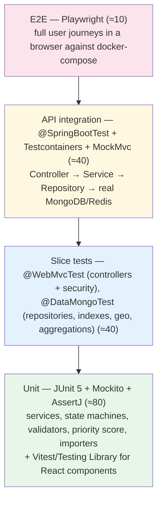

# 09 — Testing Strategy

The subject asks to "test the interaction with the frontend and the database part, illustrating **nominal and alternative scenarios**", with JUnit suggested.

## 1. Test pyramid



| Level | Tools | What it proves | Runs |
|---|---|---|---|
| Unit | JUnit 5, Mockito, AssertJ | Business rules in isolation (no Spring context) | every build |
| Repository | `@DataMongoTest` + Testcontainers `mongo:8` | Derived queries, `@Query`, geo queries, aggregation pipelines, **indexes used** (`explain()` asserts `IXSCAN`) | every build |
| Web/security | `@WebMvcTest` + `spring-security-test` (`@WithMockUser`) | Status codes, validation errors, role access (403), JSON shape | every build |
| Integration | `@SpringBootTest` + `MockMvc` + Testcontainers (Mongo replica set + Redis) | Full layers incl. transactions, cache, SSE | every build (CI) |
| Frontend | Vitest + React Testing Library + MSW (mocked API) | Forms, role-based rendering, error display. Built so far (M1a): Vitest unit tests of the pure auth functions (`priorityRole`, `activeRole` fallback, `safeRedirect`). M1b: Vitest tests of the user form's error mapping (`fieldMessages`, `errorBanner` in `admin/users.ts`) | every build |
| E2E | Playwright (mobile viewport 390×844 + desktop) | Real browser → Nginx → API → DB | before release |
| Load | **k6** | NFR-4: 100 concurrent users, map/search < 10 s | before release, on the VPS |
| Manual | Checklist on a real phone | Geolocation, usability in the field, guided tour | before demo |

Coverage target: **≥ 70 % line coverage on `service` packages** (JaCoCo report included in the report).

## 2. Scenario catalogue (nominal + alternative)

| ID | Use case | Scenario | Type | Level | Expected |
|---|---|---|---|---|---|
| T-SYS-1 | System status | `GET /api/system/status` with MongoDB and Redis running | Nominal | API | 200, `api`, `mongo`, `redis` = `UP`, `version` (`SystemStatusControllerTest`) |
| T-AUTH-1 | Login | valid credentials (seeded Admin) | Nominal | API | 200, access token, `user.roles` contains `ADMIN`, `refresh_token` cookie is `HttpOnly; Secure; SameSite=Strict; Path=/api/auth` (`AuthControllerTest`, `RefreshTokenTest`) |
| T-AUTH-2 | Login | wrong password ×6 | Alternative | API | 401 ×5 then 429 `TOO_MANY_ATTEMPTS` + `Retry-After` (`LoginRateLimitTest`, `LoginRateLimiterTest`) |
| T-AUTH-12 | Login | 5 failures then the right password | Alternative | API | 429 (still blocked) (`LoginRateLimitTest`) |
| T-AUTH-13 | Login | 4 failures, a success, 5 failures | Alternative | API | 401 ×5 (counter reset) (`LoginRateLimitTest`) |
| T-AUTH-3 | Login | disabled account (also wrong password, unknown email) | Alternative | API | 401 `INVALID_CREDENTIALS`, same message for all three (`AuthControllerTest`) |
| T-AUTH-4 | Refresh | refresh with the cookie, then again with the old cookie | Alternative | API | 200 with a new access token and a new cookie value; the old cookie gets 401 `SESSION_EXPIRED` (`RefreshTokenTest`) |
| T-AUTH-5 | Logout | logout, then refresh with that cookie, then logout again | Alternative | API | 204 (cookie cleared), refresh 401, second logout 204 (`RefreshTokenTest`) |
| T-AUTH-6 | Disable | Admin disables a User, then the User tries to refresh and log in; the Admin enables them again | Alternative | API | disable 204, old refresh cookie 401, login 401; after enable, login 200 (`UserControllerTest`) |
| T-AUTH-9 | Refresh | no cookie | Alternative | API | 401 `UNAUTHENTICATED` (`RefreshTokenTest`) |
| T-AUTH-10 | Refresh | User disabled in the database after login | Alternative | API | 401 and the Redis set `user:{id}:refresh` is gone (`RefreshTokenTest`) |
| T-AUTH-11 | Refresh | roles changed in the database after login | Nominal | API | `user.roles` in the response are the current ones (`RefreshTokenTest`) |
| T-AUTH-7 | Login | blank email | Alternative | API | 400 `VALIDATION_FAILED` with `errors[]` (`AuthControllerTest`) |
| T-AUTH-8 | Startup | seeding run twice | Alternative | API | one Admin, `createdBy` = `system`; the `users` indexes exist (`AdminSeederTest`) |
| T-SEC-5 | Any | `GET /api/me` without a token (or with a garbage token) | Alternative | API | 401 `UNAUTHENTICATED`; with a valid token 200 `MeDto` (`AuthControllerTest`) |
| T-SEC-6 | Me | valid token whose User was deleted | Alternative | API | 401 `UNAUTHENTICATED` (`AuthControllerTest`) |
| T-SEC-1 | Any | farmer reads another farmer's orchard | Alternative | API | **404** |
| T-ORCH-1 | Manage orchards | farmer creates an orchard with two valid plots | Nominal | API + unit | 201, totals recomputed, owner snapshot stored (`OrchardControllerTest`, `OrchardTest`) |
| T-ORCH-2 | Manage orchards | another farmer reads the orchard URL | Alternative | API | 404 `NOT_FOUND` (`OrchardControllerTest`) |
| T-ORCH-3 | Manage orchards | plot has an out-of-range area | Alternative | API | 400 `VALIDATION_FAILED` (`OrchardControllerTest`) |
| T-ORCH-4 | Manage orchards | GPS point is outside Tunisia | Alternative | API | 400 `VALIDATION_FAILED` (`OrchardControllerTest`) |
| T-ORCH-5 | Manage orchards | collection manager lists farmers' orchards | Nominal | API | all orchards are returned (`OrchardControllerTest`) |
| T-ORCH-6 | Reference data | variety list is read twice after the first request | Nominal | API | second response is served from `cache:varieties::all` (`OrchardControllerTest`) |
| T-SEC-2 | Any | farmer calls `POST /rounds` | Alternative | Web | 403 |
| T-SEC-3 | Public map | response contains no owner/phone/yield fields | Nominal | Web | JSON has no such keys |
| T-SEC-4 | Users | Farmer calls `GET /users`, `GET /users/{id}` and `POST /users/{id}/disable` | Alternative | API | 403 `FORBIDDEN` on each (`UserControllerTest`) |
| T-USR-1 | Create user | Admin creates a Farmer with a profile | Nominal | API | 201 with `Location` (`UserControllerTest`) |
| T-USR-2 | Create user | email already used (any letter case) | Alternative | API | 409 `EMAIL_TAKEN` (`UserControllerTest`) |
| T-USR-3 | Create user | FARMER role without a Farmer profile | Alternative | API | 400 `VALIDATION_FAILED` (`UserControllerTest`) |
| T-USR-4 | Disable user | Admin disables themselves | Alternative | API | 422 `SELF_LOCKOUT` (`UserControllerTest`) |
| T-USR-5 | Create user | email sent with spaces and capitals | Alternative | API | 201, email stored trimmed and lowercased (`UserControllerTest`) |
| T-USR-6 | Create user | blank phone | Alternative | API | 201, no phone stored (`UserControllerTest`) |
| T-USR-7 | Create user | Farmer profile with `delegation: null` | Alternative | API | 400 `VALIDATION_FAILED`, field `farmerProfile.delegation` (`UserControllerTest`) |
| T-HR-1 | Declare request | valid planned request | Nominal | API | 201, status SUBMITTED, manager notified |
| T-HR-2 | Declare request | `desiredTo < desiredFrom` | Alternative | API + Web | 400 with field error |
| T-HR-3 | Declare request | orchard already has an active request | Alternative | API | 409 |
| T-HR-4 | Cancel | request SCHEDULED, round PLANNED | Nominal | API | 200, stop removed from round |
| T-HR-5 | Cancel | round IN_PROGRESS | Alternative | API | 409 |
| T-HR-6 | Modify | concurrent edit (stale version) | Alternative | API | 409 STALE_VERSION |
| T-HR-7 | Validate/reject | reject without reason | Alternative | Web | 400 |
| T-RD-1 | Plan round | free resources, mill capacity OK | Nominal | API | 201, bookings created, requests SCHEDULED, farmers notified |
| T-RD-2 | Plan round | bin already booked on overlapping slot | Alternative | API | 409 BOOKING_CONFLICT, **nothing persisted** (transaction rollback) |
| T-RD-3 | Plan round | request not VALIDATED | Alternative | API | 422 |
| T-RD-4 | Plan round | estimate > mill capacity | Alternative | API | 201 + warning MILL_CAPACITY_LOW |
| T-RD-5 | Plan round | two managers book same bin concurrently | Alternative | API | exactly one 201, one 409 |
| T-RD-6 | Run round | start by another team leader | Alternative | API | 403 |
| T-RD-7 | Run round | complete with pending stops | Alternative | API | 422 |
| T-RD-8 | Run round | full run: start → stops → complete | Nominal | API + E2E | statuses cascade to requests & orchards |
| T-AL-1 | Report alert | with GPS near orchard | Nominal | API | 201, SSE event received by manager |
| T-AL-2 | Report alert | GPS 5 km away | Alternative | Unit | `locationMismatch=true` |
| T-AL-3 | Report alert | photo too large / wrong type | Alternative | Web | 400 |
| T-AL-4 | Handle alert | create urgent request from MATURITY alert | Nominal | API | request URGENT created, alert RESOLVED |
| T-RS-1 | Resources | calendar of a bin for a week | Nominal | Repo | bookings + unavailabilities returned |
| T-RS-3 | Workers | logistics manager creates, reads, updates, filters and deletes a worker | Nominal | API | 201 with `Location`, 200, 204 then 404 (`ResourceControllerTest`) |
| T-RS-4 | Workers | worker with an existing `cin` | Alternative | API | 409 `CIN_TAKEN` (`ResourceControllerTest`) |
| T-RS-5 | Equipment | `GET /equipment` with a tractor, a bin and a tool | Nominal | API | each item has its own fields, `type` filter works (`ResourceControllerTest`) |
| T-RS-6 | Equipment | update, `status` filter, delete | Nominal | API | 200, 200, 204 then 404 (`ResourceControllerTest`) |
| T-RS-7 | Equipment | equipment with an existing `code` | Alternative | API | 409 `CODE_TAKEN` (`ResourceControllerTest`) |
| T-RS-8 | Equipment | `PUT` with another `type` | Alternative | API | 422 `EQUIPMENT_TYPE_IMMUTABLE` (`ResourceControllerTest`) |
| T-RS-9 | Equipment | `capacityKg` 0, `powerHp` < 0, `stockQuantity` < 0, field missing for the type, `dailyRate` < 0 | Alternative | API | 400 `VALIDATION_FAILED` (`ResourceControllerTest`) |
| T-RS-10 | Unavailability | add a period to a bin and to a worker | Nominal | API | 201 with the updated resource, `status` unchanged (`ResourceControllerTest`) |
| T-RS-11 | Unavailability | `to` not after `from` | Alternative | API | 400 `VALIDATION_FAILED` on field `to`, nothing stored (`ResourceControllerTest`; the rule itself in `ResourceServiceTest`) |
| T-RS-12 | Workers / equipment | collection manager | Alternative | API | GET 200, POST/PUT/DELETE 403 (`ResourceControllerTest`) |
| T-RS-13 | Workers / equipment | farmer and admin | Alternative | API | farmer 403 on every route, admin full access, no token 401 (`ResourceControllerTest`) |
| T-RS-2 | Supply order | receive → stock incremented | Nominal | API | `stockQuantity` += qty |
| T-ML-1 | Reception | valid weighing | Nominal | API | net & fillRate computed, capacity decremented, farmer notified |
| T-ML-2 | Reception | bin not part of round | Alternative | API | 422 |
| T-ML-3 | Reception | same bin/orchard twice | Alternative | Repo | duplicate key → 409 |
| T-ML-4 | Reception | mill manager of another mill | Alternative | API | 403 |
| T-IM-1 | Import | valid weather file | Nominal | API | SUCCESS, readings inserted |
| T-IM-2 | Import | file with 3 invalid lines | Alternative | Unit + API | PARTIAL, 3 ImportErrors with line numbers |
| T-IM-3 | Import | same file twice | Alternative | API | second run skipped (checksum) |
| T-IM-4 | Import | rain over threshold | Nominal | API | automatic RAIN alert created once |
| T-IM-5 | Import | > 50 % invalid | Alternative | API | FAILED, nothing committed |
| T-KPI-1 | Dashboard | fill rate per week on seeded data | Nominal | Repo | values equal to hand-computed fixture |
| T-KPI-2 | Dashboard | second call served from cache | Nominal | API | repository called once (spy) |
| T-MAP-1 | Map | bbox query | Nominal | Repo | only orchards inside bbox; `explain` shows 2dsphere IXSCAN |
| T-PERF-1 | Load | 100 VUs, 10 min, mixed scenario | NFR | k6 | p95 map < 2 s, p99 < 10 s, error rate < 1 % |

## 3. Examples

**Unit test of a state rule**
```java
@Test
void farmerCannotCancelWhenRoundStarted() {
    var round = aRound().status(IN_PROGRESS).build();
    var req = aRequest().status(SCHEDULED).roundId(round.getId()).farmerId(FARMER_ID).build();
    when(requests.findById(req.getId())).thenReturn(Optional.of(req));
    when(rounds.findById(round.getId())).thenReturn(Optional.of(round));

    assertThatThrownBy(() -> service.cancel(req.getId(), farmer(FARMER_ID), "changed my mind"))
        .isInstanceOf(ConflictException.class)
        .hasMessageContaining("already started");
    verify(requests, never()).save(any());
}
```

**Integration test with Testcontainers (transaction rollback)**
```java
@SpringBootTest
@AutoConfigureMockMvc
@Testcontainers
class PlanRoundIT {
    @Autowired MockMvc mockMvc;

    @Container @ServiceConnection
    static MongoDBContainer mongo = new MongoDBContainer("mongo:8"); // starts as replica set → transactions OK
    @Container @ServiceConnection(name = "redis")
    static GenericContainer<?> redis = new GenericContainer<>("redis:7-alpine").withExposedPorts(6379);

    @Test
    void conflictingBinBookingRollsBackEverything() throws Exception {
        var bin = fixtures.bin("B-07");
        fixtures.roundBooking(bin, "2026-11-25T07:00Z", "2026-11-25T15:00Z");
        var dto = planDto().bins(bin.getId()).date("2026-11-25").slot("10:00", "14:00").build();

        mockMvc.perform(post("/api/rounds")
                .header("Authorization", "Bearer " + tokenFor(COLLECTION_MANAGER))
                .contentType(APPLICATION_JSON).content(json(dto)))
            .andExpect(status().isConflict())
            .andExpect(jsonPath("$.code").value("BOOKING_CONFLICT"));

        assertThat(roundRepository.count()).isEqualTo(1);           // only the pre-existing one
        assertThat(harvestRequests.findAllById(dto.requestIds()))
            .allMatch(r -> r.getStatus() == VALIDATED);              // unchanged
    }
}
```

**Index usage test**
```java
@Test
void mapQueryUsesGeoIndex() {
    Document plan = mongoTemplate.getDb().runCommand(Document.parse("""
      { explain: { find: "orchards", filter: { location: { $geoWithin: { $box: [[10.6,34.7],[10.9,34.9]] } } } },
        verbosity: "queryPlanner" }"""));
    assertThat(plan.toJson()).contains("IXSCAN").contains("location_2dsphere").doesNotContain("COLLSCAN");
}
```

**k6 load scenario (excerpt)**
```js
export const options = {
  scenarios: { harvest_peak: { executor: 'ramping-vus', stages: [
      { duration: '2m', target: 100 }, { duration: '6m', target: 100 }, { duration: '2m', target: 0 } ] } },
  thresholds: { 'http_req_duration{name:map}': ['p(95)<2000', 'p(99)<10000'], http_req_failed: ['rate<0.01'] },
};
export default function () {
  const bbox = randomBboxAroundSfax();
  http.get(`${BASE}/api/map/public?bbox=${bbox}`, { tags: { name: 'map' } });
  http.get(`${BASE}/api/harvest-requests?mine=true`, auth(), { tags: { name: 'myRequests' } });
  sleep(Math.random() * 3);
}
```
The k6 run is done against the deployed VPS with the `--history` dataset loaded (10⁵+ receptions, 10⁶ readings). The Grafana screenshots from that run (CPU, heap, Mongo opcounters, p95 latency) go into the report.

## 4. CI

A GitHub Actions (or GitLab CI) pipeline runs on each push: `./mvnw verify` (unit, slice and Testcontainers tests, plus the JaCoCo report), then `pnpm install --frozen-lockfile && pnpm lint && pnpm test && pnpm build`, then the Docker image build (`docker compose -f deploy/docker-compose.yml build`). This is `.github/workflows/ci.yml`; the Mermaid render check is the separate `.github/workflows/docs.yml`. On the `main` branch it also runs the Playwright tests against `docker compose up`.
