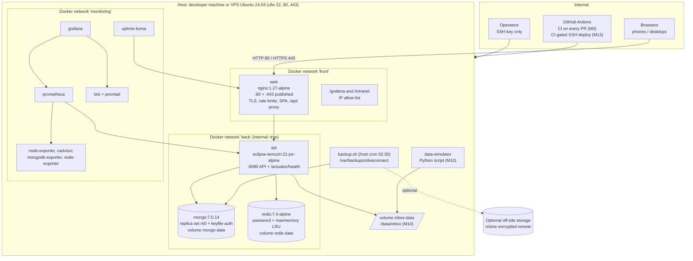
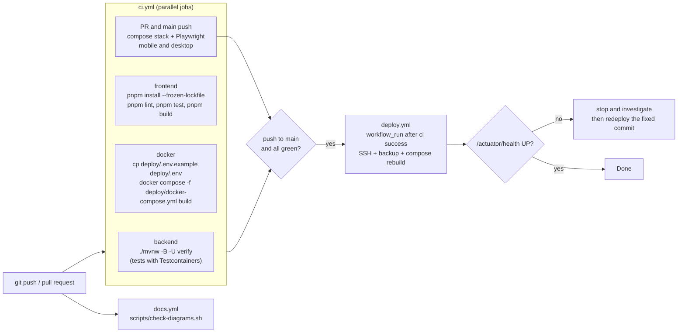
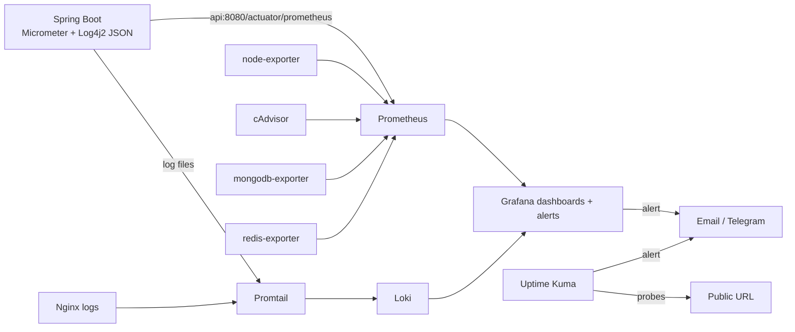

# 10 — Deployment, Backups & Monitoring (subject §V)

Target: a Linux VPS (Ubuntu Server 24.04 LTS, 2 vCPU / 4 GB RAM / 40 GB SSD is enough) running **Docker Compose**, reachable at `https://<domain>` (or `http://<IP>` for the demo, as the subject allows).

**Repository status.** M13 production configuration is implemented and validated locally. A real VPS run still needs the operator-provided domain, SSH secrets, notification destination and restore/load-test evidence.

| Status | Content |
|---|---|
| **Built (M0)** | `.github/workflows/ci.yml` (backend verify, frontend lint + test + build, Docker build), `.github/workflows/docs.yml` (Mermaid render), `backend/Dockerfile`, `frontend/Dockerfile`, `frontend/nginx.conf`, `deploy/docker-compose.yml` (production-like stack on port 80, runs locally), `deploy/docker-compose.dev.yml` (MongoDB + Redis only, for development). CI copies `deploy/.env.example` to `deploy/.env` before the build, because compose rejects the file without the secrets even for `build`. In M0, "done" means CI is green and the production compose stack works on a developer machine |
| **Built (M10)** | Import inbox volume `inbox-data` mounted on `api` at `/data/inbox`, Nginx upload limit `client_max_body_size 21m` on `/api/`. The data simulator is a script run by hand (`data-simulator/`), not a compose service |
| **Implemented (M13)** | Production-shaped VPS stack in `deploy/docker-compose.yml`, TLS/self-signed local fallback, Nginx hardening and rate limiting, Prometheus/Grafana/Loki/Promtail/exporters/Uptime Kuma, MongoDB authentication + generated keyfile, Redis password, `.env` secrets, backups/restore drill scripts, and CI-gated SSH deployment |

The VPS-specific secrets and evidence are deliberately not committed. `deploy/README.md` is the operator runbook; this document records the design and its checked-in implementation.

## 1. Deployment diagram

All service boxes and flows below exist in `deploy/docker-compose.yml`. The simulator remains a developer-side data source and writes into the inbox volume.



## 2. Build & release pipeline



The images are built on the VPS by `docker compose up -d --build`. There is no image registry or automatic rollback: a failed health check stops the SSH job; the operator fixes or reverts the commit and reruns the CI-gated deployment.

**Backend Dockerfile** (`backend/Dockerfile`, comments omitted)
```dockerfile
FROM maven:3.10.0-eclipse-temurin-21-alpine AS build
WORKDIR /app
COPY pom.xml ./
RUN for attempt in 1 2 3 4 5; do \
      if mvn -B -q dependency:go-offline; then exit 0; fi; \
      echo "Maven dependency prefetch failed (attempt ${attempt}/5); retrying" >&2; \
      sleep $((attempt * 5)); \
    done; \
    exit 1
COPY src src
RUN for attempt in 1 2 3 4 5; do \
      if mvn -B -q package -DskipTests; then exit 0; fi; \
      echo "Maven package failed (attempt ${attempt}/5); retrying" >&2; \
      sleep $((attempt * 5)); \
    done; \
    exit 1

FROM eclipse-temurin:21-jre-alpine
RUN addgroup -S app && adduser -S app -G app
WORKDIR /app
RUN mkdir -p /data/inbox /app/logs && chown -R app:app /data /app/logs
COPY --from=build /app/target/oliveconnect-*.jar app.jar
USER app
EXPOSE 8080
ENTRYPOINT ["java", "-XX:MaxRAMPercentage=70", "-jar", "/app/app.jar"]
```

**Frontend Dockerfile** (`frontend/Dockerfile`, comments omitted)
```dockerfile
FROM node:24-alpine AS build
WORKDIR /app
RUN npm install -g pnpm@12.4.1
COPY package.json pnpm-lock.yaml ./
RUN pnpm install --frozen-lockfile
COPY . .
RUN pnpm build

FROM nginx:1.27-alpine
COPY --from=build /app/dist /usr/share/nginx/html
COPY nginx.conf /etc/nginx/conf.d/default.conf
EXPOSE 80
```

## 3. `docker-compose.yml`

### 3.1 Historical M0 baseline (superseded)

The following excerpt records the M0 walking-skeleton topology. It is retained as design history; the current production file and its M13 additions are summarized in §3.2 and kept in `deploy/docker-compose.yml`.

```yaml
name: oliveconnect

services:
  web:
    build: ../frontend
    ports:
      - "${HTTP_PORT:-80}:80"
    depends_on:
      api:
        condition: service_healthy
    networks: [front, back]
    restart: unless-stopped

  api:
    build: ../backend
    environment:
      MONGO_URI: mongodb://mongo:27017/oliveconnect?replicaSet=rs0
      REDIS_HOST: redis
      # no defaults: compose refuses to start when deploy/.env lacks one of these
      JWT_SECRET: ${JWT_SECRET:?Set JWT_SECRET in deploy/.env (at least 32 characters)}
      ADMIN_EMAIL: ${ADMIN_EMAIL:?Set ADMIN_EMAIL in deploy/.env}
      ADMIN_PASSWORD: ${ADMIN_PASSWORD:?Set ADMIN_PASSWORD in deploy/.env}
      IMPORT_INBOX_DIR: /data/inbox
    volumes:
      - inbox-data:/data/inbox   # files dropped here (by the simulator or the admin) are imported
    healthcheck:
      test: ["CMD", "wget", "-qO-", "http://localhost:8080/actuator/health"]
      interval: 5s
      timeout: 3s
      retries: 20
      start_period: 20s
    depends_on:
      mongo:
        condition: service_healthy
      redis:
        condition: service_healthy
    networks: [back]
    restart: unless-stopped

  mongo:
    image: mongo:7.0
    command: ["--replSet", "rs0", "--bind_ip_all"]
    volumes:
      - mongo-data:/data/db
    healthcheck:
      test: >
        mongosh --quiet --eval "try { rs.status().ok } catch (e) { rs.initiate({_id:'rs0',members:[{_id:0,host:'mongo:27017'}]}).ok }"
      interval: 5s
      timeout: 10s
      retries: 10
      start_period: 5s
    networks: [back]
    restart: unless-stopped

  redis:
    image: redis:7-alpine
    volumes:
      - redis-data:/data
    healthcheck:
      test: ["CMD", "redis-cli", "ping"]
      interval: 5s
      timeout: 3s
      retries: 10
    networks: [back]
    restart: unless-stopped

networks:
  front:
  back:
    internal: true

volumes:
  mongo-data:
  redis-data:
  inbox-data:
```

In the M0 baseline only `web` published a port, MongoDB and Redis had no authentication, and the Actuator was health-only. The M13 current stack publishes web ports 80/443, keeps MongoDB and Redis unpublished, adds authenticated app/exporter/backup users and a Redis password, and exposes production Prometheus metrics only to the internal monitoring network.

`deploy/docker-compose.dev.yml` starts MongoDB 8 and Redis 7, with ports bound to `127.0.0.1`, so the API and the frontend can run on the host during development.

On startup, `MongoIndexInitializer` creates the declared indexes after reconciling the M2 orchard geospatial index. If an existing development database still has the legacy single-field index named `location`, the initializer removes that index only and recreates it as `location_2dsphere`; no orchard documents are deleted.

### 3.2 M13 services and isolation

The current Compose file adds the following production concerns on top of the application services:

- `web` builds the SPA with `deploy/nginx/Dockerfile`, serves HTTP/HTTPS, explicitly runs `nginx -g 'daemon off;'` after its TLS/allowlist wrapper, mounts the certificate and log volumes, and joins `front`, `back` and `monitoring` only so it can proxy the internal Grafana path.
- `api`, MongoDB and Redis use the internal `back` network. The API also joins `monitoring` for the Prometheus scrape; MongoDB and Redis remain unpublished.
- Prometheus, Alertmanager, Grafana, Loki, Promtail, node-exporter, cAdvisor, the MongoDB and Redis exporters, and Uptime Kuma are pinned to explicit image versions. Grafana provisioning loads the Prometheus/Loki data sources and the OliveConnect overview dashboard automatically.
- Named volumes isolate database, inbox, logs, monitoring state and the generated TLS key pair. Docker JSON logs are capped at 10 MB × 3 files per service.

The exact image tags, environment interpolation, health checks and mounts are validated by `deploy/tests/validate.sh`; the file below is intentionally the source of truth.

`backend/src/main/resources/application-prod.yml` exposes `health,info,prometheus` and requires `MONGO_URI`, `REDIS_PASSWORD`, `JWT_SECRET`, `ADMIN_EMAIL` and `ADMIN_PASSWORD`. `deploy/mongo/init/01-users.js` creates the application, exporter and backup users on first initialization. The replica set is initiated by the authenticated healthcheck described in §3.1.

## 4. Nginx configuration

### 4.1 Baseline configuration (M0)

Copied into the `web` image as `/etc/nginx/conf.d/default.conf`. Comments omitted.

```nginx
proxy_cache_path /var/cache/nginx/map levels=1:2 keys_zone=mapcache:10m max_size=50m inactive=10m;
server {
    listen 80;
    root /usr/share/nginx/html;

    gzip on;
    gzip_types text/css application/javascript application/json image/svg+xml;

    location /assets/ {
        add_header Cache-Control "public, max-age=31536000, immutable";
    }

    # Anonymous public map: micro-cache for 30 s (the API also caches it in Redis).
    location /api/map/public {
        proxy_pass http://api:8080;
        proxy_set_header Host $host;
        proxy_set_header X-Forwarded-For $proxy_add_x_forwarded_for;
        proxy_set_header X-Forwarded-Proto $scheme;
        proxy_cache mapcache;
        proxy_cache_valid 200 30s;
    }

    location /api/ {
        client_max_body_size 21m;   # import file upload (the API accepts up to 20 MB)
        proxy_pass http://api:8080;
        proxy_set_header Host $host;
        proxy_set_header X-Forwarded-For $proxy_add_x_forwarded_for;
        proxy_set_header X-Forwarded-Proto $scheme;
    }

    location / {
        try_files $uri /index.html;
    }
}
```

### 4.2 Current M13 hardening: TLS, rate limiting, caches

```nginx
# Policy excerpt from frontend/nginx.conf (the deploy image renders it at startup)
limit_req_zone $binary_remote_addr zone=api:10m rate=20r/s;
limit_req_zone $binary_remote_addr zone=login:10m rate=5r/m;
proxy_cache_path /var/cache/nginx/map levels=1:2 keys_zone=mapcache:10m max_size=200m inactive=10m;

server {
  listen 80;
  listen 443 ssl http2;
  server_name oliveconnect.example.tn;
  ssl_certificate     /etc/letsencrypt/live/oliveconnect.example.tn/fullchain.pem;
  ssl_certificate_key /etc/letsencrypt/live/oliveconnect.example.tn/privkey.pem;
  if ($scheme = http) { return 301 https://$host$request_uri; }
  add_header Strict-Transport-Security "max-age=31536000" always;
  add_header X-Content-Type-Options nosniff always;
  add_header Referrer-Policy strict-origin-when-cross-origin always;

  gzip on; gzip_types application/json application/javascript text/css image/svg+xml;
  client_max_body_size 21m;   # import upload, the API accepts 20 MB

  root /usr/share/nginx/html;
  location /assets/ { expires 1y; add_header Cache-Control "public, immutable"; }
  location / { try_files $uri /index.html; add_header Cache-Control "no-cache"; }

  location /api/ {
    limit_req zone=api burst=40 nodelay;
    proxy_pass http://api:8080;
    proxy_set_header Host $host;
    proxy_set_header X-Forwarded-For $proxy_add_x_forwarded_for;
    proxy_set_header X-Forwarded-Proto $scheme;
  }
  location = /api/auth/login { limit_req zone=api burst=40 nodelay; limit_req zone=login burst=5 nodelay; proxy_pass http://api:8080; }
  location /api/events {                      # SSE: no buffering, long timeout
    proxy_pass http://api:8080;
    proxy_buffering off; proxy_cache off;
    proxy_read_timeout 1h;
    proxy_set_header Connection "";
    proxy_http_version 1.1;
  }
  location /api/map/public {                  # micro-cache public map (anonymous)
    limit_req zone=api burst=40 nodelay;
    proxy_cache mapcache; proxy_cache_valid 200 30s;
    proxy_cache_key $request_uri;
    proxy_cache_bypass $http_authorization; proxy_no_cache $http_authorization;
    add_header X-Cache-Status $upstream_cache_status;
    proxy_pass http://api:8080;
  }
  location = /intranet { allow 10.0.0.0/8; allow <coop-public-ip>; deny all; return 301 /intranet/; }
  location /intranet/ { allow 10.0.0.0/8; allow <coop-public-ip>; deny all; try_files $uri /index.html; }
  location = /grafana { allow <admin-ips>; deny all; return 301 /grafana/; }
  location /grafana/  { allow <admin-ips>; deny all; proxy_pass http://grafana:3000/; }
}
```

The checked-in `frontend/nginx.conf` also forwards `X-Request-ID`, bypasses the map cache for authenticated requests, disables buffering for SSE, emits JSON access logs, and keeps the `/intranet/` and `/grafana/` allowlists. `deploy/nginx/entrypoint.sh` copies a mounted Let's Encrypt certificate when available, otherwise creates a local self-signed certificate, substitutes `INTRANET_ALLOWED_IP`, and only enables the HTTP→HTTPS redirect when `FORCE_HTTPS=true`. The Actuator (same port 8080 as the API) is never proxied: Nginx only forwards `/api/`. Prometheus and the Docker healthcheck reach it directly on the `back`/`monitoring` networks.

The **cache layers** asked for in §V are, from the outside in:
1. Browser cache for hashed static assets (1 year).
2. Nginx micro-cache for the anonymous map (30 s).
3. Redis application cache (KPIs, map tiles, reference data).
4. MongoDB WiredTiger cache.

## 5. Step-by-step deployment procedure (goes into the report)

The procedure below is implemented for M13. A local run uses the same Compose file with the example secrets and `FORCE_HTTPS=false`; the VPS-specific steps require operator credentials and a real domain.

1. **Provision the VPS.** Create a non-root `deploy` user with SSH key login, set `PasswordAuthentication no`, and run `apt upgrade`. Enable `ufw allow 22,80,443` and `unattended-upgrades`, and install `fail2ban`.
2. **Install Docker** Engine and the Compose plugin, and add `deploy` to the `docker` group.
3. **DNS**: create an A record `oliveconnect.<domain>` pointing to the VPS IP. With no domain, use `http://<IP>` and skip TLS.
4. **TLS**: provision or renew the certificate for `oliveconnect.<domain>` and make its live directory available through `LETSENCRYPT_DIR`; the web entrypoint copies `fullchain.pem` and `privkey.pem` into its TLS volume. Set `FORCE_HTTPS=true` only after the certificate is present.
5. **Get the code**: `git clone` the repository to `/opt/oliveconnect`. Create the operator-owned backup and node-exporter textfile directories (`sudo install -d -o deploy -g deploy -m 700 /var/backups/oliveconnect` and `sudo install -d -o deploy -g deploy -m 755 /var/lib/node_exporter/textfile`). In `deploy/`, create `.env` from `.env.example` with strong hexadecimal secrets (`openssl rand -hex 32` is suitable for the Mongo URI password). The first Compose start generates the Mongo keyfile in the named `mongo-keyfile` volume. Add the SSH deploy key and the VPS host as GitHub Actions secrets.
6. `docker compose -f deploy/docker-compose.yml up -d --build`, then check `docker compose ps` (all healthy) and `docker compose exec -T api wget -qO- http://localhost:8080/actuator/health`. Later deployments are done by `deploy.yml` after the `ci` workflow succeeds: it fetches `main`, runs a pre-deploy backup when a stack is already running, rebuilds and checks the API.
7. **Bootstrap**: the first start creates the Admin from `ADMIN_EMAIL`/`ADMIN_PASSWORD` in `deploy/.env` when no Admin exists (M1a). Forced password change comes with M9.
8. **Load reference data**: run `python3 data-simulator/simulator.py <inbox dir> --only reference` against the inbox volume (or upload the files from `/intranet/imports`, or call `POST /api/imports/upload`), then run `POST /api/imports/run?type=REFERENCE` if needed, then check the import journal.
9. **Monitoring**: open `/grafana/`; Prometheus/Loki data sources and the OliveConnect overview dashboard are provisioned automatically. Add the public `/` and internal API-health monitors in Uptime Kuma, and configure the Alertmanager `operations` receiver.
10. **Smoke test**: log in with each role and run the E2E smoke suite against the public URL.

## 6. User & access-rights management (operations doc)

The account and access procedures below are implemented by the existing admin screens and production network policy.

| Task | How |
|---|---|
| New farmer | Visitor submits `/register`, admin approves in **Admin → Registrations**, the account gets role `FARMER` and a temporary password (displayed once or sent by email/SMS in a later version) |
| New staff member | **Admin → Users → New**: email, name, one or more roles; for `MILL_MANAGER` choose the mill |
| Change rights | **Admin → Users → Roles**. Takes effect at the next token refresh (≤ 15 min). For an immediate effect, use **Revoke sessions**, which deletes the Redis refresh tokens |
| Disable account | **Admin → Users → Disable**: blocks login and revokes all sessions; data is kept (history integrity) |
| Forgotten password | Admin resets it (temporary password, change forced at next login) |
| Server access | Only the `deploy` user via SSH key; MongoDB and Redis are not exposed; Grafana is behind an IP allow-list plus its own login |
| Secrets rotation | Change `JWT_SECRET` in `.env` and run `docker compose up -d api`. All users must log in again |

## 7. Backups & restore

`deploy/backup/backup.sh` wraps `scripts/backup-restore-drill.sh backup`. The script loads the gitignored `deploy/.env`, takes an exclusive lock, writes temporary files before renaming them into place, and never touches the production data volumes during a restore drill.

| What | How | When | Retention |
|---|---|---|---|
| MongoDB (incl. GridFS photos) | authenticated `mongodump --archive --gzip --oplog` → `/var/backups/oliveconnect/mongo-YYYYMMDD-HHmm.archive.gz` | daily 02:30 and before a deployment | 7 snapshots; weekly bundles 4; monthly bundles 3 |
| Redis | authenticated `redis-cli --rdb` | daily | 3 snapshots |
| Config | `deploy/` is in Git; `.env` is supplied out-of-band and must be kept in the operator's encrypted secret store | on change | — |
| Grafana / Kuma data | tar archives of the named volumes | daily with the backup job | 4 snapshots |
| Off-site | optional `rclone copy` when `OFFSITE_REMOTE` is set | after each backup | controlled by the remote |

The installed `/etc/cron.d/oliveconnect-backup` entry is:

```cron
30 2 * * * deploy cd /opt/oliveconnect && /opt/oliveconnect/deploy/backup/backup.sh >> /var/log/oliveconnect-backup.log 2>&1
```

The implementation also writes a Prometheus textfile metric, creates deterministic weekly/monthly bundles, keeps the backup directory mode `0700`, and warns when no off-site remote is configured. The node-exporter textfile directory must exist and be writable by the `deploy` user on the VPS.

The last line exposes a metric, so Grafana can **alert when no backup has succeeded in the last 26 h**.

**Restore drill**: run `scripts/backup-restore-drill.sh restore` (or pass a specific archive name). It starts a disposable MongoDB container, runs `mongorestore --drop --oplogReplay`, prints the restored collection list and user count, and removes the scratch container automatically. Target RPO is 24 h and target RTO is under 1 h; screenshots and measured timings remain release evidence for the report.

## 8. Monitoring

M13 monitoring is implemented in `deploy/monitoring/`. Production exposes `/actuator/health`, `/actuator/info` and `/actuator/prometheus` on port 8080; only the first two are needed by the API healthcheck, and none are proxied publicly.

| Need (§V) | Tool | Metrics / view | Alert rule (Grafana / Alertmanager) |
|---|---|---|---|
| Availability rate | Uptime Kuma (HTTP probe `/`, and `http://api:8080/actuator/health` on the internal network, 60 s) + Prometheus `up` | uptime % over 24 h / 30 d in Kuma and Grafana | down > 2 min → configured Alertmanager receiver |
| Resource consumption | node-exporter, cAdvisor | CPU, RAM, disk, network per host and per container | disk > 80 %, RAM > 90 % for 5 min |
| Application | Spring Actuator + Micrometer (`/actuator/prometheus` on port 8080) | HTTP p95, error rate, JVM heap/GC and Mongo driver metrics | p95 > 2 s, 5xx rate > 1 % |
| Database | mongodb-exporter, redis-exporter | exporter health, MongoDB operations/replication metrics, Redis memory and evictions | replication lag or Redis evictions require investigation |
| Logs | Log4j2 JSON → rolling file → Promtail → Loki; Nginx JSON access/error logs | search by `traceId`, user, level; 4xx/5xx panels | investigate elevated errors |
| Backups | textfile metric | time since last backup | > 26 h |

**Log management**: Log4j2 rolling file appender (daily, 100 MB, 14 files kept). Each log line has a JSON layout with `traceId`, `userId` and `endpoint` (set through MDC by a filter). Docker logs use the `json-file` driver with `max-size: 10m, max-file: 3`.



## 9. M14 report build and release evidence

From a clean clone, `report/build.sh` renders the Mermaid sources, derives the
three focused class views from `docs/04-uml-design.md`, and builds
`report/OliveConnect-report.pdf` and `report/OliveConnect-report.docx`. It uses
local Pandoc or the pinned `pandoc/extra:3.6.3` container; Mermaid rendering
requires Chrome or Chromium (`CHROME_PATH` selects a non-default executable).
The runtime evidence
register is produced separately by `scripts/collect-evidence.sh`; build-time
missing evidence is recorded as `not collected` rather than replaced with a
claim.
