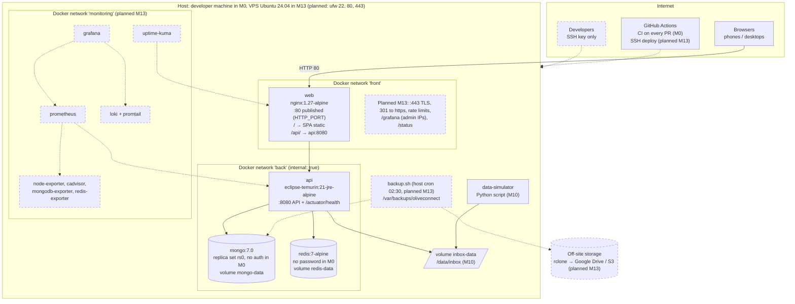
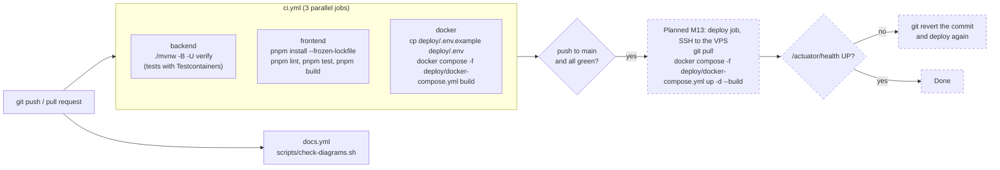
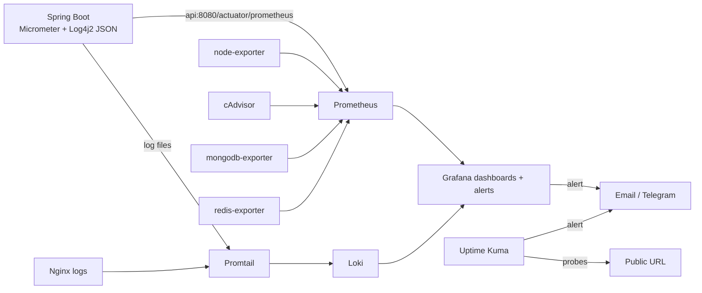

# 10 — Deployment, Backups & Monitoring (subject §V)

Target: a Linux VPS (Ubuntu Server 24.04 LTS, 2 vCPU / 4 GB RAM / 40 GB SSD is enough) running **Docker Compose**, reachable at `https://<domain>` (or `http://<IP>` for the demo, as the subject allows).

**What exists and what is planned.** There is no VPS before milestone M13.

| Status | Content |
|---|---|
| **Built (M0)** | `.github/workflows/ci.yml` (backend verify, frontend lint + test + build, Docker build), `.github/workflows/docs.yml` (Mermaid render), `backend/Dockerfile`, `frontend/Dockerfile`, `frontend/nginx.conf`, `deploy/docker-compose.yml` (production-like stack on port 80, runs locally), `deploy/docker-compose.dev.yml` (MongoDB + Redis only, for development). CI copies `deploy/.env.example` to `deploy/.env` before the build, because compose rejects the file without the secrets even for `build`. In M0, "done" means CI is green and the production compose stack works on a developer machine |
| **Built (M10)** | Import inbox volume `inbox-data` mounted on `api` at `/data/inbox`, Nginx upload limit `client_max_body_size 21m` on `/api/`. The data simulator is a script run by hand (`data-simulator/`), not a compose service |
| **Planned (M13)** | VPS, TLS, rate limiting, monitoring stack (Prometheus, Grafana, Loki, exporters, Uptime Kuma), MongoDB authentication + keyfile, Redis password, `.env` secrets, backups, automatic deployment |

Everything marked *planned* below is kept as the target design.

## 1. Deployment diagram

Solid boxes exist in `deploy/docker-compose.yml`. Dashed boxes are planned (M13). The simulator runs on the developer machine and writes into the inbox volume.



## 2. Build & release pipeline



The images are built on the VPS by `docker compose up -d --build`. There is no image registry and no rollback script: a bad release is undone with `git revert` and a new deployment.

**Backend Dockerfile** (`backend/Dockerfile`, comments omitted)
```dockerfile
FROM eclipse-temurin:21-jdk AS build
WORKDIR /app
COPY mvnw ./
COPY .mvn .mvn
COPY pom.xml ./
RUN ./mvnw -q dependency:go-offline
COPY src src
RUN ./mvnw -q package -DskipTests

FROM eclipse-temurin:21-jre-alpine
RUN addgroup -S app && adduser -S app -G app
WORKDIR /app
COPY --from=build /app/target/oliveconnect-*.jar app.jar
USER app
EXPOSE 8080
ENTRYPOINT ["java", "-XX:MaxRAMPercentage=70", "-jar", "/app/app.jar"]
```

**Frontend Dockerfile** (`frontend/Dockerfile`, comments omitted)
```dockerfile
FROM node:24-alpine AS build
WORKDIR /app
RUN npm install -g pnpm@12.4.1
COPY package.json pnpm-lock.yaml ./
RUN pnpm install --frozen-lockfile
COPY . .
RUN pnpm build

FROM nginx:1.27-alpine
COPY --from=build /app/dist /usr/share/nginx/html
COPY nginx.conf /etc/nginx/conf.d/default.conf
EXPOSE 80
```

## 3. `docker-compose.yml`

### 3.1 As built (M0): `deploy/docker-compose.yml`

First copy `deploy/.env.example` to `deploy/.env` (gitignored) and set `JWT_SECRET`, `ADMIN_EMAIL` and `ADMIN_PASSWORD`. Run with `docker compose -f deploy/docker-compose.yml up --build`, then open `http://localhost` (or `http://localhost:$HTTP_PORT`). Comments omitted.

```yaml
name: oliveconnect

services:
  web:
    build: ../frontend
    ports:
      - "${HTTP_PORT:-80}:80"
    depends_on:
      api:
        condition: service_healthy
    networks: [front, back]
    restart: unless-stopped

  api:
    build: ../backend
    environment:
      MONGO_URI: mongodb://mongo:27017/oliveconnect?replicaSet=rs0
      REDIS_HOST: redis
      # no defaults: compose refuses to start when deploy/.env lacks one of these
      JWT_SECRET: ${JWT_SECRET:?Set JWT_SECRET in deploy/.env (at least 32 characters)}
      ADMIN_EMAIL: ${ADMIN_EMAIL:?Set ADMIN_EMAIL in deploy/.env}
      ADMIN_PASSWORD: ${ADMIN_PASSWORD:?Set ADMIN_PASSWORD in deploy/.env}
      IMPORT_INBOX_DIR: /data/inbox
    volumes:
      - inbox-data:/data/inbox   # files dropped here (by the simulator or the admin) are imported
    healthcheck:
      test: ["CMD", "wget", "-qO-", "http://localhost:8080/actuator/health"]
      interval: 5s
      timeout: 3s
      retries: 20
      start_period: 20s
    depends_on:
      mongo:
        condition: service_healthy
      redis:
        condition: service_healthy
    networks: [back]
    restart: unless-stopped

  mongo:
    image: mongo:7.0
    command: ["--replSet", "rs0", "--bind_ip_all"]
    volumes:
      - mongo-data:/data/db
    healthcheck:
      test: >
        mongosh --quiet --eval "try { rs.status().ok } catch (e) { rs.initiate({_id:'rs0',members:[{_id:0,host:'mongo:27017'}]}).ok }"
      interval: 5s
      timeout: 10s
      retries: 10
      start_period: 5s
    networks: [back]
    restart: unless-stopped

  redis:
    image: redis:7-alpine
    volumes:
      - redis-data:/data
    healthcheck:
      test: ["CMD", "redis-cli", "ping"]
      interval: 5s
      timeout: 3s
      retries: 10
    networks: [back]
    restart: unless-stopped

networks:
  front:
  back:
    internal: true

volumes:
  mongo-data:
  redis-data:
  inbox-data:
```

Only `web` publishes a port. MongoDB and Redis have no published port, so only the API can reach them. The replica set is initiated by the MongoDB healthcheck (container host name `mongo:27017`). The Actuator runs on the API port 8080 and is not reachable from outside, because Nginx only forwards `/api/`.

`deploy/docker-compose.dev.yml` starts MongoDB 8 and Redis 7, with ports bound to `127.0.0.1`, so the API and the frontend can run on the host during development.

On startup, `MongoIndexInitializer` creates the declared indexes after reconciling the M2 orchard geospatial index. If an existing development database still has the legacy single-field index named `location`, the initializer removes that index only and recreates it as `location_2dsphere`; no orchard documents are deleted.

### 3.2 Planned additions (M13)

Outline of what is added on top of the file above. Not built yet.

```yaml
services:
  web:                                   # M13
    ports: ["80:80", "443:443"]
    volumes:
      - ./nginx/conf.d:/etc/nginx/conf.d:ro
      - /etc/letsencrypt:/etc/letsencrypt:ro
      - nginx-logs:/var/log/nginx

  api:                                   # M13 secrets (the inbox volume exists since M10)
    env_file: .env                       # JWT_SECRET, MONGO_URI, REDIS_PASSWORD … (never committed)
    environment:
      SPRING_PROFILES_ACTIVE: prod
    volumes: [inbox-data:/data/inbox, api-logs:/app/logs]
    deploy: { resources: { limits: { memory: 1g } } }

  mongo:                                 # M13: authentication and keyfile
    command: ["--replSet", "rs0", "--bind_ip_all", "--keyFile", "/etc/mongo-keyfile", "--wiredTigerCacheSizeGB", "1"]
    environment: { MONGO_INITDB_ROOT_USERNAME: root, MONGO_INITDB_ROOT_PASSWORD_FILE: /run/secrets/mongo_root }
    volumes: [./mongo/init:/docker-entrypoint-initdb.d:ro, ./mongo/keyfile:/etc/mongo-keyfile:ro]

  redis:                                 # M13: password and memory limit
    command: ["redis-server", "--requirepass", "${REDIS_PASSWORD}", "--maxmemory", "256mb",
              "--maxmemory-policy", "allkeys-lru", "--save", "900", "1"]

    networks: [back]

  # M13: monitoring stack
  prometheus: { image: prom/prometheus, volumes: [./monitoring/prometheus.yml:/etc/prometheus/prometheus.yml:ro, prom-data:/prometheus], networks: [monitoring] }
  grafana:    { image: grafana/grafana, volumes: [grafana-data:/var/lib/grafana, ./monitoring/grafana/provisioning:/etc/grafana/provisioning:ro], networks: [monitoring] }
  loki:       { image: grafana/loki, networks: [monitoring] }
  promtail:   { image: grafana/promtail, volumes: [api-logs:/logs/api:ro, nginx-logs:/logs/nginx:ro, ./monitoring/promtail.yml:/etc/promtail/config.yml:ro], networks: [monitoring] }
  node-exporter: { image: prom/node-exporter, pid: host, volumes: ["/:/host:ro,rslave"], command: ["--path.rootfs=/host"], networks: [monitoring] }
  cadvisor:   { image: gcr.io/cadvisor/cadvisor, volumes: ["/:/rootfs:ro", "/var/run:/var/run:ro", "/sys:/sys:ro", "/var/lib/docker/:/var/lib/docker:ro"], networks: [monitoring] }
  mongodb-exporter: { image: percona/mongodb_exporter:0.40, networks: [back, monitoring] }
  redis-exporter:   { image: oliver006/redis_exporter, networks: [back, monitoring] }
  uptime-kuma: { image: louislam/uptime-kuma:1, volumes: [kuma-data:/app/data], networks: [front] }

networks:
  monitoring: {}                         # added to front and back
volumes: { inbox-data: {}, api-logs: {}, nginx-logs: {}, prom-data: {}, grafana-data: {}, kuma-data: {} }
```

The image versions above are placeholders. Pin exact versions (for example `mongo:7.0.14`) in the real file. The Actuator `prometheus` endpoint is exposed in M13 (`management.endpoints.web.exposure.include` is `health,info` today).

In M13, `mongo/init/01-init.js` creates the application user with the `readWrite` role on `oliveconnect` only, plus a read-only `exporter` user. The replica set is still initiated by the healthcheck shown in §3.1.

## 4. Nginx configuration

### 4.1 As built (M0): `frontend/nginx.conf`

Copied into the `web` image as `/etc/nginx/conf.d/default.conf`. Comments omitted.

```nginx
proxy_cache_path /var/cache/nginx/map levels=1:2 keys_zone=mapcache:10m max_size=50m inactive=10m;
server {
    listen 80;
    root /usr/share/nginx/html;

    gzip on;
    gzip_types text/css application/javascript application/json image/svg+xml;

    location /assets/ {
        add_header Cache-Control "public, max-age=31536000, immutable";
    }

    # Anonymous public map: micro-cache for 30 s (the API also caches it in Redis).
    location /api/map/public {
        proxy_pass http://api:8080;
        proxy_set_header Host $host;
        proxy_set_header X-Forwarded-For $proxy_add_x_forwarded_for;
        proxy_set_header X-Forwarded-Proto $scheme;
        proxy_cache mapcache;
        proxy_cache_valid 200 30s;
    }

    location /api/ {
        client_max_body_size 21m;   # import file upload (the API accepts up to 20 MB)
        proxy_pass http://api:8080;
        proxy_set_header Host $host;
        proxy_set_header X-Forwarded-For $proxy_add_x_forwarded_for;
        proxy_set_header X-Forwarded-Proto $scheme;
    }

    location / {
        try_files $uri /index.html;
    }
}
```

### 4.2 Planned (M13): TLS, rate limiting, caches

```nginx
# /etc/nginx/conf.d/oliveconnect.conf (planned)
limit_req_zone $binary_remote_addr zone=api:10m rate=20r/s;
limit_req_zone $binary_remote_addr zone=login:10m rate=5r/m;
proxy_cache_path /var/cache/nginx/map levels=1:2 keys_zone=mapcache:10m max_size=200m inactive=10m;

server { listen 80; server_name oliveconnect.example.tn; return 301 https://$host$request_uri; }

server {
  listen 443 ssl http2;
  server_name oliveconnect.example.tn;
  ssl_certificate     /etc/letsencrypt/live/oliveconnect.example.tn/fullchain.pem;
  ssl_certificate_key /etc/letsencrypt/live/oliveconnect.example.tn/privkey.pem;
  add_header Strict-Transport-Security "max-age=31536000" always;
  add_header X-Content-Type-Options nosniff always;
  add_header Referrer-Policy strict-origin-when-cross-origin always;

  gzip on; gzip_types application/json application/javascript text/css image/svg+xml;
  client_max_body_size 21m;   # import upload, the API accepts 20 MB

  root /usr/share/nginx/html;
  location /assets/ { expires 1y; add_header Cache-Control "public, immutable"; }
  location / { try_files $uri /index.html; add_header Cache-Control "no-cache"; }

  location /api/ {
    limit_req zone=api burst=40 nodelay;
    proxy_pass http://api:8080;
    proxy_set_header Host $host;
    proxy_set_header X-Forwarded-For $proxy_add_x_forwarded_for;
    proxy_set_header X-Forwarded-Proto $scheme;
  }
  location = /api/auth/login { limit_req zone=login burst=5; proxy_pass http://api:8080; }
  location /api/events {                      # SSE: no buffering, long timeout
    proxy_pass http://api:8080;
    proxy_buffering off; proxy_cache off;
    proxy_read_timeout 1h;
    proxy_set_header Connection "";
    proxy_http_version 1.1;
  }
  location /api/map/public {                  # micro-cache public map (anonymous)
    proxy_cache mapcache; proxy_cache_valid 200 30s;
    proxy_cache_key $request_uri;
    add_header X-Cache-Status $upstream_cache_status;
    proxy_pass http://api:8080;
  }
  location /intranet/ { allow 10.0.0.0/8; allow <coop-public-ip>; deny all; try_files $uri /index.html; }
  location /grafana/  { allow <admin-ips>; deny all; proxy_pass http://grafana:3000/; }
}
```

The Actuator (same port 8080 as the API) is never proxied: Nginx only forwards `/api/`. Prometheus and the Docker healthcheck reach it directly on the `back` network.

The **cache layers** asked for in §V are, from the outside in:
1. Browser cache for hashed static assets (1 year).
2. Nginx micro-cache for the anonymous map (30 s).
3. Redis application cache (KPIs, map tiles, reference data).
4. MongoDB WiredTiger cache.

## 5. Step-by-step deployment procedure (goes into the report)

Planned for M13. In M0 only step 6 is done locally, with `docker compose -f deploy/docker-compose.yml up --build`.

1. **Provision the VPS.** Create a non-root `deploy` user with SSH key login, set `PasswordAuthentication no`, and run `apt upgrade`. Enable `ufw allow 22,80,443` and `unattended-upgrades`, and install `fail2ban`.
2. **Install Docker** Engine and the Compose plugin, and add `deploy` to the `docker` group.
3. **DNS**: create an A record `oliveconnect.<domain>` pointing to the VPS IP. With no domain, use `http://<IP>` and skip TLS.
4. **TLS**: `certbot certonly --standalone -d oliveconnect.<domain>`, with renewal by cron (`certbot renew --deploy-hook "docker compose exec nginx nginx -s reload"`).
5. **Get the code**: `git clone` the repository to `/opt/oliveconnect`. In `deploy/`, create `.env` from `.env.example` with strong secrets (`openssl rand -base64 48`). Generate the Mongo keyfile (`openssl rand -base64 756 > mongo/keyfile && chmod 400`). Add the SSH deploy key and the VPS host as GitHub Actions secrets.
6. `docker compose -f deploy/docker-compose.yml up -d --build`, then check `docker compose ps` (all healthy) and `docker compose exec api wget -qO- http://localhost:8080/actuator/health`. Later deployments are done by the GitHub Actions job over SSH: `git pull && docker compose -f deploy/docker-compose.yml up -d --build`.
7. **Bootstrap**: the first start creates the Admin from `ADMIN_EMAIL`/`ADMIN_PASSWORD` in `deploy/.env` when no Admin exists (M1a). Forced password change comes with M9.
8. **Load reference data**: run `python3 data-simulator/simulator.py <inbox dir> --only reference` against the inbox volume (or upload the files from `/intranet/imports`, or call `POST /api/imports/upload`), then run `POST /api/imports/run?type=REFERENCE` if needed, then check the import journal.
9. **Monitoring**: open Grafana and import the provisioned dashboards (JVM Micrometer 4701, Node Exporter 1860, MongoDB, Redis, Nginx logs). Add the HTTP monitors in Uptime Kuma.
10. **Smoke test**: log in with each role and run the E2E smoke suite against the public URL.

## 6. User & access-rights management (operations doc)

Planned: depends on the accounts and admin screens of later milestones.

| Task | How |
|---|---|
| New farmer | Visitor submits `/register`, admin approves in **Admin → Registrations**, the account gets role `FARMER` and a temporary password (displayed once or sent by email/SMS in a later version) |
| New staff member | **Admin → Users → New**: email, name, one or more roles; for `MILL_MANAGER` choose the mill |
| Change rights | **Admin → Users → Roles**. Takes effect at the next token refresh (≤ 15 min). For an immediate effect, use **Revoke sessions**, which deletes the Redis refresh tokens |
| Disable account | **Admin → Users → Disable**: blocks login and revokes all sessions; data is kept (history integrity) |
| Forgotten password | Admin resets it (temporary password, change forced at next login) |
| Server access | Only the `deploy` user via SSH key; MongoDB and Redis are not exposed; Grafana is behind an IP allow-list plus its own login |
| Secrets rotation | Change `JWT_SECRET` in `.env` and run `docker compose up -d api`. All users must log in again |

## 7. Backups & restore

Planned for M13. `backup.sh` does not exist yet.

| What | How | When | Retention |
|---|---|---|---|
| MongoDB (incl. GridFS photos) | `docker compose exec -T mongo mongodump --archive --gzip --oplog` → `/var/backups/oliveconnect/mongo-YYYYMMDD-HHmm.archive.gz` | daily 02:30 (host cron) + before each deployment | 7 daily, 4 weekly, 3 monthly |
| Redis | copy `dump.rdb` (tokens only, non-critical) | daily | 3 days |
| Config | `deploy/` is in Git; `.env` is encrypted with `age` and kept off-site | on change | — |
| Grafana / Kuma data | volume tarball | weekly | 4 |
| Off-site | `rclone copy` to cloud storage (encrypted remote) | after each backup | same as above |

```bash
#!/usr/bin/env bash
# deploy/backup/backup.sh — called by cron: 30 2 * * * /opt/oliveconnect/backup/backup.sh
set -euo pipefail
TS=$(date +%Y%m%d-%H%M); DIR=/var/backups/oliveconnect; mkdir -p "$DIR"
cd /opt/oliveconnect
docker compose exec -T mongo mongodump --username backup --password "$MONGO_BACKUP_PWD" \
  --authenticationDatabase admin --archive --gzip --oplog > "$DIR/mongo-$TS.archive.gz"
docker compose exec -T redis redis-cli -a "$REDIS_PASSWORD" --rdb - > "$DIR/redis-$TS.rdb" 2>/dev/null
find "$DIR" -name 'mongo-*' -mtime +7 ! -name '*-01-*' -delete   # simple rotation (refine for weekly/monthly)
rclone copy "$DIR" offsite:oliveconnect-backups --max-age 25h
echo "backup_last_success_timestamp $(date +%s)" > /var/lib/node_exporter/textfile/backup.prom
```

The last line exposes a metric, so Grafana can **alert when no backup has succeeded in the last 26 h**.

**Restore drill** (done once and documented with screenshots): `mongorestore --archive=mongo-….archive.gz --gzip --drop --oplogReplay` into a scratch container, then check document counts and log in to the restored instance. Target RPO is 24 h and target RTO is under 1 h.

## 8. Monitoring

Planned for M13. Today only `/actuator/health` and `/actuator/info` are exposed (port 8080) and used by the Docker healthcheck.

| Need (§V) | Tool | Metrics / view | Alert rule (Grafana / Alertmanager) |
|---|---|---|---|
| Availability rate | Uptime Kuma (HTTP probe `/`, and `http://api:8080/actuator/health` on the internal network, 60 s) + Prometheus `up` | uptime % over 24 h / 30 d, status page `/status` | down > 2 min → email/Telegram |
| Resource consumption | node-exporter, cAdvisor | CPU, RAM, disk, network per host and per container | disk > 80 %, RAM > 90 % for 5 min |
| Application | Spring Actuator + Micrometer (`/actuator/prometheus` on port 8080) | HTTP p95 per endpoint, error rate, JVM heap/GC, Mongo driver pool, cache hit ratio (`cache_gets_total{result="hit"}`), custom metrics: `oliveconnect_import_rejected_total`, `oliveconnect_alerts_created_total`, `oliveconnect_rounds_in_progress` | p95 > 2 s, 5xx rate > 1 % |
| Database | mongodb-exporter, redis-exporter | opcounters, connections, replication lag, slow queries; Redis memory, hit rate, evictions | connections > 80 % |
| Logs | Log4j2 JSON → file → Promtail → Loki; Nginx access/error logs | search by `traceId`, user, level; 4xx/5xx panels | > 20 ERROR/min |
| Backups | textfile metric | time since last backup | > 26 h |

**Log management**: Log4j2 rolling file appender (daily, 100 MB, 14 files kept). Each log line has a JSON layout with `traceId`, `userId` and `endpoint` (set through MDC by a filter). Docker logs use the `json-file` driver with `max-size: 10m, max-file: 3`.


