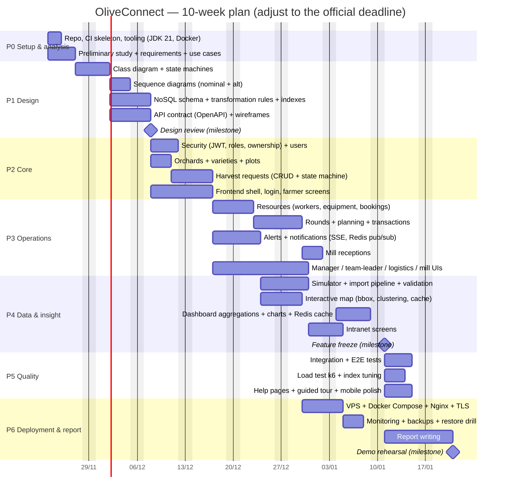

# 12 — Roadmap, Team Split & Working Method

## 1. Budget

The subject budgets **30 h per student per module**, for 3 modules and 3 students: **≈ 270 h of team effort** outside lab sessions (TP).

> **Assumption:** the dates below assume a start on **Mon 23 Nov 2026** and a delivery around **end of January 2027** (10 weeks). Adjust them once the teachers give the official deadline. Shifting the start date of the Gantt chart shifts everything else.

| Phase | Content | Effort (team-hours) | Main module |
|---|---|---|---|
| P0 Setup & analysis | repo, tooling, study, requirements, use cases | 20 | all |
| P1 Design | class diagram, sequences, states, NoSQL schema + rules, API contract, wireframes | 35 | BD + J2EE |
| P2 Core backend + frontend skeleton | auth/security, users, orchards, harvest requests, app shell, login, farmer screens | 55 | J2EE |
| P3 Operations | rounds + planning + bookings, resources, alerts + SSE, mill receptions | 60 | J2EE + BD |
| P4 Data & insight | import pipeline + simulator, map, dashboard aggregations, Redis cache, intranet | 45 | BD |
| P5 Quality | test completion, load test, security hardening, help/tour, mobile polish | 25 | all |
| P6 Deployment & report | VPS, Docker, Nginx, TLS, monitoring, backups, deployment doc, report, demo | 30 | Web admin |
| **Total** | | **270** | |

## 2. Gantt chart

Deployment (P6a) starts **early**, in parallel with P4. Deploying on the last day is the classic failure mode, and a staging VPS makes every later demo trivial.

## 3. Team split (3 students)

Each student **leads one module**, which makes them responsible for its deliverables in the report. Each student also **owns vertical features end-to-end** (entity, repository, service, controller, React page, tests), so everyone practises every layer. That matters because each student is graded on all three modules.

| | Student A — *Data lead* (Massive DB) | Student B — *Backend lead* (J2EE) | Student C — *Ops & UI lead* (Web admin) |
|---|---|---|---|
| Module deliverables | NoSQL schema, transformation rules, index justification, aggregation pipelines, sharding design, `explain()` evidence | Layered architecture, security, OpenAPI contract, test strategy, JUnit/Testcontainers | Deployment, Nginx, TLS, monitoring, backups, deployment & operations docs |
| Vertical features owned | Orchards + map (F4), import pipeline + simulator, dashboard (F5), telemetry | Auth/users/registrations, harvest requests, rounds + planning + bookings (F1, F3 core) | Frontend shell + design system, alerts + SSE (F2), resources UI + supply orders (F3 UI), mill receptions, intranet, help/tour |
| Diagrams | class diagram (co-owner), NoSQL ER, transformation flow | sequences, state machines | use cases, deployment, monitoring |
| Report chapters | NoSQL schema, persistence API | Requirements, design (layers), tests | Preliminary study, deployment & monitoring |

Pairing rule: every merge request is **reviewed by another student**. The class diagram and the NoSQL schema are reviewed by all three in the P1 design review, the most important meeting of the project.

## 4. Backlog by phase (actionable checklist)

### P0 — Setup
- [ ] Install JDK 21; `git init`; push to a private GitHub/GitLab repo; protect `main`
- [ ] Generate the backend with Spring Initializr: Web, Validation, Security, Data MongoDB, Data Redis, Cache, Actuator, Lombok (optional), springdoc. Group `tn.oliveconnect`
- [ ] Switch logging to Log4j2 (exclude `spring-boot-starter-logging`)
- [ ] `npm create vite@latest frontend -- --template react-ts`; add Mantine, React Router, TanStack Query, axios, react-leaflet, chart.js
- [ ] `deploy/docker-compose.dev.yml` with Mongo (replica set) + Redis + mongo-express (optional)
- [ ] CI pipeline: backend `./mvnw verify`, frontend lint/test/build
- [ ] Conventions: Conventional Commits, branch per feature, PR template with checklist (tests, docs, traceability row)

### P1 — Design (deliverables are in `docs/`, then reviewed)
- [ ] Validate the class diagram ([04](04-uml-design.md)): every attribute used by a screen or KPI exists
- [ ] Validate the NoSQL schema ([05](05-nosql-schema.md)): every query in §6 has an index
- [ ] Write the OpenAPI skeleton (controllers with DTOs, `501 Not Implemented`) and generate the TS types
- [ ] Clickable wireframes for the farmer and team-leader mobile flows

### P2 — Core
- [ ] `SecurityConfig`, `JwtService`, refresh rotation in Redis, login rate limiter, `CurrentUser` resolver
- [ ] `GlobalExceptionHandler` (ProblemDetail), auditing, `@Version`
- [ ] Users / registrations (admin)
- [ ] Orchards with plots, geo field, `nearest`; varieties (cached)
- [ ] Harvest requests: create, list, modify, cancel, validate, reject, state machine, history, `allowedActions`, priority score
- [ ] Frontend: auth flow, layout + bottom nav, farmer home, orchard form with map picker, request form, my requests timeline

### P3 — Operations
- [ ] Workers, equipment (inheritance), unavailabilities
- [ ] Bookings + overlap query + Redis lock; availability endpoint; calendar endpoint
- [ ] Rounds: plan (transaction), modify, cancel, start, stop updates (positional), complete; cascade statuses
- [ ] Planning suggestions (score + `$geoNear` grouping + nearest mill)
- [ ] Alerts: report (multipart + GridFS), queue, acknowledge/resolve/dismiss, urgent request creation
- [ ] Notifications: persistence, Redis pub/sub, SSE registry, ticket auth
- [ ] Mill: incoming rounds, receptions (computed fields, denormalisation), capacity updates
- [ ] Frontend: request queue, planning board, round runner (offline draft), alerts board, logistics screens + calendar, mill screens, notification bell

### P4 — Data & insight
- [ ] Simulator (reference + dynamic + `--history` + invalid records)
- [ ] Import framework: scheduler + ShedLock, importers, validators, bulk ops, journal, auto alerts
- [ ] Map endpoints (bbox, filters, server-side clustering at low zoom), Redis tile cache, Nginx micro-cache
- [ ] KPI pipelines (yield, lead time, fill rate, mill volumes) + cache + CSV export
- [ ] Dashboard page, intranet grids, import journal page, settings page
- [ ] Production index migration + `explain()` evidence

### P5 — Quality
- [ ] Complete the scenario catalogue ([09](09-testing.md)); JaCoCo ≥ 70 % on services
- [ ] Playwright journeys: farmer declares → manager plans → team leader runs → mill weighs → dashboard updates
- [ ] k6 at 100 VUs on the VPS with the history dataset; tune indexes and caches; record results
- [ ] Help Markdown for each page; Joyride tours per role; Lighthouse mobile ≥ 90 for accessibility/best practices

### P6 — Deployment & report
- [ ] VPS hardening, Docker, compose prod, TLS, Nginx config
- [ ] Prometheus/Grafana/Loki/Kuma provisioned; alert rules; screenshots
- [ ] Backup script + cron + off-site + **restore drill**
- [ ] Deployment / operations documentation ([10](10-deployment.md) → report chapter)
- [ ] Report: assemble chapters from `docs/`, export Mermaid diagrams to SVG/PNG (`npx @mermaid-js/mermaid-cli -i x.md -o x.svg`), add screenshots
- [ ] Demo script (10 min) covering all 5 features and both nominal and alternative scenarios

## 5. Definition of Done (per feature)

A feature is "done" when:
1. the entity, repository, service and controller exist, with constructor injection and no business logic in the controller;
2. Bean Validation is on the DTOs, and errors return ProblemDetail;
3. role and ownership checks are in place and tested;
4. the nominal **and** at least one alternative scenario are tested (unit + integration);
5. the indexes for its queries exist and are documented in [05](05-nosql-schema.md);
6. the React screen works at 360 px width, with a help page entry;
7. the [traceability](11-traceability.md) row is up to date;
8. it is deployed on staging and shows up in Grafana (no new 5xx).

## 6. Report outline (maps to "VI. Expected results")

1. General introduction
2. **Preliminary study**: context, existing situation, problems, objectives, actors, feature choice ([01](01-preliminary-study.md))
3. **Requirements analysis**: functional requirements, use cases, user stories, non-functional requirements ([02](02-requirements.md))
4. **Design**
   4.1 Architecture and layers: Controller, Service, DAO, Entity ([03](03-architecture.md))
   4.2 Class diagram, sequence diagrams, state machines ([04](04-uml-design.md))
   4.3 REST API and security ([06](06-api-security.md))
5. **NoSQL schema**: collections, embedding vs. referencing, indexes, partitioning; **transformation rules** from the class diagram; **persistence API justification** ([05](05-nosql-schema.md))
6. **Data integration**: sources, validation, scheduling, intranet ([07](07-data-import.md))
7. **Implementation**: tech stack, screenshots per role ([08](08-frontend.md))
8. **Tests**: strategy, nominal/alternative scenarios, coverage, load test ([09](09-testing.md))
9. **Deployment and monitoring**: procedure, server configuration, users and rights management, backups, supervision ([10](10-deployment.md))
10. Conclusion and outlook (Spring Batch, sharding, PWA offline-first, SMS notifications, yield prediction)
- Appendices: traceability matrix ([11](11-traceability.md)), OpenAPI excerpt, index list, Grafana screenshots

## 7. Risks

| Risk | Impact | Mitigation |
|---|---|---|
| Java 8 on dev machines, environment drift | blocked builds | JDK 21 + `mvnw` + dev Docker Compose from day 1 |
| MongoDB transactions need a replica set | rollback test fails | single-node `rs0` in dev, CI (Testcontainers does this by default) and prod |
| Scope creep (5 features + infra) | late delivery | MoSCoW priorities in [02](02-requirements.md); "Could" items cut first; feature freeze milestone |
| Inconsistency between model, schema, API and deployment (graded) | lost marks | single glossary, traceability matrix, generated TS types, design review |
| Late deployment surprises | failed demo | deploy staging in week 6, redeploy on every merge to main |
| Geolocation blocked on HTTP | alert form degraded | browsers allow geolocation only on HTTPS or localhost → TLS (Let's Encrypt) is needed; with IP-only demo, use manual orchard pick fallback |
| Uneven contribution | individual grading | per-student vertical features, Git history, weekly 30-min sync with written notes |
